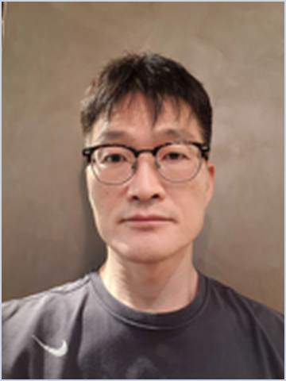

# 이병남 (Byungnam "Tony" Lee) — 이력서 (Resume)

---

## 📌 1. 인적사항 · 지원목표 · 학력 · 핵심스킬 (Profile / Objective / Education / Skillset)

<table style="width: 100%; border: none; margin-bottom: 12px;">
  <tr>
    <td style="width: 140px; vertical-align: top; border: none; padding-right: 15px;">
      
    </td>
    <td style="vertical-align: top; border: none;">
      <table style="width: 100%; font-size: 13.5px; border-collapse: collapse;">
        <tr>
          <td style="width: 100px; font-weight: 700; background: #f1f5f9; padding: 5px 8px;">성명 / 영문</td>
          <td style="padding: 5px 8px;"><strong>이병남</strong> | Byungnam "Tony" Lee</td>
          <td style="width: 100px; font-weight: 700; background: #f1f5f9; padding: 5px 8px;">지원 직무</td>
          <td style="padding: 5px 8px;"><strong style="color: #0f766e;">자율주행 로보틱스 &amp; 온디바이스 비전 AI 엔지니어 (Autonomous Navigation &amp; Edge Vision AI)</strong></td>
        </tr>
        <tr>
          <td style="font-weight: 700; background: #f1f5f9; padding: 5px 8px;">희망 연봉</td>
          <td style="padding: 5px 8px;"><strong>회사 내규에 따름 (면접 후 협의)</strong></td>
          <td style="font-weight: 700; background: #f1f5f9; padding: 5px 8px;">연락처</td>
          <td style="padding: 5px 8px;">010-2544-1197 | <a href="mailto:xraiegoo@gmail.com">xraiegoo@gmail.com</a></td>
        </tr>
        <tr>
          <td style="font-weight: 700; background: #f1f5f9; padding: 5px 8px;">현거주지</td>
          <td colspan="3" style="padding: 5px 8px;">경기도 고양시 일산동구 <em>(본적/등록지: 서울특별시 마포구 공덕동)</em></td>
        </tr>
        <tr>
          <td style="font-weight: 700; background: #f1f5f9; padding: 5px 8px;">웹 포털 / GitHub</td>
          <td colspan="3" style="padding: 5px 8px;">
            <a href="https://github.com/aiegoo" target="_blank">github.com/aiegoo</a> &nbsp;|&nbsp; 
            <a href="https://github.com/aiegoo/finalproject" target="_blank">Autonomous UAV/로보틱스 (finalproject)</a> &nbsp;|&nbsp; 
            <a href="https://pf1.eggs.or.kr/portfolio.html" target="_blank">pf1.eggs.or.kr (포트폴리오)</a> &nbsp;|&nbsp; 
            <a href="https://pf7.eggs.or.kr" target="_blank">pf7.eggs.or.kr (아키텍처 문서 허브)</a>
          </td>
        </tr>
        <tr>
          <td style="font-weight: 700; background: #f1f5f9; padding: 5px 8px;">Core Motto</td>
          <td colspan="3" style="padding: 5px 8px; color: #0f766e; font-weight: 600;">
            "36 Years of Systems Engineering Ahead — 펌웨어부터 엣지 NPU, 클라우드 관제까지 엔드투엔드(End-to-End) 아키텍처 단독 설계·구현"
          </td>
        </tr>
      </table>
    </td>
  </tr>
</table>

### 🎯 지원 목표 (Objective)
**"LiDAR·IMU·Vision 센서 융합 SLAM, Voronoi/Medial Axis 자율 경로 계획, Hailo-8L 엣지 NPU 기반 3D 공간 인지, 15ms 수동 제어권 중재 아키텍처를 통합 구현하여 물류·산업용 자율주행 로봇의 무인프라 현장 적응력과 기능 안전성을 극대화하겠습니다."**

### 🎓 학력 사항 (Education)
- **University of Maryland (미국 메릴랜드대)** | **1985.08 ~ 1994.06 (졸업)**
  - 전공: **경영학 학사 (Management / Computer &amp; Information Science)** • **TOEFL 627점** (원어민급 기술 문서 작성·협상)

### 🛠️ 직무 핵심 코딩 스킬셋 (Coding Skillset)
- **자율주행 SLAM &amp; 로보틱스 내비게이션 (Autonomous SLAM &amp; Navigation — 45%)**: **Extended Kalman Filter (EKF)**, **Monte Carlo Localization (MCL)**, **LiDAR SLAM (FastSLAM, GraphSLAM, Occupancy Grid Mapping 2D/3D)**, **자율 경로 계획 (Voronoi Graph, Medial Axis Transform, Grid Search (A*, Dijkstra), RRT*)**, **ROS Navigation Stack / Nav2**, **Cascaded PID (Position → Velocity → Attitude → Rate)**, **STM32/PX4 펌웨어 임베딩 (Firmware Embedding)**, **드론/로봇 PID 커스터마이징 (최대 50km/h 급가속 및 반동 복원)**, **LiDAR SLAM 자율 경로 탐색 &amp; 화물 인양/Drop-off 투하 제어**, **Direct RF(ELRS/CRSF) 15ms 제어권 중재기 (Control Authority Arbiter)**, Gazebo 3D 시뮬레이션, Traxxas Stampede UGV
- **온디바이스 컴퓨터 비전 AI &amp; 엣지 인식 (Edge Vision AI &amp; Perception — 35%)**: **Hailo-8L (13 TOPS) / Hailo-8 (26 TOPS) / NVIDIA Jetson AGX Xavier &amp; Nano**, **YOLOv8s / YOLOv8s-Pose INT8 HEF 컴파일 (30~60 FPS)**, **2단계 분리 가속 파이프라인 (NPU 20.4ms + ARM CPU Pure NumPy 0.018ms)**, **Safe Torso Scale Guard (투영 수축에 따른 25배 좌표 폭발 억제, $max\_abs < 4.81$)**, **3D Depth 카메라 연동 &amp; 공간 좌표 정렬**, OpenCV, 마르코프 5-프레임 디바운서, PyHailoRT
- **로봇 플릿 관제 &amp; 클라우드 인프라 (Fleet C2 &amp; Cloud Infrastructure — 20%)**: **5G BVLOS Cloud GCS (gcs-uno / Webix Jet)**, **WebRTC P2P 초저지연 영상/텔레메트리 (&lt; 200ms)**, **MAVLink v1/v2**, **ROS2**, **DJI PSDK**, **Betaflight MSP**, **K-MOSA 밀스펙**, Redis Pub/Sub, Typesense Hybrid Search (Dense bge-m3 1024차원 + BM25, p95 42ms), **AWS (CLF-C02 자격 취득)**, **ECS Fargate**, **OpenSearch Serverless**, Docker, Linux/WSL2

---

## 🚀 2. 핵심 수행 역량 및 실증 지표 (Core Competencies &amp; Metrics)

| 핵심 수행 역량 | 내가 분명히 수행할 수 있는 구체적 실무 역량 | 검증 지표 및 산출물 |
| :--- | :--- | :--- |
| **1. 센서 융합 SLAM &amp; 자율 경로 계획** *(Autonomous SLAM/Nav — 비중 45%)* | • EKF/MCL 기반 센서 융합(LiDAR/IMU/Odometry) 비정형 환경 실시간 상태 추정 • 2D/3D 점유격자지도(Occupancy Grid Mapping), FastSLAM, GraphSLAM 구축 • Voronoi Graph &amp; Medial Axis 기반 물류 복도 중심 장애물 무충돌 경로 생성 | • **SLAM 기반 자율 하역/도킹 오차 10cm 이내** • 복잡 장애물 환경 Voronoi 최적 경로 실측 • [Autonomous UAV &amp; SLAM 레퍼런스](https://github.com/aiegoo/finalproject) • [Dronus-Net6 SLAM 레퍼런스](https://github.com/aiegoo/Uc-dronusnet6) |
| **2. 온디바이스 비전 NPU &amp; 3D 인식** *(Edge Vision AI — 비중 35%)* | • Hailo-8L(13 TOPS) 2단계 분리 가속 파이프라인 (NPU 20.4ms + CPU NumPy 0.018ms) • 단일 2D 카메라 급각도 원근 왜곡 좌표 폭발을 Safe Torso Scale Guard($max\_abs < 4.81$)로 억제 • 3D Depth 카메라 및 INT8 HEF 경량화로 33.4 FPS 고정 실시간 객체/포켓 검출 | • **33.4 FPS 실시간 추론 완결 / 라벨 지터 제로** • **$140 단일 어플라이언스로 월 GPU $720 제거 (Zero Cloud Egress)** • [YogaQ 엣지 NPU 아키텍처 명세](https://pf7.eggs.or.kr) |
| **3. 로봇 펌웨어 제어 &amp; 제어권 중재기** *(Firmware &amp; Safety — 비중 15%)* | • STM32/PX4 펌웨어 임베딩 및 Cascaded PID 제어 루프 커스터마이징 • 최고 50km/h 급가속 요격 및 외란 충격 복원 PID 게인/FeedForward 튜닝(0.2초 내 수평 복원) • Direct RF 수동 조종 개입 시 15ms 이내에 즉각 자율 명령을 차단하는 제어권 중재기 | • **50km/h 고속 주행/비행 자세 안정성 입증** • **비상 개입 시 15ms 무충돌 핸드오버 실측** • [GCS &amp; 제어권 중재기 명세](https://pf7.eggs.or.kr) |
| **4. 5G 초저지연 플릿 관제 &amp; Cloud AI** *(Fleet C2 &amp; Cloud — 비중 5%)* | • 5G 무선망 기반 초저지연 WebRTC P2P 비디오/텔레메트리 파이프라인 (&lt; 200ms) • 이기종 통신 규격 단일 정규화 브리지 및 Redis 기반 실시간 다수 로봇 동시 관제 • Terraform IaC 기반 AWS ECS Fargate &amp; OpenSearch Serverless k-NN 클러스터 100% 자동화 | • **WebRTC 종단간 지연 200ms 이하 실측** • **캠프 전체 1위 팀 우수상 &amp; 개인 최우수상** • 장애 시 1.2초 내 Bedrock 무중단 자동 전환 |

---

## 💼 3. 엔지니어링 경력 및 집중 R&amp;D (Work Experience — Strict Reverse-Chronological)

### 1. 제주오르미캠프 (AI / Cloud Intensive)
- **역할**: **팀 리드 &amp; 클라우드 AI 아키텍트** (풀타임) | **2025.10 ~ 2025.12**
- **핵심 성과**: Terraform IaC 기반 AWS ECS Fargate 및 OpenSearch Serverless k-NN 클러스터 100% 자동화 배포. 문장별 벡터-원문 청크 역코사인 유사도 기반 XAI 신뢰도 검증 엔진 및 로컬 장애 시 1.2초 내 AWS Bedrock 무중단 페일오버 구현. **캠프 종합 평가 1위 팀 프로젝트 우수상 &amp; 개인 성적 최우수상 동시 수상**.

---

### 2. 유콘크리에이티브(주) (Ucon Creative Co., Ltd.)
- **직책**: **개발실장 / Head of Engineering** (정규직) | **2023.05 ~ 2025.08 (2년 4개월)**
- **핵심 역할 및 성과**:
  - **Dronus-Net6 안티드론(C-UAS) 비파괴 포획 및 자율 하역 체계**:
    - **고압 CO2 6연발 리볼버 넷 캐처 펌웨어 임베딩**: 고압 CO2 솔레노이드 밸브 및 6연발 서보 회전 탄창 드라이버를 STM32/PX4 비행제어기(FC) 인터럽트(ISR)에 직결 임베딩, MAVLink 페이로드 격발 명령 트리거 연동.
    - **비행제어 PID 커스터마이징 &amp; 50km/h 고속 추격 제어**: 50km/h 고속 요격 및 발사 반동 억제를 위한 PID·가속도 피드포워드 튜닝(0.2초 내 수평 복원).
    - **3D LiDAR SLAM 기반 표적·화물 인양 및 지정 구역 정밀 투하**: 3D LiDAR SLAM 기반 표적·화물 인양(Lift) 및 지정 구역(Drop-off Zone) 정밀 투하(오차 10cm 이내) 구현.
  - **요가큐(YogaQ) 온디바이스 비전 AI &amp; 생체역학 RAG 플랫폼**:
    - **2단계 분리 가속 파이프라인**: 13 TOPS Hailo-8L NPU(YOLOv8s-Pose 20.4ms)와 ARM Cortex-A76 CPU(순수 NumPy 분류 0.018ms) 2단계 분리 가속 파이프라인 설계(PCIe DMA 오버헤드 0.5ms 대비 25배 단축).
    - **Safe Torso Scale Guard**: 단일 2D 카메라 급각도 원근 왜곡에 따른 25배 좌표 발산을 하한 클램핑($\text{scale}=\max(H_{\text{torso}}, 0.250 \cdot ref)$, $max\_abs < 4.81$)으로 억제하는 Safe Torso Scale Guard 설계 — 협소 통로 주행 및 급기동 시 3D 객체/파렛트 포켓 인식 안정화에 직결. 마르코프 5-프레임 디바운서 구현.
    - **완전 온디바이스 독립 추론 (Zero Cloud Egress)**: $140 PoE 단일 엣지 어플라이언스로 33.4 FPS 실시간 추론을 완결하여 클라우드 GPU 인프라 비용($720/월)을 제거(Zero Cloud Egress).

---

### 3. (주)제이디랩 (JDLab Co., Ltd.)
- **직책**: **수석연구원 / Principal Engineer** (정규직) | **2022.02 ~ 2022.05 (4개월 및 연속 연구)**
- **핵심 성과**: 5G BVLOS 환경에서 UDP 기반 WebRTC P2P 스트리밍 파이프라인을 구축해 종단간(E2E) 영상·텔레메트리 지연 200ms 이하 달성. MAVLink v2, DJI PSDK, Betaflight MSP, K-MOSA 4종 이기종 프로토콜 통합 정규화 브리지 및 물리 조종기(ELRS 250Hz / TBS CRSF) 스틱 개입 시 15ms 이내 수동 조종으로 강제 절체하는 제어권 중재기(Control Authority Arbiter) 구현. 조종사 6-DOF 행동 생체인식 기반 0.5초 Soft-Cloak 제어권 잠금(Control Air-Gap) 설계.

---

### 4. 이전 기반 경력 요약 (Foundational Experience Overview)
- **2020.02 ~ 2020.12 | 하이테크 — 개발팀장**: 저전력 IoT 센서 노드 임베디드 펌웨어 및 MQTT/LTE 원격 관제 시스템 구축 (전력 최적화로 배터리 수명 2.5배 연장).
- **2019.03 ~ 2019.09 | 온오프링크 — 개발책임**: Asterisk/FreePBX 기반 대용량 VoIP CTI 음성 처리 솔루션 및 VR 실시간 통신 연동 모듈 개발.
- **2014.07 ~ 2018.06 | 엔지니어링 전향 및 집중 독학 (일산)**: *"36 Years of Systems Engineering Ahead"*를 모토로 비즈니스·교육 커리어에서 소프트웨어 및 임베디드 시스템 엔지니어링으로 전향, 기초 전산학 및 리눅스·C/Python 집중 학습.
- **2005.12 ~ 2014.06 | (주)이오즈 / 유림ADS — 기획실장 / 총괄 PM**: 전자정부 공공 정보화 사업 제안·수주 총괄 및 대기업 B2B IT 프로젝트 관리.
- **1985.03 ~ 2014.02 | 기업 비즈니스 영어 컨설턴트 &amp; 대표강사 (병행)**: 삼성HP, SK텔레콤, 현대자동차 등 주요 대기업 사내 임직원 대상 글로벌 기술·비즈니스 커뮤니케이션 컨설팅(누적 10,000+명 교육).

---

## 📚 4. 직무 교육·자격 및 학력 (Strict Reverse-Chronological)

| 기간 | 구분 | 기관 / 자격명 | 핵심 내용 및 검증 성과 |
| :--- | :--- | :--- | :--- |
| **2025.11** | 자격 | **AWS Certified Cloud Practitioner (CLF-C02)** | 클라우드 아키텍처, 보안, 서버리스 인프라 역량 인증 |
| **2025.10 ~ 2025.12** | 교육·수상 | **제주오르미캠프 (AI/Cloud)** | AWS ECS Fargate, OpenSearch, Bedrock 기반 RAG/XAI 구축 • **종합 1위 팀 우수상 &amp; 개인 최우수상** |
| **2020.07 ~ 2021.06** | 교육·자격 | **한국전파진흥협회 (RAPA, 1,080h)** | 5G 자율주행·무인체계(C++, ROS/ROS2, Gazebo, FastSLAM, Voronoi, Hailo NPU) • **초경량비행장치 멀티콥터 1종 조종자 취득** (비행 1,000+시간) |
| **2018.07 ~ 2019.01** | 교육 | **하이미디어 아카데미 (1,120h)** | 풀스택 소프트웨어 엔지니어링 집중 이수 (Java, JS, MySQL, 비동기 네트워크 통신) |
| **1985.08 ~ 1994.06** | 학력·어학 | **University of Maryland (미국 메릴랜드대)** | **경영학 학사 (Management / Computer &amp; Information Science)** • **TOEFL 627점** (원어민급 기술 문서 작성·협상) |
