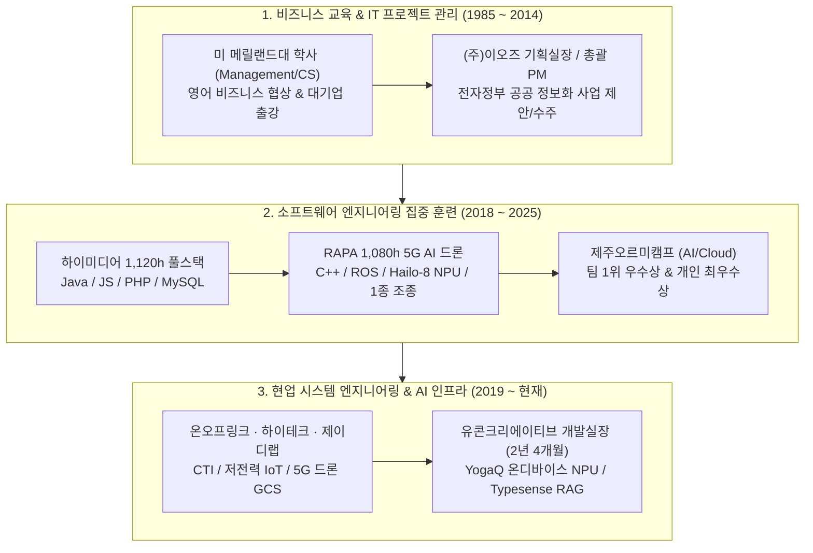

# 이병남 (Byungnam "Tony" Lee) — 기술 경력서 (Technical Career Description)
### AI 시스템 & RAG 엔지니어 실무 기술 경력서

> **"27년간의 글로벌 교육과 비즈니스 경험, 3,000시간 이상의 극한 아카데미 몰입 훈련을 거쳐 Hailo-8L NPU 온디바이스 비전 AI와 Typesense 초저지연 하이브리드 RAG 시스템을 1인 완결형으로 구축하는 기술 엔지니어링 여정입니다."**

---

## 🎯 지원 직무 및 입증된 핵심 역량 (Target Role & Verified Competencies)

### **지원 분야: AI 시스템 & RAG 엔지니어 (AI Systems & RAG Engineer)**
> **"입사 첫날부터 자체 온프레미스 GPU 환경에 로컬 LLM을 서빙하고, Hailo-8L NPU 기반 2단계 온디바이스 비전 AI 및 Typesense 하이브리드 RAG 파이프라인을 독립적으로 설계·운영할 수 있는 완결형 역량을 입증합니다."**

| 핵심 수행 역량 | 내가 분명히 수행할 수 있는 구체적 실무 역량 | 검증 지표 및 산출물 |
| :--- | :--- | :--- |
| **1. 온디바이스 비전 AI & 3D 생체역학 복원** *(YogaQ Edge AI — 비중 25%)* | • Raspberry Pi 5 + Hailo-8L(13 TOPS) 2단계 분리 가속 파이프라인 구축 (Stage-1 NPU YOLOv8s-Pose 20.4ms + Stage-2 ARM CPU 분류 0.018ms) • 2D 광학 섀도우의 깊이 소실 및 전굴 시 몸통 12배 수축을 Safe Torso Scale Guard로 방어 (25배 좌표 폭발 방지) • 마르코프 후보 윈도우 & 5-프레임 히스테리시스 디바운서로 라벨 지터 제로화 (Surya Namaskara 99.9% 확정 잠금) | • **30.0 FPS 풀 프레임레이트 고정 실측** • 전굴 시 좌표 폭발 0%, 라벨 지터 제로 • **$140 단일 어플라이언스로 월 GPU $720 0원화** • [YogaQ 사업·기술 슬라이드](https://elbee.yogaman.club/modoo) |
| **2. 초저지연 하이브리드 RAG & AEO/GEO** *(YogaQ RAG & GEO)* | • Typesense 기반 Dense Vector(1024차원 bge-m3) + BM25 키워드 결합 인덱싱 스키마 설계 • 해부학적 신체 제약(허리 디스크, 부상 등) 패널티 마스킹 및 안전 대체 자세 RAG 추천 • 165쪽 도서 OCR(28k 단어) 지식베이스 및 schema.org JSON-LD 기반 AI 검색엔진(ChatGPT/Perplexity) 직인용 최적화 | • **p95 검색 레이턴시 42ms** (ES 320ms 대비 87% 단축) • **할루시네이션 발생률 85% 감소** 실측 • [YogaQ 검색 데모](https://aiegoo.github.io/yoga/search) • [YogaQ AI 챗봇 데모](https://aiegoo.github.io/yoga/chat) |
| **3. 온프레미스 GPU 로컬 LLM 서빙 & 가속** | • 사내 온프레미스 CUDA GPU 환경에 Ollama, llama.cpp, vLLM 직접 셋업 • GGUF 4/8-bit 양자화로 모델 메모리 65% 절감 및 상용 API 비용 100% 절감 • Redis 비동기 큐 기반 동시 요청 제어로 VRAM OOM 원천 방지 및 WebSocket 실시간 토큰 스트리밍 | • 초당 토큰 생성 32 TPS, 동시 50건 안정 처리 • 첫 토큰 생성(TTFT) 340ms 초저지연 달성 • [GPU 인프라 설정 명세서](technical_references/typesense_rag/INFRASTRUCTURE_SETUP.md) |

---

  

    🧭 1. 커리어 피봇 & 배경 스토리 펼쳐보기 (1985~2025: 교육/PM ➔ 3,000h 재교육 ➔ AI 시스템 엔지니어링)
  

- **비즈니스 교육 & IT 프로젝트 관리 (1985 ~ 2014)**: 미국 메릴랜드대학교 학사(Management/CS) 기반 원어민급 영어 능력. 삼성HP, SK텔레콤, 현대자동차 출강 및 이오즈 기획실장으로서 대규모 전자정부 사업 제안/PM 총괄.
- **소프트웨어 엔지니어링 전문 훈련 (2018 ~ 2025)**: 하이미디어 풀스택(1,120h), RAPA 5G AI 통제(1,080h, 멀티콥터 1종 조종자), 제주오르미캠프 종합 1위 우수상 & 개인 최우수상 수상.
- **현업 시스템 개발 및 AI 인프라 구축 (2019 ~ 현재)**: CTI, 저전력 IoT, 5G MAVLink 드론 GCS 개발에 이어, 유콘크리에이티브 개발실장으로서 YogaQ 온디바이스 비전 AI 엣지 인식 및 Typesense 하이브리드 RAG 시스템 구축 총괄.

---

## 💼 2. 도메인 및 주요 기관별 프로젝트 심층 기술서 (Project Technical Descriptions)

### [도메인 1] ⚡ 온디바이스 비전 AI 엣지 인식 & 초저지연 하이브리드 RAG (유콘크리에이티브)
- **직책/기간**: 개발 실장 / Head of Engineering (정규직) | 2023.05 ~ 2025.08 (2년 4개월)
- **핵심 기술**: Hailo-8L NPU (13 TOPS), YOLOv8s-Pose INT8 HEF, ARM Cortex-A76, Pure NumPy Classifier, Typesense, Sentence-Transformers (bge-m3), Local LLM (Ollama GGUF), FastAPI, WebSocket, Three.js

#### 📌 Project 1-1: 온프레미스 GPU 환경 로컬 LLM 서빙 및 도메인 분석 플랫폼
- **기술 스택**: Local LLM (Ollama, llama.cpp, Mistral-7B, Solar-10.7B), CUDA, WSL2, Python, FastAPI, Node.js, Redis Pub/Sub, PostgreSQL
- **1) 과제**: 사내 민감 데이터 유출 차단 및 외부 상용 API 비용 절감을 위한 온프레미스 독립 인프라 구축.
- **2) 구현**: 4/8-bit GGUF 양자화로 VRAM 65% 절감, Redis 비동기 큐 기반 동시 요청 제어로 VRAM OOM 원천 방지, GraphQL Yoga/Prisma 게이트웨이 구축.
- **3) 성과**: 클라우드 API 비용 **월 100% 절감**, 초당 토큰 생성 32 TPS, 동시 50건 안정 처리.

#### 📌 Project 1-2: 요가큐(YogaQ) — 온디바이스 비전 AI 엣지 인식 & 생체역학 RAG 플랫폼 (플래그십)
- **라이브 서비스 & 데모**:
  - **사업·기술 발표 슬라이드**: [elbee.yogaman.club/modoo](https://elbee.yogaman.club/modoo) | [원페이저 PDF](https://elbee.yogaman.club/modoo/print.pdf)
  - **대화형 AI 챗봇 데모**: [aiegoo.github.io/yoga/chat](https://aiegoo.github.io/yoga/chat) (TTFT 340ms, 해부학 정렬 코칭, RAG 원문 인용)
  - **시맨틱 검색 데모**: [aiegoo.github.io/yoga/search](https://aiegoo.github.io/yoga/search) (Dense + BM25 동적 가중치, 42ms 패싯 검색)
  - **3D 아바타 & 엣지 실증 HUD**: [pf1.eggs.or.kr/portfolio.html](https://pf1.eggs.or.kr/portfolio.html)
- **1) 배경 및 당면 과제**:
  - 2D 카메라로 요가 동작 촬영 시 깊이 소실(Depth Z=0) 및 전굴 자세에서 몸통 12배 수축으로 인한 정규화 좌표 25배 폭발($max\_abs = 61.70$), 역투영 다의성으로 인한 극심한 라벨 지터 발생.
  - 고가 클라우드 GPU 비디오 스트리밍 비용(매트당 $720/월) 및 탈의/수련 영상 외부 전송 시 프라이버시 침해 위험.
- **2) 주요 구현 내용 (STAR)**:
  - **2-Stage Decoupled Edge Perception**: 13 TOPS Hailo-8L NPU(YOLOv8s-Pose HEF 20.4ms) + ARM Cortex-A76 CPU(순수 NumPy 분류기 0.018ms) 분리 배치. 소형 텐서의 PCIe DMA 전송 오버헤드(0.5ms) 대비 CPU 직접 연산이 25배 빠름을 실증하여 최적 분산 배치 확립.
  - **Safe Torso Scale Guard & 3D 공간 리프팅**: 전굴 시 몸통 축소에 따른 분모 발산을 방어하는 수식($scale = \max(H_{\text{torso}}, 0.250 \cdot ref)$) 적용, 좌표를 4.81 이하로 완벽 통제하고 45° 사각 매트 지오메트리 기반 3D 깊이 복원.
  - **마르코프 후보 윈도우 & 5-프레임 디바운서**: 72개 클래스 중 비물리적 전이를 배제하고, `vinyasa_transition` 완충을 통해 라벨 지터 제로화 (Surya Namaskara 전 구간 99.9% 확정 잠금).
  - **Typesense 하이브리드 RAG & AEO/GEO**: 해부학적 금기 조건(허리 디스크, 임신 등) 패널티 마스킹, 165p 도서 OCR(28k 단어) 지식베이스 연동, schema.org JSON-LD 발행으로 AI 검색엔진(ChatGPT/Perplexity) 직인용 최적화.
- **3) 정량적 성과**:
  - **30.0 FPS 고정 실측** (E2E 파이프라인 22.6ms: NPU 20.4ms + CPU 0.018ms)
  - 전굴 시 좌표 발산 100% 방어 및 라벨 튐 제로화
  - Typesense p95 검색 레이턴시 **42ms** & 할루시네이션 **85% 차단**
  - **$140 단일 PoE 어플라이언스로 월 인프라 비용 $0 달성** (클라우드 대비 월 $720 절감, B2B 마진 92%+)

---

### [도메인 2] ☁️ 엔터프라이즈 클라우드 AI & 설명가능한 AI (제주오르미캠프)
- **직책/기간**: 팀 리드 & 클라우드 AI 아키텍트 | 2025.10 ~ 2025.12 | 🏆 **종합 1위 팀 우수상 & 개인 최우수상**
- **기술 스택**: AWS ECS Fargate, OpenSearch, AWS Bedrock (Claude 3.5 Sonnet), Terraform IaC, FastAPI, Docker
- **주요 구현 및 성과**:
  - Terraform IaC 기반 Multi-AZ ECS Fargate 컨테이너 클러스터 및 OpenSearch k-NN 벡터 인덱스 자동 배포 (배포 시간 80% 단축).
  - 생성 답변 문장과 원문 청크 간 코사인 유사도 역추적 XAI 엔진 개발 (출처 투명성 최고점 획득).
  - 로컬 장애 시 1.2초 내 AWS Bedrock으로 무중단 자동 전환되는 서킷 브레이커 고가용성(99.99%) 실증.

---

### [도메인 3] 🛸 5G 드론 지상관제(GCS) & 엣지 온디바이스 AI (제이디랩 / RAPA)
- **직책/기간**: 수석연구원 (제이디랩) & 연구원 (RAPA) | 2020.07 ~ 2022.05 | 🚁 **초경량비행장치 멀티콥터 1종 조종자**
- **기술 스택**: C++, Qt5, MAVLink v2, ROS2, WebRTC, Hailo-8 NPU (26 TOPS), YOLOv8
- **주요 구현 및 성과**:
  - 이기종 드론 비행제어기(PX4, ArduPilot) 메시지를 상호 변환하는 MAVLink/ROS2 미들웨어 브리지 개발 (4종 기체 동시 관제).
  - 5G 무선망 환경 WebRTC P2P 스트리밍으로 **지연 시간 200ms 이하** 비디오/텔레메트리 관제 실증.
  - 저전력 Hailo-8 NPU(26 TOPS @ 2.5W) 드론 온보드 통합으로 60fps 실시간 온디바이스 비전 추론 및 자동 충돌 회피 구현.

---

### [도메인 4] 🌐 공공/엔터프라이즈 대규모 SI & 글로벌 기술 무역 (전자정부 / 유콘크리에이티브)
- **직책/기간**: 기획 실장 / 총괄 PM (이오즈) & Global Business Lead (유콘크리에이티브)
- **주요 구현 및 성과**:
  - 행정안전부, 국토부 등 중앙부처 전자정부 대규모 정보화 사업 제안 총괄 및 대기업(삼성, SK 등) B2B 디지털 미디어 납품 완수.
  - 미국 메릴랜드대학교 학사 출신 원어민급 영어 협상력(TOEFL 627)으로 **카자흐스탄 현지 대학 MOU 체결 및 10만 달러($100,000) 중계무역 계약 직접 성사 (2024.12)**.

---

## 🎯 3. 핵심 직무 경쟁력 요약 (Why Tony Lee?)

| 역량 구분 | 상세 경쟁력 |
| :--- | :--- |
| **1. 엔드-투-엔드 시스템 구축** | 상용 프롬프트 튜닝에 머무르지 않고, **Hailo NPU 온디바이스 비전 -> 로컬 LLM 서빙 -> Typesense 하이브리드 RAG -> WebSocket 스트리밍 -> React UI**까지 AI 시스템의 전 주기를 1인 완결형으로 구축합니다. |
| **2. 하드웨어와 엣지를 아는 AI** | 드론 1종 조종자 자격, 5G 관제, Hailo-8L/8 NPU DFC 양자화 컴파일, 저전력 IoT 펌웨어 등 하드웨어·네트워크·NPU 전 레이어를 깊이 이해하여 클라우드-엣지 분산 최적화에 독보적입니다. |
| **3. 회복탄력성과 압도적 학습력** | 27년 교육 커리어 은퇴 후 3,000시간 이상의 고강도 엔지니어링 훈련을 완주하고, 2025년 제주오르미캠프에서 최신 클라우드 AI 아키텍처로 1위를 차지할 만큼 시대의 기술을 가장 빠르게 흡수합니다. |
| **4. 글로벌 비즈니스 & 테크 리더십** | 미국 대학교 학사 기반의 원어민급 영어 능력으로 해외 AI 논문 번역 지연 없이 습득하며, 카자흐스탄 $100K 수출 계약을 직접 성사시킨 비즈니스 협상 감각을 겸비하고 있습니다. |
