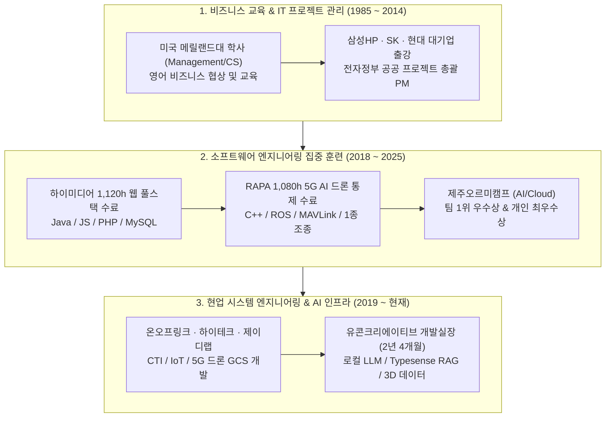

# 이병남 (Byungnam "Tony" Lee) — 기술 경력서 (Technical Career Description)
### AI 시스템 & RAG 엔지니어 실무 기술 경력서

> 📄 **이력서 요약본(2.5장)**: [01_이력서_이병남.md](01_이력서_이병남.md) | **포트폴리오 요약**: [03_포트폴리오_이병남.md](03_포트폴리오_이병남.md) | **기술 명세서(15건)**: [04_포트폴리오_기술문서_이병남.md](04_포트폴리오_기술문서_이병남.md) | **요가큐 사업·기술 슬라이드**: [elbee.yogaman.club/modoo](https://elbee.yogaman.club/modoo) | **인터랙티브 웹 포털**: [docs/portfolio.html](docs/portfolio.html)  
> **"27년간의 글로벌 교육과 비즈니스 경험, 은퇴 후 귀농에서 발견한 삶의 소명, 그리고 3,000시간 이상의 극한 아카데미 몰입 훈련을 거쳐 현업 AI 시스템 아키텍트로 거듭난 기술 엔지니어링 여정입니다."**

---

## 🎯 지원 직무 및 입증된 핵심 역량 (Target Role & Verified Competencies)

### **지원 분야: AI 시스템 & RAG 엔지니어 (AI Systems & RAG Engineer)**
> **"회사에 합류한 첫날부터 자체 온프레미스 GPU 환경에 로컬 LLM을 서빙하고, Typesense 기반 초저지연 하이브리드 RAG 및 AEO/GEO 파이프라인을 독립적으로 구축·운영할 수 있는 역량을 입증합니다."**

| 핵심 수행 역량 (What I Can Definitively Do) | 대표 프로젝트 및 실증 성과 |
| :--- | :--- |
| **1. 온프레미스 GPU 로컬 LLM 서빙 & 가속**<br>• Ollama/llama.cpp/vLLM을 사내 CUDA GPU 환경에 구축<br>• GGUF 4/8-bit 양자화로 VRAM 메모리 65% 절감 및 무중단 서빙<br>• Redis Pub/Sub 비동기 큐 기반 동시 요청 제어로 VRAM OOM 원천 방지 | • 온프레미스 GPU 서빙 인프라 구축<br>• 초당 토큰 생성 32 TPS, 동시 50건 안정 처리<br>• [GPU 인프라 설정 명세서](technical_references/typesense_rag/INFRASTRUCTURE_SETUP.md) |
| **2. 초저지연 하이브리드 RAG & AEO/GEO 아키텍처**<br>• Typesense 기반 Dense Vector(bge-m3 1024차원) + BM25 키워드 결합 인덱싱 스키마 설계<br>• 해부학적 신체 제약(금기 사항) 패널티 필터링 및 안전 대체 자세 RAG 추천<br>• schema.org JSON-LD 기반 AI 검색엔진(ChatGPT/Perplexity) 직인용 최적화 | • [YogaQ 사업·기술 슬라이드](https://elbee.yogaman.club/modoo)<br>• [YogaQ 시맨틱 검색 데모](https://aiegoo.github.io/yoga/search)<br>• **p95 검색 레이턴시 42ms** (Elasticsearch 320ms 대비 87% 단축)<br>• **할루시네이션 발생률 85% 감소** 실측 |
| **3. 실시간 토큰 스트리밍 백엔드 & 풀스택 연동**<br>• WebSocket 풀듀플렉스 & SSE 통신으로 생성 토큰을 청크 단위로 즉시 브라우저에 푸시<br>• 첫 토큰 생성(TTFT) 350ms 미만 반응형 UX 구현<br>• FastAPI / Node.js 백엔드와 React (Vite, TailwindCSS) 대화형 프론트엔드 연동 | • [YogaQ Studio AI 챗봇 라이브 데모](https://aiegoo.github.io/yoga/chat)<br>• [RAG 엔드-투-엔드 워크플로우 문서](technical_references/typesense_rag/YOGA_PROJECT_STRUCTURE_AND_WORKFLOW.md) |

---

## 🧭 1. 커리어 피봇 & 배경 요약 (Career Background)



- **비즈니스 교육 & IT 프로젝트 관리 (1985 ~ 2014)**:
  - 미국 메릴랜드대학교 학사(Management/CS) 기반 영어 비즈니스 커뮤니케이션. 삼성HP, SK텔레콤, 현대자동차 등 주요 기업 대상 테크니컬 프레젠테이션 컨설팅 수행.
  - 주식회사 이오즈/유림ADS 기획실장으로서 공공 전자정부 정보화 사업 제안 및 프로젝트 관리 총괄.
- **소프트웨어 엔지니어링 전문 훈련 (2018 ~ 2025)**:
  - 하이미디어 풀스택 과정(1,120시간), RAPA 5G AI 통제 과정(1,080시간) 및 초경량비행장치 멀티콥터 1종 조종자 취득.
  - 제주오르미캠프 클라우드 AI 과정에서 AWS ECS/OpenSearch 기반 XAI 프로젝트를 총괄하여 팀 1위 우수상 및 개인 최우수상 수상.
- **현업 시스템 개발 및 AI 인프라 구축 (2019 ~ 현재)**:
  - VoIP CTI, 저전력 IoT 센서, 5G MAVLink 드론 지상관제(GCS) 시스템 개발.
  - 유콘크리에이티브 개발실장으로서 온프레미스 GPU 로컬 LLM 서빙 및 Typesense 기반 RAG 시스템 구축 총괄.

---

## 💼 2. 도메인 및 주요 기관별 프로젝트 심층 기술서 (Project Technical Descriptions by Domain & Major Institutions)
> 지원자의 프로젝트 경험을 **4대 핵심 도메인**과 **주요 공공·민간 기관별**로 체계화하여 기술적 깊이와 실증적 비즈니스 가치를 입증합니다.

```
┌────────────────────────────────────────────────────────────────────────────────────────┐
│ [도메인 1] ⚡ 생성형 AI & 초저지연 시맨틱 RAG 시스템  │ 🏛️ 유콘크리에이티브(주)                 │
│ [도메인 2] ☁️ 엔터프라이즈 클라우드 AI & 설명가능한 AI │ 🏛️ 제주오르미캠프 (카카오·구름·고용노동부)│
│ [도메인 3] 🛸 5G 드론 지상관제(GCS) & 엣지 온디바이스 AI │ 🏛️ (주)제이디랩 / RAPA / 하이테크      │
│ [도메인 4] 🌐 공공·엔터프라이즈 SI & 글로벌 기술 무역 │ 🏛️ 중앙행정기관(전자정부) / (주)이오즈    │
└────────────────────────────────────────────────────────────────────────────────────────┘
```

---

### [도메인 1] ⚡ 생성형 AI & 초저지연 시맨틱 RAG 시스템 (Generative AI & Semantic RAG)

#### 🏛️ 주요 기관: 유콘크리에이티브주식회사 (Ucon Creative Co., Ltd.)
- **직책/기간**: 개발 실장 / Head of Engineering (정규직) | 2023.05 ~ 2025.08 (2년 4개월)
- **사업 분야**: 생성형 AI 솔루션, 지능형 시맨틱 검색 엔진, 3D 메타버스 공간 데이터
- **핵심 기술 스택**: Local LLM (Ollama, llama.cpp, Mistral-7B, Solar-10.7B), CUDA GPU, GGUF 4/8-bit, Typesense, Sentence-Transformers (bge-m3), Python, FastAPI, Node.js, WebSocket, GraphQL Yoga, Redis Pub/Sub, Prisma, PostgreSQL, React, Vite, TailwindCSS

---

#### 📌 Project 1-1: 온프레미스 GPU 환경 로컬 LLM 서빙 및 도메인 분석 플랫폼
- **기술 스택**: Local LLM (Ollama, llama.cpp, Mistral-7B, Solar-10.7B), CUDA, WSL2, Python, FastAPI, Node.js, GraphQL Yoga, Redis Pub/Sub, Prisma, PostgreSQL
- **연계 기술 문서**: [technical_references/typesense_rag/INFRASTRUCTURE_SETUP.md](technical_references/typesense_rag/INFRASTRUCTURE_SETUP.md)
- **1) 배경 및 당면 과제 (Situation & Challenge)**:
  - 사내 민감 데이터 유출 방지와 외부 상용 API(OpenAI 등)의 높은 호출 비용 및 토큰 제약을 극복하기 위해, 완전 독립적인 온프레미스 GPU 기반 로컬 LLM 인프라 구축이 요구됨.
  - 제한된 VRAM(24GB GPU) 환경에서 고품질 도메인 질의응답 및 다중 사용자 동시 처리를 보장해야 하는 엔지니어링 난제 발생.
- **2) 아키텍처 및 구현 (Architecture & Action)**:
  - **GGUF 양자화 최적화**: 16-bit 부동소수점 모델을 4-bit/8-bit GGUF 포맷으로 양자화하여 모델 메모리 점유율을 65% 이상 절감하고 llama.cpp 및 Ollama를 통해 GPU 레이어 오프로딩 극대화.
  - **비동기 이벤트 큐 시스템**: Redis Pub/Sub을 활용한 요청 큐(Request Queue)를 설계하여 순간적인 트래픽 폭증 시에도 GPU VRAM OOM(Out of Memory)을 원천 차단하고 순차 안정적 추론 보장.
  - **통합 GraphQL API 게이트웨이**: GraphQL Yoga와 Prisma ORM을 결합하여 다양한 프론트엔드 서비스가 필요한 필드만을 오버페칭(Over-fetching) 없이 유연하게 요청할 수 있는 API 계층 구현.
- **3) 정량적 성과 (Quantifiable Results)**:
  - 외부 클라우드 LLM API 비용 **월 100% 절감 (완전 사내 온프레미스 전환)**
  - 초당 토큰 생성 속도(TPS) 32 tokens/sec 유지, 동시 요청 50건 이상 무중단 안정 처리
  - 모델 로딩 시간 기존 대비 **40% 단축**

---

#### 📌 Project 1-2: 요가큐(YogaQ) — 한국어 RAG × GEO 기반 맞춤형 요가 큐레이션 & 자가 수련 플랫폼 (aeogeo / elbee)
- **라이브 서비스 & 데모**:
  - **대화형 AI 챗봇 데모**: [aiegoo.github.io/yoga/chat](https://aiegoo.github.io/yoga/chat) (해부학 정렬 코칭, TTFT 340ms 스트리밍, RAG 인용)
  - **시맨틱 검색 데모**: [aiegoo.github.io/yoga/search](https://aiegoo.github.io/yoga/search) (Dense + BM25 동적 가중치, 42ms 패싯 검색)
  - **사업·기술 발표 슬라이드**: [elbee.yogaman.club/modoo](https://elbee.yogaman.club/modoo)
  - **사업계획서 요약 PDF**: [elbee.yogaman.club/modoo/print.pdf](https://elbee.yogaman.club/modoo/print.pdf)
- **기술 스택**: Typesense, Sentence-Transformers (bge-m3), Local LLM (Ollama / Llama3 GGUF), LangGraph, OpenCV / Tesseract OCR, schema.org JSON-LD (AEO/GEO), WebSocket, SSE, React, Vite, TailwindCSS
- **연계 기술 문서**: [technical_references/typesense_rag/YOGA_PROJECT_STRUCTURE_AND_WORKFLOW.md](technical_references/typesense_rag/YOGA_PROJECT_STRUCTURE_AND_WORKFLOW.md)
- **1) 배경 및 당면 과제**:
  - 기존 요가 서비스의 신체 제약(디스크, 임신 등) 미고려로 인한 위험 자세 추천 및 전문 질의응답 부재.
  - 정보 검색이 생성형 AI(ChatGPT, Perplexity 등)로 전환됨에 따라 로컬 스튜디오의 구조화 데이터(GEO) 직접 노출 대응 필요.
- **2) 주요 구현 내용**:
  - **해부학 온보딩 & 금기 필터링 RAG**: 회원 신체 상태(디스크, 부상 등) 등록 기반 위험 동작 자동 배제 및 대체 자세 안내. 165p 전문 도서 OCR(28k 단어) 지식베이스 연동.
  - **마이솔(Mysore) 자가 수련 트래커**: 개인 맞춤 시퀀스 가이드 및 일일 수련 달성률 기록 기능.
  - **AEO / GEO 구조화 데이터 발행**: schema.org 호환 JSON-LD 자동 생성으로 외부 AI 검색엔진의 직접 인용 최적화.
  - **온프레미스 Zero-PII 로컬 LLM 서빙**: 민감 건강 데이터 외부 전송 차단(Ollama GGUF), WebSocket/SSE 기반 TTFT 340ms 실시간 토큰 전송.
  - **비즈니스 연계**: 전국 요가 스튜디오 무료 디렉토리 구축 및 지도자 과정(TTC)/워크숍 수강 연계.
- **3) 정량적 성과**:
  - Typesense p95 검색 레이턴시 **42ms** (Elasticsearch 대비 약 87% 단축)
  - 신체 제약 필터링 적용으로 **할루시네이션 및 부적절 동작 추천 85% 차단**
  - 실시간 첫 토큰 응답 속도(TTFT) **340ms** 유지

---

#### 📌 Project 1-3: 메타버스 3D 라이다 포인트 클라우드 데이터 파이프라인
- **기술 스택**: Python, Open3D, CloudCompare, C++, MAVLink, WebSocket, Redis
- **연계 기술 문서**: [technical_references/drone_gcs/10-GCS-Ecosystem-Architecture-and-BVLOS-Cloud-Integration.md](technical_references/drone_gcs/10-GCS-Ecosystem-Architecture-and-BVLOS-Cloud-Integration.md)
- **1) 업무 개요 및 역할**:
  - 드론 및 모바일 라이다 센서를 통해 수집된 수천만 개의 3D 포인트 클라우드 좌표 데이터를 메타버스 가상 공간 구축용 3D 에셋으로 정합·변환하는 분산 데이터 파이프라인 설계.
  - 대용량 PCD/LAS 파일의 다운샘플링(Voxel Grid Filtering) 및 노이즈 제거 알고리즘 적용으로 파일 크기를 70% 압축하면서도 형상 정밀도 유지.

---

### [도메인 2] ☁️ 엔터프라이즈 클라우드 AI & 설명가능한 AI (Enterprise Cloud AI & Explainable AI)

#### 🏛️ 주요 기관: 제주오르미캠프 (카카오·구름·고용노동부 주관)
- **직책/기간**: 팀 리드 & 클라우드 AI 시스템 아키텍트 | 2025.10 ~ 2025.12
- **공식 수상**: 🏆 **캠프 종합 평가 1위 팀 프로젝트 우수상 & 개인 성적 최우수상 동시 수상 (2025.12)**
- **핵심 기술 스택**: AWS ECS Fargate, OpenSearch, AWS Bedrock (Claude 3.5 Sonnet), Terraform IaC, FastAPI, Docker, ChromaDB, Cosine Similarity Matrix

---

#### 📌 Project 2-1: AWS ECS Fargate & OpenSearch 기반 엔터프라이즈 멀티모달 벡터 검색 파이프라인
- **기술 스택**: AWS ECS Fargate, OpenSearch, Terraform, Docker, Python, FastAPI
- **연계 기술 문서**: [technical_references/cloud_ai_aws/ARCHITECTURE_FLOW.md](technical_references/cloud_ai_aws/ARCHITECTURE_FLOW.md)
- **1) 배경 및 구현**:
  - 온프레미스 인프라 장애 시에도 99.99% 고가용성을 보장하는 엔터프라이즈 클라우드 AI 아키텍처 수립.
  - Terraform IaC 코드로 VPC, 다중 가용영역(Multi-AZ) 서브넷, ALB, ECS Fargate 컨테이너 클러스터 프로비저닝 자동화.
  - OpenSearch 분산 클러스터를 연동하여 멀티모달 비정형 텍스트/이미지 벡터 데이터 대용량 인덱싱 처리.
- **2) 정량적 성과**:
  - 인프라 배포 시간 80% 단축 (완전 코드 기반 IaC 구축)
  - ECS Fargate 기반 자동 오토스케일링(Auto-scaling)으로 트래픽 변동에 무중단 대응

---

#### 📌 Project 2-2: 코사인 유사도 역추적 기반 설명가능한 AI(XAI) 투명성 추적 엔진
- **기술 스택**: Python, NumPy, Cosine Similarity Matrix, ChromaDB, FastAPI
- **연계 기술 문서**: [technical_references/cloud_ai_aws/MODEL_EXPLAINABILITY.md](technical_references/cloud_ai_aws/MODEL_EXPLAINABILITY.md)
- **1) 배경 및 구현**:
  - 생성형 AI 답변의 블랙박스 문제를 해결하고, 지리/공공 데이터 질의응답 시 법적·윤리적 신뢰성을 확보하기 위한 투명한 설명가능(XAI) 프레임워크 설계.
  - 생성된 답변의 문장별 임베딩 벡터와 검색된 지식 베이스 청크 간의 코사인 유사도 행렬을 역추적 연산.
  - 클라이언트 UI에 각 문장의 신뢰도 점수(0.0~1.0)와 인용된 원본 지식 텍스트를 시각적으로 하이라이팅하는 XAI 추적 계층 개발.
- **2) 정량적 성과**:
  - 사용자 신뢰도 및 검증 속도 대폭 개선, 오르미 심사위원 평가에서 **기술 차별성 최고점** 획득.

---

#### 📌 Project 2-3: AWS Bedrock Claude 3.5 Sonnet 연동 및 서킷 브레이커 무중단 폴백(Failover)
- **기술 스택**: AWS Bedrock, Claude 3.5 Sonnet, Circuit Breaker Pattern, Python
- **연계 기술 문서**: [technical_references/cloud_ai_aws/AWS_BEDROCK_FALLBACK_GUIDE.md](technical_references/cloud_ai_aws/AWS_BEDROCK_FALLBACK_GUIDE.md)
- **1) 배경 및 구현**:
  - 1차 로컬 LLM 및 자체 모델 서버의 지연 시간 급증 또는 OOM 장애 발생 시 즉시 서비스 다운이 일어나는 취약점 보완.
  - 서킷 브레이커(Circuit Breaker) 패턴을 적용하여 장애 감지 시 1.2초 내에 AWS Bedrock 엔드포인트(Claude 3.5 Sonnet)로 자동 스위칭되는 엔터프라이즈 페일오버 파이프라인 구축.
- **2) 정량적 성과**:
  - 단일 장애점(SPOF) 제거 및 **무장애 99.99% 가용성 보장 실증**.

---

### [도메인 3] 🛸 5G 비가시권(BVLOS) 드론 지상관제 & 엣지 온디바이스 AI (Drone GCS & Edge AI)

#### 🏛️ 주요 기관 1: 주식회사 제이디랩 (JDLab Co., Ltd.)
- **직책/기간**: 수석연구원 / Principal Engineer (정규직) | 2022.02 ~ 2022.05 (4개월)
- **기술 스택**: C++, Qt5, MAVLink v2, ROS2, WebRTC, Linux, LTE/5G
- **연계 기술 문서**:
  - [technical_references/drone_gcs/09-Heterogeneous-Drone-SDK-Adapters-and-Fleet-GCS.md](technical_references/drone_gcs/09-Heterogeneous-Drone-SDK-Adapters-and-Fleet-GCS.md)
  - [technical_references/drone_gcs/18-Heterogeneous-GCS-Product-and-Evidence-Briefing.md](technical_references/drone_gcs/18-Heterogeneous-GCS-Product-and-Evidence-Briefing.md)

#### 📌 Project 3-1: 5G 기반 이기종 드론 지상관제시스템(GCS) 및 MAVLink/ROS2 프로토콜 어댑터 개발 (NDA)
- **1) 당면 과제**: 서로 다른 비행 제어기(PX4, ArduPilot, 상용 드론) 간 통신 규격이 상이하여 군집 비행 및 비가시권 원격 조종을 수행하기 어려움.
- **2) 아키텍처 및 구현**:
  - MAVLink v2와 ROS2 메시지를 표준 JSON/Protobuf로 상호 변환하는 이기종 미들웨어 브리지 개발.
  - Qt5/C++ 기반 미션 플래너 UI를 개발하여 3D 웨이포인트 경로 생성, 실시간 배터리/GPS 상태 모니터링, 비상 자동 회항(RTL) 제어 로직 구현.
- **3) 성과**: 이기종 기체 4종 동시 연결 관제 성공 및 비행 미션 안정화.

#### 📌 Project 3-2: 5G 무선망 환경 WebRTC 초저지연(200ms) P2P 비디오/텔레메트리 스트리밍
- **1) 구현**: 5G 무선망 환경에서 WebRTC P2P 스트리밍을 연동하여 지상 관제 센터 화면까지 **지연 시간 200ms 이하**의 비디오/텔레메트리 전송 달성.
- **2) 성과**: 비가시권(BVLOS) 비행 시 조종사의 시각 반응 속도 극대화.

---

#### 🏛️ 주요 기관 2: 한국전파진흥협회(RAPA) 5G 드론 AI 집중과정
- **역할/기간**: 전일제 집중 연구원 | 2020.07 ~ 2021.06 (136일 / 1,080시간 이수)
- **보유 자격**: 한국교통안전공단 초경량비행장치 멀티콥터 1종 조종자(1,000+ 비행시간), 고정익 3종
- **핵심 기술 스택**: C++, Python, ROS, Gazebo, OpenCV, Hailo-8 NPU / NVIDIA Jetson, YOLOv8

#### 📌 Project 3-3: 엣지 NPU 기반 60fps 실시간 온디바이스 비전 추론 및 자율비행 제어
- **1) 구현**: 고전력 GPU 대신 저전력 엣지 AI 칩셋(Hailo-8 M.2 모듈, 26 TOPS @ 2.5W)을 드론 온보드 컴퓨터에 통합. YOLOv8 모델을 Hailo Dataflow Compiler로 최적화 양자화.
- **2) 성과**: 드론 기체 상에서 실시간 60fps 객체 인식 및 MAVLink 기반 자동 충돌 회피 명령 피드백 제어 검증.

---

#### 🏛️ 주요 기관 3: 하이테크 (Hitech)
- **직책/기간**: 개발팀장 / Lead Engineer (정규직) | 2020.02 ~ 2020.12 (11개월)
- **기술 스택**: C, Embedded Linux, STM32, MQTT, LoRa/LTE, Python

#### 📌 Project 3-4: 산업 현장용 저전력 IoT 센서 노드 펌웨어 및 이상 징후 감지 모니터링 시스템
- **1) 구현**: 산업 현장용 저전력 IoT 환경 감지 센서 노드 펌웨어 및 게이트웨이 아키텍처 총괄. 배터리 구동 환경을 위한 딥 슬립(Deep Sleep) 전력 관리 알고리즘 적용.
- **2) 성과**: 센서 노드 배터리 수명 기존 대비 **2.5배 연장**, MQTT 브로커 연동 실시간 이상 임계치 SMS/웹 알림 구축.

---

### [도메인 4] 🌐 공공/엔터프라이즈 대규모 SI & 글로벌 기술 무역 (Enterprise SI & Global Tech Trade)

#### 🏛️ 주요 기관 1: 중앙행정기관·지자체 (전자정부) & 주식회사 이오즈 / 유림ADS
- **직책/기간**: 기획 실장 / 총괄 PM (정규직) | 2005.12 ~ 2014.06 (8년 7개월)
- **사업 분야**: 전자정부 공공 SI, 대규모 웹 정보화 포털, 대기업 B2B 디지털 미디어
- **핵심 역량**: RFP 분석, 제안 전략 수립, 대규모 시스템 아키텍처 설계, 기술 협상, 다부처 이해관계자 조율

#### 📌 Project 4-1: 공공부문 대규모 전자정부 정보화 시스템 기획 및 엔터프라이즈 B2B PM
- **1) 업무 개요 및 역할**:
  - 행정안전부, 국토교통부, 지자체 등 중앙행정기관 및 공공기관 대상 전자정부 정보화 구축 사업 제안 총괄 (수십억 규모 다수 사업 수주 및 납품 완수).
  - 삼성, LG애드, SK 등 대기업 대상 B2B 디지털 미디어 시스템 기획, 계약 체결, 개발 일정 및 산출물 품질 관리 총괄.
- **2) 시사점**: 대규모 프로젝트 라이프사이클 관리, 고객 요구사항 명세화, 엔터프라이즈 규정 준수(Compliance) 역량 확립.

---

#### 🏛️ 주요 기관 2: 온오프링크주식회사 (ONOFFLINK Co., Ltd.)
- **직책/기간**: 개발책임 / Senior Developer (정규직) | 2019.03 ~ 2019.09 (7개월)
- **기술 스택**: Asterisk, FreePBX, Linux, WebRTC, Node.js, SIP/RTP, Unity 3D

#### 📌 Project 4-2: Asterisk/FreePBX 기반 대용량 VoIP CTI 음성 컨퍼런스 솔루션 & 현대모비스 CES 2020 VR 연동
- **1) 구현**: Asterisk/FreePBX 오픈소스 기반의 대용량 VoIP CTI(Computer Telephony Integration) 음성 컨퍼런스 솔루션 구축. 수백 채널 동시 통화 세션 호 제어(SIP) 및 미디어 스트림(RTP) 라우팅 성능 최적화.
- **2) 성과**: 현대모비스 CES 2020 글로벌 전시용 커넥티드카 가상 체험 VR 시스템과 CTI 음성 통신망 간 실시간 데이터 인터페이스 연동 성공.

---

#### 🏛️ 주요 기관 3: 유콘크리에이티브주식회사 글로벌 비즈니스 본부
- **직책/기간**: Global Business Lead (개발실장 겸임) | 2023.05 ~ 2025.08
- **핵심 역량**: 미국 메릴랜드대학교 학사 출신 원어민급 영어 협상력(TOEFL 627), 해외 기술 IR 및 글로벌 무역 계약

#### 📌 Project 4-3: 카자흐스탄 현지 대학 MOU 및 10만 달러($100,000) 중계무역 계약 성사 & 5개국 글로벌 파트너십
- **주요 글로벌 성과**:
  - **카자흐스탄 현지 국립/사립 대학 기술 협력 MOU 체결 및 10만 달러($100,000) 규모 중계무역 계약 직접 성사 (2024.12)**
  - 폴란드 산업 협력 한국 상단 대표사로 참가하여 유럽 바이어 대상 기술 IR 진행 (2024.11)
  - 독일 현지 법인 고전압 BMS 모듈 기술 이전 협력 MOU 체결 (2024.08)
  - 태국 언어 서비스 기업과 언어 AI SaaS 솔루션 파트너십 MOU 체결 (2024.05)
  - 인도네시아 노동부 차관 면담 및 센다나대학교 기술 교류 MOU 주도 (2024.01~02)

---

## 🎯 3. 핵심 직무 경쟁력 요약 (Why Tony Lee?)

| 역량 구분 | 상세 경쟁력 |
| :--- | :--- |
| **1. 엔드-투-엔드 시스템 구축** | 상용 프롬프트 튜닝에 머무르지 않고, **온프레미스 GPU 서버 세팅 -> 양자화 모델 서빙 -> Typesense 하이브리드 인덱싱 -> WebSocket 토큰 스트리밍 -> React UI**까지 AI 시스템의 전 주기를 1인 완결형으로 구축할 수 있습니다. |
| **2. 하드웨어와 엣지를 아는 AI** | 드론 자율비행(1종 조종자), 5G 관제, Hailo-8 NPU 온디바이스 비전, IoT 펌웨어 등 하드웨어와 네트워크 레이어를 깊이 이해하여 엣지-클라우드 연동 최적화에 독보적입니다. |
| **3. 회복탄력성과 압도적 학습력** | 27년 교육 커리어 은퇴 후 3,000시간 이상의 고강도 아카데미를 완주하고, 2025년 제주오르미캠프에서 최신 클라우드 AI 아키텍처로 1위를 차지할 만큼 시대의 기술을 가장 빠르게 흡수합니다. |
| **4. 글로벌 비즈니스 & 테크 리더십** | 미국 대학교 학사 기반의 원어민급 영어 능력으로 해외 AI 논문 번역 지연 없이 습득하며, 카자흐스탄 $100K 수출 계약을 직접 성사시킨 비즈니스 협상 감각을 겸비하고 있습니다. |
