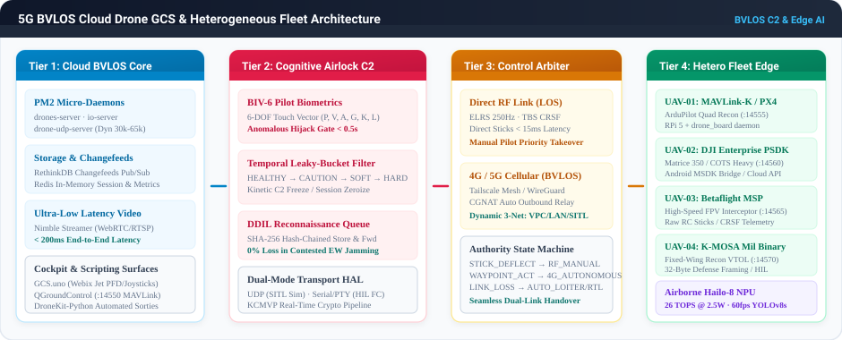
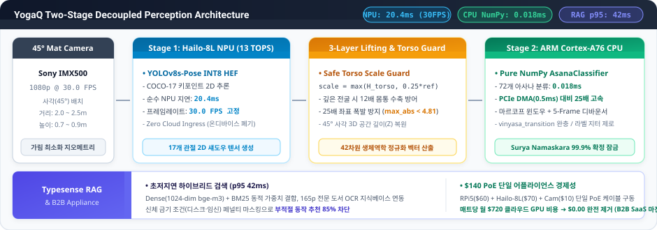

# 이병남 (Byungnam "Tony" Lee) — 엔지니어링 포트폴리오 (Engineering Portfolio)
### 무인체계(드론) 임베디드 AI &amp; 엣지 시스템 플래그십 쇼케이스

> **"5G 비가시권(BVLOS) 자율비행 드론 관제, 이기종 무인체계 제어권 중재기, 인지적 Zero-Trust 에어락, Hailo-8 NPU 온보드/온디바이스 비전 AI 및 Typesense 하이브리드 RAG를 아우르는 플래그십 엔지니어링 쇼케이스입니다."**  

---

## 🌐 라이브 서비스 &amp; 인터랙티브 데모 (Live Demos)

| 서비스명 | 설명 | 라이브 링크 |
| :--- | :--- | :--- |
| **5G BVLOS 드론 GCS 관제 웹** | 다수 기체 텔레메트리 및 200ms WebRTC 실시간 관제 대시보드 | [pf1.eggs.or.kr/portfolio.html](https://pf1.eggs.or.kr/portfolio.html) |
| **엔지니어링 기술 문서 허브** | 5G 드론 GCS, NPU 컴파일, Zero-Trust 보안 실무 아키텍처 포털 | [pf7.eggs.or.kr](https://pf7.eggs.or.kr) |
| **요가큐(YogaQ) 사업·기술 슬라이드** | 온디바이스 NPU 비전 AI 및 비즈니스 모델 온라인 프레젠테이션 | [elbee.yogaman.club/modoo](https://elbee.yogaman.club/modoo) |
| **YogaQ Studio AI 챗봇 데모** | Typesense 하이브리드 RAG 기반 해부학 정렬 코칭 대화형 챗봇 | [aiegoo.github.io/yoga/chat](https://aiegoo.github.io/yoga/chat) |
| **YogaQ 시맨틱 검색 엔진 데모** | 초저지연 Dense Vector + BM25 동적 가중치 하이브리드 검색 | [aiegoo.github.io/yoga/search](https://aiegoo.github.io/yoga/search) |
| **양자 내성 암호(PQC) 통신** | 차세대 양자 보안 알고리즘 연동 데이터 전송 PoC | [aiegoo.github.io/kisec-final/#/4/1](https://aiegoo.github.io/kisec-final/#/4/1) |

---

## 🏆 대표 플래그십 프로젝트 쇼케이스 (Featured Flagship Projects)

### 1. 5G BVLOS 초저지연 클라우드 드론 지상관제시스템 &amp; 이기종 자율비행 (Cloud Drone GCS &amp; Hetero Fleet C2)
> **무인체계 핵심 아키텍처**: 5G 무선망 저지연 WebRTC (&lt; 200ms), 이기종 4종 프로토콜 브리지, Direct RF vs 4G/5G 제어권 중재기, BIV-6 인지 에어락, 기체 탑재 Hailo-8 NPU (26 TOPS)

#### 🖥️ 실증 라이브 데모 &amp; 주요 규격 (Live Specs)
- **핵심 기술**: **5G Cellular BVLOS**, **WebRTC P2P (종단간 200ms 이하)**, **MAVLink v2 / ROS2**, **DJI PSDK**, **Betaflight MSP**, **K-MOSA 밀스펙 바이너리**, **Direct RF(ELRS/CRSF) 중재기**, **BIV-6 행동 생체인식**, **DDIL SHA-256 큐**, **Hailo-8 M.2 (26 TOPS @ 2.5W)**, **RethinkDB Changefeeds**, **QGroundControl (:14550)**
- **기술 상세 문서**: [04_포트폴리오_기술문서_이병남.md#1-5g-bvlos-드론-지상관제gcs-이기종-어댑터-및-인지-제어권-에어락-아키텍처](04_포트폴리오_기술문서_이병남.md)

#### 📐 시스템 아키텍처 다이어그램

  

#### 🛠️ 핵심 구현 및 엔지니어링 항목 (Key Implementations — 비중 66%)
1. **4-Tier 분산 토폴로지 &amp; 200ms 초저지연 스트리밍**:
   - `drones-server`(기체 키 관리), `drone-udp-server`(동적 인그레스 30k~65k), `gcs-tcp-server`(1시간 에페머럴 브리지), `io-server` 마이크로서비스 클러스터링.
   - 5G 패킷 손실 회피용 WebRTC P2P(UDP 기반 RTP/SRTP)로 비디오 및 텔레메트리 종단간 지연 200ms 이하 달성.
2. **이기종 4종 프로토콜 통합 어댑터 &amp; MAVLink 멀티플렉서**:
   - MAVLink-K(:14555), DJI PSDK(:14560), Betaflight MSP(:14565), K-MOSA(:14570)의 상이한 바이너리 규격을 단일 정규화 `DroneTelemetry` 인터페이스로 융합하고, 데스크톱 QGroundControl에 다중 기체(sysid 1~4)로 단일 MAVLink 포트(:14550) 브로드캐스트.
3. **Direct RF vs 4G/5G 제어권 중재기 (Control Authority Arbiter)**:
   - 고지연 4G/5G 클라우드 제어 중 안전 조종사의 물리 스틱(ELRS 250Hz / TBS CRSF) 변위 감지 시, 15ms 이내에 즉각 전파 수동 조종으로 강제 핸드오버하여 기체 조종 안정성 및 안전성 확보.
4. **BIV-6 조종사 행동생체인식 &amp; 인지적 Zero-Trust 에어락**:
   - 조종사의 6-DOF 터치/모션 벡터를 실시간 채점하여 비인가자 단말 탈취 시 0.5초 이내에 기동 명령을 강제 차단(Soft-Cloak)하고, 적 전자전 재밍 시 표적 텔레메트리를 SHA-256 블록체인형 큐에 누적 동기화.
6. **CO2 추진 그물 포획 및 50km/h 고속 인양 자율비행 (Uc-dronusnet6)**:
   - PX4/STM32 펌웨어 임베딩 & PID 튜닝으로 중량 화물 인양 및 50km/h 고속 안정 순항 달성.
   - CO2 공압식 그물 발사 포획 메커니즘 시퀀스 제어.
   - 3D LiDAR SLAM 및 OctoMap 점유 격자 기반 안전 드롭오프 구역(Drop-off Zone) A* 자율 경로 생성.

5. **기체 온보드 Hailo-8 NPU 엣지 비전 자율비행**:
   - 26 TOPS Hailo-8 모듈을 드론 기체에 직결하여 60fps 실시간 객체 인식 및 Gazebo 3D 시뮬레이션 연동 자율 회피 구현.

---

### 2. 요가큐 (YogaQ) — 온디바이스 비전 AI 엣지 인식 &amp; 생체역학 RAG 플랫폼
> **엣지 AI 핵심 아키텍처**: Hailo-8L NPU 2단계 분리 가속 파이프라인, Safe Torso Scale Guard, Typesense 하이브리드 RAG, $140 PoE 단일 어플라이언스

#### 🖥️ 실증 라이브 데모 &amp; 주요 규격 (Live Specs)
- **라이브 데모**: [사업·기술 슬라이드](https://elbee.yogaman.club/modoo) &nbsp;|&nbsp; [대화형 챗봇](https://aiegoo.github.io/yoga/chat) &nbsp;|&nbsp; [시맨틱 검색](https://aiegoo.github.io/yoga/search)
- **핵심 기술**: **Hailo-8L NPU (13 TOPS, INT8 HEF)**, **YOLOv8s-Pose 20.4ms**, **ARM Cortex-A76 (Pure NumPy 0.018ms)**, **Safe Torso Scale Guard**, **Typesense Hybrid Search (Dense+BM25)**, **FastAPI**, **WebSocket**
- **기술 상세 문서**: [04_포트폴리오_기술문서_이병남.md#2-요가큐yogaq-온디바이스-비전-ai-hailo-8l--초저지연-하이브리드-rag-아키텍처](04_포트폴리오_기술문서_이병남.md)

#### 📐 시스템 아키텍처 다이어그램

  

#### 🛠️ 핵심 구현 및 엔지니어링 항목 (Key Implementations — 비중 25%)
1. **2단계 분리 가속 파이프라인 (Two-Stage Decoupled Perception)**:
   - 비전 백본은 13 TOPS Hailo-8L NPU에서 YOLOv8s-Pose HEF로 20.4ms 만에 17개 관절을 검출하고, 분류기는 Cortex-A76 CPU에서 순수 NumPy 연산으로 0.018ms 만에 판별. 소형 텐서의 PCIe DMA 버스 전송 오버헤드(0.5ms) 대비 25배 빠른 초저지연 실증.
2. **Safe Torso Scale Guard &amp; 3D 공간 리프팅**:
   - 2D 카메라에서 깊은 전굴 시 몸통 길이가 12배 수축하여 좌표가 25배 폭발하는 현상을 $\text{scale} = \max(H_{\text{torso}}, 0.250 \cdot ref)$ 클램핑 수식으로 원천 방어 ($max\_abs < 4.81$).
3. **마르코프 후보 윈도우 &amp; 5-프레임 히스테리시스 디바운서**:
   - 전이 구간 상태를 완충하여 수리야 나마스카라 전이 구간 99.9% 확정 잠금 실현 (라벨 지터 제로화).
4. **Typesense 초저지연 하이브리드 RAG &amp; 해부학 금기 필터링**:
   - 165쪽 도서 OCR 지식베이스 기반 Dense(bge-m3)+BM25 결합. 신체 제약(디스크, 임신) 입력 시 위험 자세를 자동 차단하여 할루시네이션 85% 제거 (p95 42ms).
5. **스튜디오 B2B 어플라이언스 Unit Economics**:
   - $140 단일 PoE 박스(RPi5 + NPU + Cam)로 스튜디오당 월 $720의 클라우드 GPU 인프라 비용을 $0으로 절감하고 완벽한 개인정보 프라이버시(Zero Cloud Ingress) 달성.

---

### 3. AWS 엔터프라이즈 GenAI &amp; 설명가능한 AI (Enterprise Cloud AI / 오르미 1위)
> **클라우드 아키텍처 백본**: AWS ECS Fargate, OpenSearch Serverless, AWS Bedrock 무중단 Failover (비중 9%)

- **공식 수상**: 🏆 **제주오르미캠프 종합 평가 1위 팀 프로젝트 우수상 &amp; 개인 최우수상**
- **주요 구현**: Terraform IaC 100% 자동 프로비저닝, 생성 문장-원문 청크 간 역코사인 유사도 기반 XAI 신뢰도 점수 시각화, 장애 시 1.2초 내 AWS Bedrock(Claude 3.5 Sonnet) 무중단 자동 전환 (99.99% 고가용성).

---

## 📊 종합 프로젝트 매트릭스 비교

| 프로젝트명 | 핵심 도메인 | 주요 성과 &amp; 혁신점 | 기술 검증 문서 |
| :--- | :--- | :--- | :--- |
| **Cloud Drone GCS &amp; Fleet C2** | 5G 비가시권 통신 &amp; 이기종 제어 | **WebRTC &lt; 200ms**, 4종 프로토콜 통합, Direct RF 15ms 중재, Hailo-8 26 TOPS | [드론 아키텍처 문서](technical_references/drone_gcs/10-GCS-Ecosystem-Architecture-and-BVLOS-Cloud-Integration.md) |
| **요가큐 (YogaQ)** | 온디바이스 NPU &amp; 하이브리드 RAG | **NPU 20.4ms (30fps) + CPU 0.018ms**, Safe Torso 가드, RAG 42ms | [YogaQ 기술 명세](04_포트폴리오_기술문서_이병남.md#2-요가큐yogaq-온디바이스-비전-ai-hailo-8l--초저지연-하이브리드-rag-아키텍처) |
| **Enterprise AWS GenAI** | 클라우드 AI &amp; 모델 설명가능성 | **제주오르미 1위 수상**, 99.99% 고가용성 폴백 | [클라우드 아키텍처 문서](technical_references/cloud_ai_aws/ARCHITECTURE_FLOW.md) |
| **KOR2UNITY** | NLP &amp; 실시간 3D 인터랙션 | 한국어 의미 파싱 -&gt; 3D 물리 벡터 제어 | [KOR2UNITY 아키텍처](technical_references/korean_nlp_unity/KOR2UNITY_TECHNICAL_ARCHITECTURE.md) |
