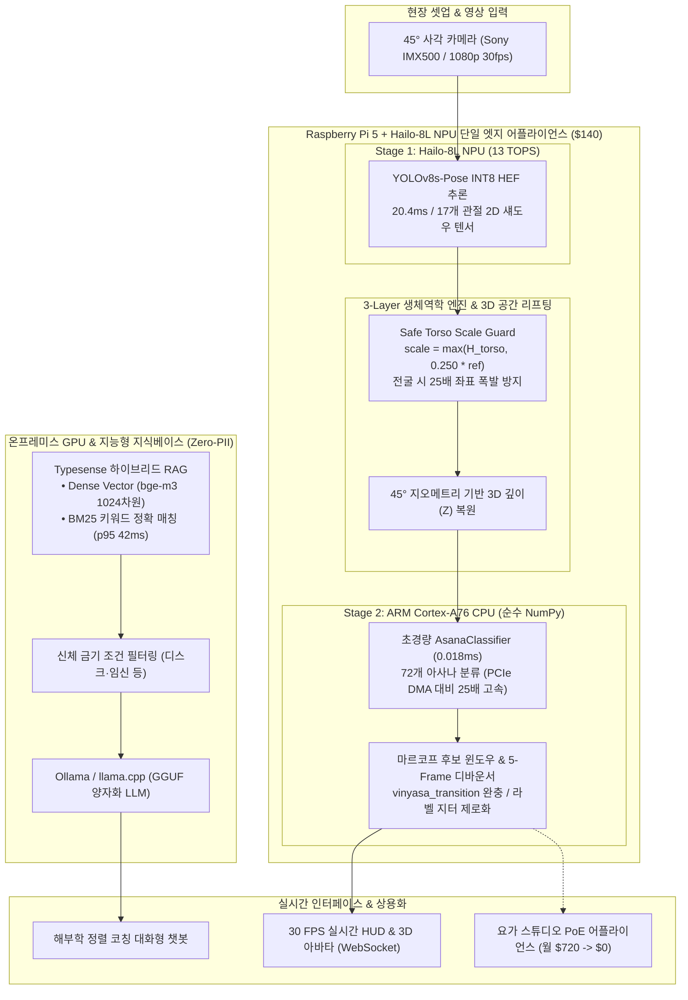

# 이병남 (Byungnam "Tony" Lee) — 엔지니어링 포트폴리오 (Engineering Portfolio)
### AI 시스템 & RAG 엔지니어 플래그십 프로젝트 쇼케이스

> **"Hailo-8L NPU 온디바이스 비전 AI 엣지 인식과 Typesense 초저지연 하이브리드 RAG, 5G 비가시권(BVLOS) 자율비행 드론 관제, 엔터프라이즈 클라우드 AI 플랫폼을 아우르는 플래그십 엔지니어링 쇼케이스입니다."**  

---

## 🌐 라이브 서비스 & 인터랙티브 데모 (Live Demos)

| 서비스명 | 설명 | 라이브 링크 |
| :--- | :--- | :--- |
| **요가큐(YogaQ) 사업·기술 슬라이드** | 온디바이스 비전 AI 및 비즈니스 모델 온라인 프레젠테이션 | [elbee.yogaman.club/modoo](https://elbee.yogaman.club/modoo) |
| **요가큐(YogaQ) 원페이저 사업계획서** | A4 인쇄 최적화 싱글페이지 비즈니스 플랜 PDF | [elbee.yogaman.club/modoo/print.pdf](https://elbee.yogaman.club/modoo/print.pdf) |
| **YogaQ Studio AI 챗봇 데모** | Typesense 하이브리드 RAG 기반 해부학 정렬 코칭 대화형 챗봇 | [aiegoo.github.io/yoga/chat](https://aiegoo.github.io/yoga/chat) |
| **YogaQ 시맨틱 검색 엔진 데모** | 초저지연 Dense Vector + BM25 동적 가중치 하이브리드 검색 | [aiegoo.github.io/yoga/search](https://aiegoo.github.io/yoga/search) |
| **Edge MCU 싱글페이지 웹** | 저사양 마이크로컨트롤러 환경에서의 로컬 웹 서빙 PoC | [festory.eggs.or.kr](https://festory.eggs.or.kr) |
| **서버리스 자동 배포 포털** | GitHub Actions 기반 서버리스 인증 및 정적 파이프라인 | [aiegoo.github.io/pro-git](https://aiegoo.github.io/pro-git) |
| **양자 내성 암호(PQC) 통신** | 차세대 양자 보안 알고리즘 연동 데이터 전송 PoC | [aiegoo.github.io/kisec-final/#/4/1](https://aiegoo.github.io/kisec-final/#/4/1) |
| **엔지니어링 문서 포털** | NPU 컴파일 및 시스템 아키텍처 실무 기술 문서 허브 | [pf7.eggs.or.kr](https://pf7.eggs.or.kr) |

---

## 🏆 대표 플래그십 프로젝트 쇼케이스 (Featured Flagship Projects)

### 1. 요가큐 (YogaQ) — 온디바이스 비전 AI 엣지 인식 & 생체역학 RAG 플랫폼
> **핵심 아키텍처**: Hailo-8L NPU 2단계 분리 가속 파이프라인, 3D 공간 리프팅 & Safe Torso Guard, Typesense 하이브리드 RAG, $140 PoE 단일 어플라이언스

#### 🖥️ 실증 라이브 데모 & 주요 규격 (Live Specs)
- **라이브 데모**: [사업·기술 슬라이드](https://elbee.yogaman.club/modoo) &nbsp;|&nbsp; [대화형 챗봇](https://aiegoo.github.io/yoga/chat) &nbsp;|&nbsp; [시맨틱 검색](https://aiegoo.github.io/yoga/search)
- **핵심 기술**: **Hailo-8L NPU (13 TOPS, INT8 HEF)**, **YOLOv8s-Pose**, **ARM Cortex-A76 (Pure NumPy Classifier 0.018ms)**, **Safe Torso Scale Guard**, **Typesense Hybrid Search (Dense+BM25)**, **Ollama GGUF**, **FastAPI**, **WebSocket**, **schema.org JSON-LD (AEO/GEO)**, **Three.js**
- **기술 상세 문서**: [04_포트폴리오_기술문서_이병남.md#1-요가큐yogaq-온디바이스-비전-ai-엣지-가속--하이브리드-rag-아키텍처-명세](04_포트폴리오_기술문서_이병남.md)

#### 📐 시스템 아키텍처 다이어그램

#### 🛠️ 핵심 구현 및 엔지니어링 항목 (Key Implementations)
1. **2단계 분리 가속 파이프라인 (Two-Stage Decoupled Perception)**:
   - Stage 1 비전 백본은 13 TOPS Hailo-8L NPU에서 YOLOv8s-Pose HEF로 20.4ms 만에 17개 관절을 검출하고, Stage 2 분류기는 Cortex-A76 CPU에서 순수 NumPy 연산으로 0.018ms 만에 판별. 소형 텐서의 PCIe DMA 전송 오버헤드(0.5ms) 대비 CPU 직접 연산이 25배 빠름을 실증.
2. **Safe Torso Scale Guard & 3D 공간 리프팅**:
   - 2D 카메라에서 깊은 전굴(Uttanasana) 시 몸통 길이가 12배 수축하여 좌표가 25배 폭발하는 현상을 $\text{scale} = \max(H_{\text{torso}}, 0.250 \cdot \text{ref})$ 클램핑 수식으로 원천 방어 ($max\_abs < 4.81$).
3. **마르코프 후보 윈도우 & 5-프레임 히스테리시스 디바운서**:
   - 72개 클래스 중 역투영 다의성으로 인한 라벨 튐(지터)을 억제하기 위해 `vinyasa_transition` 과도기 상태를 거치도록 설계하여 수리야 나마스카라 전이 구간 99.9% 확정 잠금 실현.
4. **Typesense 초저지연 하이브리드 RAG & 해부학 금기 필터링**:
   - 165쪽 도서 OCR(28k 단어) 지식베이스를 기반으로 Dense(bge-m3) + BM25 동적 결합. 신체 제약(디스크, 임신 등) 입력 시 위험 자세를 스코어 0으로 자동 차단하여 할루시네이션 85% 제거 (p95 42ms).
5. **스튜디오 B2B 어플라이언스 Unit Economics**:
   - $140 단일 PoE 박스(RPi5 + NPU + Cam)로 스튜디오당 월 $720의 클라우드 GPU 인프라 비용을 $0으로 절감하고 영상 외부 전송 없는 완전한 프라이버시(Zero Cloud Ingress) 달성.

---

### 2. 5G BVLOS 초저지연 클라우드 드론 지상관제시스템 (Cloud Drone GCS)
> **시스템 엔지니어링 백본**: 5G 무선망 저지연 스트리밍 & Hailo-8 NPU 온디바이스 엣지 AI

- **핵심 기술**: **MAVLink v2**, **ROS2 / micro-XRCE-DDS**, **WebRTC P2P (200ms 이하)**, **Raspberry Pi 5 + Hailo-8 NPU (26 TOPS, 60fps)**, **Qt5 / C++**
- **주요 구현 및 성과**:
  - MAVLink v2와 ROS2 메시지를 표준 JSON/Protobuf로 변환하는 이기종 미들웨어 브리지 개발 (4종 기체 동시 관제).
  - 5G 망 기반 WebRTC P2P 연동으로 200ms 초저지연 비디오/텔레메트리 관제 실증.
  - Hailo-8 NPU 기반 온디바이스 60fps 객체 인식 및 자율비행 회피 제어 구현.

---

### 3. AWS 엔터프라이즈 GenAI & 설명가능한 AI (Enterprise Cloud AI / 오르미 1위)
> **클라우드 아키텍처 백본**: AWS ECS Fargate, OpenSearch Serverless, AWS Bedrock 무중단 Failover

- **공식 수상**: 🏆 **제주오르미캠프 종합 평가 1위 팀 프로젝트 우수상 & 개인 최우수상**
- **핵심 기술**: **Terraform IaC**, **AWS ECS Fargate**, **OpenSearch k-NN**, **AWS Bedrock (Claude 3.5 Sonnet)**, **XAI 역코사인 유사도**
- **주요 구현 및 성과**:
  - Terraform IaC 기반 Multi-AZ 서버리스 컨테이너 클러스터 자동 프로비저닝 (배포 시간 80% 단축).
  - 생성 문장과 원문 청크 간 역코사인 유사도를 계산하여 답변 출처와 신뢰도 점수를 클라이언트에 시각화하는 XAI 엔진 설계.
  - 서킷 브레이커 패턴을 적용하여 로컬 장애 시 1.2초 내 AWS Bedrock으로 무중단 자동 전환 (99.99% 고가용성).

---

### 4. Korean NLP to Unity 3D 물리 제어 파이프라인 (KOR2UNITY)
> **인터랙션 백본**: 한국어 자연어 지시어 파싱 및 Unity 3D 실시간 물리 엔진 소켓 제어

- **핵심 기술**: **Python KoNLPy / SpaCy**, **Unity 3D / C#**, **ZeroMQ / WebSocket IPC**
- **주요 구현 및 성과**: 한국어 비정형 명령(예: "빨간 공을 앞으로 천천히 밀어줘")을 의미 구조로 파싱하여 Unity 3D 물리 강체(Rigidbody)의 힘 벡터로 실시간 변환.

---

## 📊 종합 프로젝트 매트릭스 비교

| 프로젝트명 | 핵심 도메인 | 주요 성과 & 혁신점 | 기술 검증 문서 |
| :--- | :--- | :--- | :--- |
| **요가큐 (YogaQ)** | 온디바이스 NPU & 하이브리드 RAG | **NPU 20.4ms (30fps) + CPU 0.018ms**, Safe Torso 가드, RAG 42ms | [04_포트폴리오_기술문서_이병남.md](04_포트폴리오_기술문서_이병남.md#1-요가큐yogaq-온디바이스-비전-ai-엣지-가속--하이브리드-rag-아키텍처-명세) |
| **Cloud Drone GCS** | 5G 비가시권 통신 & 엣지 AI | 200ms 초저지연 WebRTC, Hailo-8 60fps 추론 | [GCS 클라우드 문서](technical_references/drone_gcs/10-GCS-Ecosystem-Architecture-and-BVLOS-Cloud-Integration.md) |
| **Enterprise AWS GenAI** | 클라우드 AI & 모델 설명가능성 | **제주오르미 1위 수상**, 99.99% 고가용성 폴백 | [클라우드 아키텍처 문서](technical_references/cloud_ai_aws/ARCHITECTURE_FLOW.md) |
| **KOR2UNITY** | NLP & 실시간 3D 인터랙션 | 한국어 의미 파싱 -> 3D 물리 벡터 제어 | [KOR2UNITY 아키텍처](technical_references/korean_nlp_unity/KOR2UNITY_TECHNICAL_ARCHITECTURE.md) |
