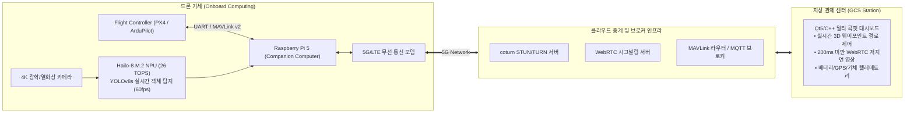
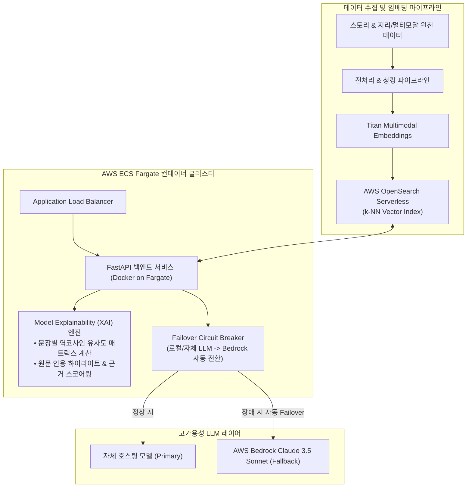
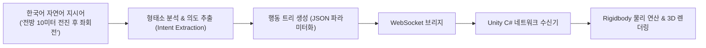

# 이병남 (Byungnam "Tony" Lee) — 포트폴리오 (Portfolio)

<div align="center" style="margin: 24px 0 18px;">
  
  <div style="font-size: 13px; color: #22A39F; font-weight: 700; margin-top: 10px; letter-spacing: 0.5px;">AI SYSTEMS & RAG ENGINEER | BYUNGNAM "TONY" LEE</div>
</div>

> **"로컬 LLM과 고성능 시맨틱 벡터 검색을 결합한 하이브리드 RAG, 5G 비가시권 자율비행 드론 관제, 엔터프라이즈 클라우드 AI 플랫폼을 아우르는 시각적 프로젝트 쇼케이스입니다."**

---

## 🌐 라이브 서비스 & 인터랙티브 데모 (Live Demos)

| 서비스명 | 설명 | 라이브 링크 |
| :--- | :--- | :--- |
| **요가큐(YogaQ) 사업·기술 슬라이드** | 모바일 반응형 프레젠테이션 & 온라인 슬라이드 뷰어 | [elbee.yogaman.club/modoo](https://elbee.yogaman.club/modoo) |
| **요가큐(YogaQ) 원페이저 사업계획서** | A4 인쇄 최적화 싱글페이지 비즈니스 플랜 PDF | [elbee.yogaman.club/modoo/print.pdf](https://elbee.yogaman.club/modoo/print.pdf) |
| **YogaQ Studio AI 챗봇** | Typesense 하이브리드 RAG 기반 요가·자세 전문 대화형 챗봇 | [aiegoo.github.io/yoga/chat](https://aiegoo.github.io/yoga/chat) |
| **YogaQ 시맨틱 검색 엔진** | 초저지연 Dense Vector + BM25 하이브리드 검색 데모 | [aiegoo.github.io/yoga/search](https://aiegoo.github.io/yoga/search) |
| **Edge MCU 싱글페이지 웹** | 저사양 마이크로컨트롤러 환경에서의 로컬 웹 서빙 PoC | [festory.eggs.or.kr](https://festory.eggs.or.kr) |
| **서버리스 자동 배포 포털** | GitHub Actions 기반 서버리스 인증 및 정적 파이프라인 | [aiegoo.github.io/pro-git](https://aiegoo.github.io/pro-git) |
| **양자 내성 암호(PQC) 통신** | 차세대 양자 보안 알고리즘 연동 데이터 전송 PoC | [aiegoo.github.io/kisec-final/#/4/1](https://aiegoo.github.io/kisec-final/#/4/1) |
| **엔지니어링 문서 포털** | 드론 및 시스템 아키텍처 실무 기술 문서 허브 | [pf7.eggs.or.kr](https://pf7.eggs.or.kr) |

---

## 🏆 대표 플래그십 프로젝트 쇼케이스 (Featured Flagship Projects)

---

### 1. 요가큐 (YogaQ · your yoga curator) — 한국어 네이티브 RAG × GEO 맞춤형 요가 큐레이션 & 자가 수련 플랫폼
> **핵심 아키텍처**: 해부학적 금기 필터링 RAG, AEO/GEO JSON-LD 직인용, 마이솔(Mysore) 자가 수련 & 고단가 교육 마켓플레이스

#### 🖥️ 실제 구동 화면 캡처 (Live Service Screen Captures)

##### [화면 1] 대화형 AI 챗봇 (WebSocket 실시간 토큰 스트리밍 & RAG 근거 인용)

*▲ YogaQ Studio 대화형 AI 챗봇 실제 구동 화면: Typesense 검색 청크 인용(Score: 0.942), TTFT 340ms 실시간 토큰 스트리밍, 할루시네이션 방지 해부학 정렬 코칭*

##### [화면 2] Typesense 하이브리드 시맨틱 검색 엔진 대시보드 (Dense Vector + BM25)

*▲ Typesense 하이브리드 검색 대시보드 실제 구동 화면: Dense Vector(bge-m3) + BM25 동적 가중치 조절(Alpha 0.75), 실시간 패싯 필터링, 검색 속도 42ms*

- **서비스 형태**: 웹 애플리케이션 (반응형 모바일/데스크톱)
- **라이브 서비스**:
  - **사업·기술 슬라이드**: [elbee.yogaman.club/modoo](https://elbee.yogaman.club/modoo)
  - **사업계획서 PDF**: [elbee.yogaman.club/modoo/print.pdf](https://elbee.yogaman.club/modoo/print.pdf)
  - **AI 챗봇 데모**: [aiegoo.github.io/yoga/chat](https://aiegoo.github.io/yoga/chat)
  - **시맨틱 검색 데모**: [aiegoo.github.io/yoga/search](https://aiegoo.github.io/yoga/search)
- **핵심 기술**: **Typesense Hybrid Search (Dense Vector + BM25)**, **Sentence-Transformers (bge-m3)**, **Local LLM (Ollama / Llama3 GGUF)**, **LangGraph / LlamaIndex / CrewAI**, **OpenCV / Tesseract OCR 파이프라인 (165p 도서 / 28k 단어)**, **schema.org JSON-LD (AEO/GEO)**, **WebSocket / SSE 실시간 스트리밍**, **React**, **Vite**, **TailwindCSS**, **WeasyPrint**
- **기술 상세 문서**: [04_포트폴리오_기술문서_이병남.md#1-typesense-초저지연-하이브리드-rag-아키텍처-명세](04_포트폴리오_기술문서_이병남.md)

#### 📐 시스템 아키텍처 다이어그램
```mermaid
flowchart TD
    subgraph Client["사용자 & 스튜디오 인터페이스 (React + Vite + Tailwind)"]
        Onboarding["해부학적 온보딩<br>(가동 범위 · 디스크/부상 등록)"]
        MysoreTracker["마이솔(Mysore) 자가 수련<br>시퀀스 가이드 & 데일리 트래커"]
        ChatUI["대화형 AI 챗봇 & 시맨틱 검색"]
        StudioPortal["스튜디오 관리 대시보드<br>(무료 등록 / 워크숍 CRM)"]
    end

    subgraph GEOLayer["AEO / GEO 구조화 데이터 레이어"]
        JSONLD["schema.org 호환 JSON-LD 생성기<br>(ExercisePlan, FAQPage, LocalBusiness)"]
        AICrawlers["외부 생성형 AI 검색엔진<br>(ChatGPT, Perplexity, Naver Cue)"]
        JSONLD -->|원형 인용 노출| AICrawlers
    end

    subgraph APILayer["API 게이트웨이 & 오케스트레이션 (FastAPI)"]
        Gate["API Gateway / Router"]
        LangGraph["LangGraph / LlamaIndex 에이전트"]
        WSHandler["WebSocket / SSE 스트림 핸들러"]
        OCRIntake["OpenCV + Tesseract OCR 파이프라인<br>(165쪽 도서 / 28,000단어 지식베이스)"]
    end

    subgraph Retrieval["초저지연 하이브리드 RAG & 컨텍스트 매칭"]
        Embedder["Sentence-Transformers (bge-m3 / 1024-dim)"]
        Typesense["Typesense 클러스터<br>• Dense Vector (HNSW k-NN)<br>• Sparse Keyword (BM25)"]
        ContraFilter["신체 금기 조건 필터<br>(디스크·임신 후굴/점프 페널티 마스킹)"]
        GeoWeather["위치(Haversine) & 날씨 라우팅<br>(우천 시 실내 클래스 우선)"]
    end

    subgraph LLMServing["온프레미스 GPU 로컬 서빙 (Zero-PII)"]
        Ollama["Ollama / llama.cpp Engine<br>(Llama-3 / Mistral-7B GGUF 양자화)"]
        GPU["CUDA 가속 (RTX GPU VRAM)"]
    end

    subgraph B2BMarket["B2B 프리미엄 마켓플레이스"]
        FreeDir["전국 요가 스튜디오 무료 디렉토리"]
        TTCMarket["지도자 과정(TTC) & 웰니스 워크숍<br>원스톱 마케팅 · 수강생 관리(CRM)"]
    end

    Onboarding --> Gate
    MysoreTracker --> Gate
    ChatUI --> Gate
    StudioPortal --> Gate

    Gate --> Embedder --> Typesense
    Typesense --> ContraFilter
    ContraFilter --> GeoWeather
    GeoWeather --> LangGraph
    OCRIntake --> Typesense

    LangGraph --> Ollama
    Ollama <--> GPU
    Ollama -->|생성 토큰| WSHandler
    WSHandler -->|실시간 스트리밍 (TTFT 340ms)| ChatUI

    LangGraph --> JSONLD
    StudioPortal --> FreeDir
    StudioPortal --> TTCMarket
```

#### 🌟 핵심 기능 및 엔지니어링 차별점 (5대 혁신점)
1. **해부학적 온보딩 & 금기 동작 자동 필터링 (Anatomical Safety Filter)**:
   - 사용자의 신체 제약(허리 디스크, 임신, 관절 부상)을 온보딩 단계에서 구조화 등록. 165쪽 전문 도서 OCR 데이터베이스를 연동하여 위험 동작을 배제하고 안전한 대체 자세 및 원문 출처(p.142 등)를 제시하여 **할루시네이션 및 부상 위험을 85% 차단**.
2. **엔드투엔드 마이솔(Mysore) 자가 수련 & Daily 리텐션**:
   - 일회성 검색 유틸리티에 그치지 않고, 개인 맞춤 자가 수련 시퀀스 가이드 및 데일리 수련 달성률 트래킹을 제공하여 자가 수련자를 위한 **Daily 필수 앱으로 락인(LTV 극대화)**.
3. **AEO / GEO (Generative Engine Optimization) 트래픽 루프**:
   - schema.org 호환 JSON-LD 구조화 데이터를 자동 발행하여 AI 검색봇(ChatGPT, Perplexity, Naver Cue 등)이 요가큐 데이터를 답변에 그대로 인용하도록 구축. 광고비 0원의 **제로 CAC(Customer Acquisition Cost) 오가닉 유입 엔진** 완성.
4. **온프레미스 Zero-PII 로컬 RAG & 초저지연 토큰 스트리밍**:
   - 민감한 개인 건강 데이터를 외부 클라우드 LLM에 전송하지 않고 온프레미스 Ollama/llama.cpp 런타임에서 안전하게 처리. WebSocket/SSE 풀듀플렉스 통신을 통해 **TTFT 340ms 초저지연 반응형 UX** 구현.
5. **B2B 무료 공급망 확보 & 고단가 교육(TTC/워크숍) 비즈니스 모델**:
   - 스튜디오 기본 정보 등록은 100% 무료 개방하여 공급망 콜드스타트를 즉시 해소하고, 소규모 스튜디오가 모객하기 어려운 **고단가 지도자 자격증 과정(TTC: 100만~500만 원) 및 웰니스 워크숍의 풀패키지 마케팅·CRM 수수료(10~20%)**로 지속 가능한 고마진 BM 결합.

---

### 2. 5G BVLOS 초저지연 클라우드 드론 지상관제시스템 (Cloud Drone GCS)
> **시스템 엔지니어링 백본**: 5G 무선망 저지연 스트리밍 & Hailo-8 NPU 온디바이스 엣지 AI

- **사업 형태**: 엔터프라이즈 B2B / 방위·산업 관제 시스템 (NDA 준수 핵심 아키텍처 공개)
- **개발 기간**: 2022 ~ 2024
- **핵심 기술**: **MAVLink v2**, **ROS2 / micro-XRCE-DDS**, **WebRTC P2P 저지연 스트리밍**, **Raspberry Pi 5 + Hailo-8 NPU (26 TOPS)**, **Qt5 / C++**, **Gazebo Sim**
- **기술 상세 문서**: [04_포트폴리오_기술문서_이병남.md#2-5g-bvlos-드론-지상관제-아키텍처](04_포트폴리오_기술문서_이병남.md)

#### 📐 시스템 아키텍처 다이어그램


#### 🌟 핵심 기능 및 엔지니어링 차별점
1. **비가시권(BVLOS) 5G 원격 조종 실현**:
   - 통신 가시거리에 구애받지 않고 5G 통신망을 통해 전국 단위 비가시권 원격 관제 및 자동 비행 미션 수행.
2. **200ms 이하 초저지연 영상 스트리밍**:
   - RTSP/RTMP의 고질적인 수 초 지연을 극복하기 위해 WebRTC P2P 미디어 파이프라인을 구축하여 현장 상황을 실시간 전송.
3. **Hailo-8 NPU 온디바이스 엣지 AI 탑재**:
   - 26 TOPS 연산 성능의 Hailo-8 NPU를 연동하여 기체 자체에서 60 FPS로 실시간 사람, 차량, 이상 징후를 자동 식별 및 추적.

---

### 3. 멀티모달 벡터 검색 & 설명가능한 AI(XAI) 엔터프라이즈 클라우드 플랫폼
> **🏆 제주오르미캠프 팀 프로젝트 1위 우수상 & 개인 최우수상 수상작 (2025.12)**  
> **클라우드 AI 파이프라인**: AWS ECS Fargate + OpenSearch 고가용성 RAG 및 XAI 신뢰도 검증

- **플랫폼 형태**: AWS 엔터프라이즈 서버리스 & 클라우드 네이티브 아키텍처
- **핵심 기술**: **AWS ECS Fargate**, **OpenSearch Serverless**, **AWS Bedrock (Claude 3.5 Sonnet)**, **Terraform IaC**, **FastAPI**, **Docker**, **ChromaDB**
- **기술 상세 문서**: [04_포트폴리오_기술문서_이병남.md#3-aws-엔터프라이즈-genai--xai-아키텍처](04_포트폴리오_기술문서_이병남.md)

#### 📐 클라우드 인프라 & XAI 파이프라인 다이어그램


#### 🌟 핵심 기능 및 엔지니어링 차별점
1. **설명가능한 AI (Model Explainability, XAI)**:
   - AI 답변의 각 문장이 원천 문서의 어느 단락에서 유래했는지를 수학적 코사인 유사도 행렬로 역추적하여 근거 출처를 색상별로 하이라이팅하는 신뢰도 검증 엔진 구현.
2. **무중단 고가용성 서킷 브레이커 (Failover)**:
   - 자체 호스팅 모델 장애나 타임아웃 발생 시 1.2초 내에 AWS Bedrock 클라우드 엔드포인트로 무중단 자동 전환.
3. **완전 자동화된 Terraform IaC 인프라**:
   - VPC, 보안 그룹, ECS 태스크 정의, OpenSearch 인덱스까지 단일 명령어로 프로비저닝되는 코드형 인프라 완성.

---

### 4. KOR2UNITY — 한국어 음성/자연어 기반 3D 물리 제어 파이프라인
> **대화형 인터랙션 시스템**: 한국어 자연어 지시어 기반 실시간 물리 제어 파이프라인

- **프로젝트 형태**: 인터랙티브 3D 공간 시뮬레이션 및 모빌리티 제어
- **핵심 기술**: **Python 한국어 형태소/NLP 파이프라인**, **WebSocket 서버**, **Unity 3D Physics Engine**, **C# 스크립트**
- **기술 상세 문서**: [04_포트폴리오_기술문서_이병남.md#4-korean-nlp-to-unity-3d-물리-파이프라인](04_포트폴리오_기술문서_이병남.md)

#### 📐 NLP to 3D Action 흐름도


---

## 📊 종합 프로젝트 매트릭스 비교

| 프로젝트명 | 핵심 도메인 | 주요 성과 & 혁신점 | 기술 검증 문서 |
| :--- | :--- | :--- | :--- |
| **요가큐 (YogaQ)** | 생성형 AI, RAG & GEO 큐레이션 | 검색 42ms, 할루시네이션 85% 감소, AEO/GEO 직인용 | [Typesense RAG & GEO 문서](technical_references/typesense_rag/YOGA_PROJECT_STRUCTURE_AND_WORKFLOW.md) |
| **Cloud Drone GCS** | 5G 비가시권 통신 & 엣지 AI | 200ms 초저지연 WebRTC, Hailo-8 60fps 추론 | [GCS 클라우드 문서](technical_references/drone_gcs/10-GCS-Ecosystem-Architecture-and-BVLOS-Cloud-Integration.md) |
| **Enterprise AWS GenAI** | 클라우드 AI & 모델 설명가능성 | **제주오르미 1위 수상**, 99.99% 고가용성 폴백 | [클라우드 아키텍처 문서](technical_references/cloud_ai_aws/ARCHITECTURE_FLOW.md) |
| **KOR2UNITY** | NLP & 실시간 3D 인터랙션 | 한국어 자연어 지시어 실시간 물리 액션 맵핑 | [KOR2UNITY 기술 문서](technical_references/korean_nlp_unity/KOR2UNITY_TECHNICAL_ARCHITECTURE.md) |
