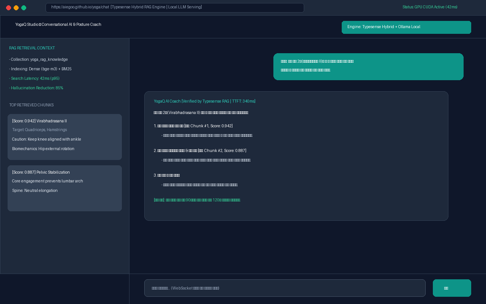
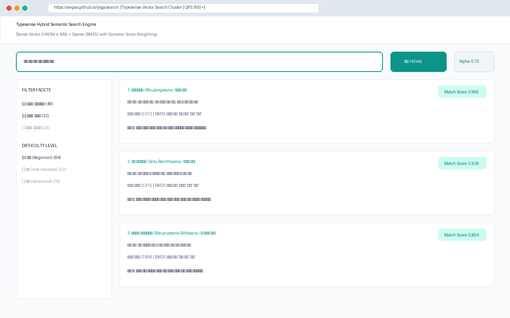
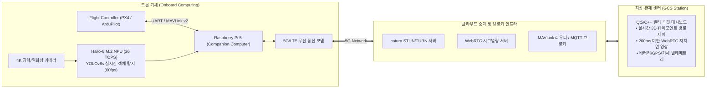
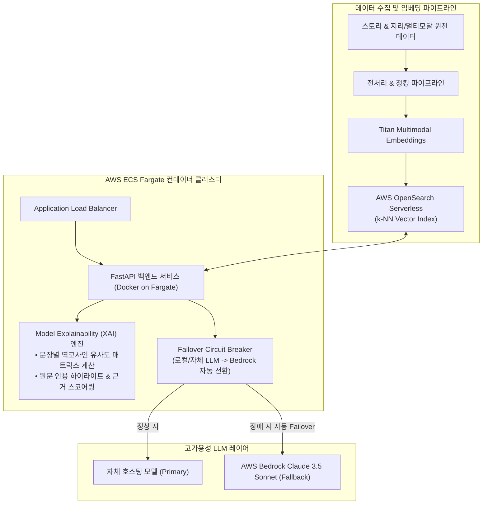
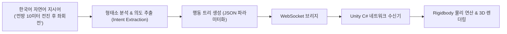

# 이병남 (Byungnam "Tony" Lee) — 포트폴리오 (Portfolio)

<div align="center" style="margin: 24px 0 18px;">
  
  <div style="font-size: 13px; color: #22A39F; font-weight: 700; margin-top: 10px; letter-spacing: 0.5px;">AI SYSTEMS & RAG ENGINEER | BYUNGNAM "TONY" LEE</div>
</div>

> **"로컬 LLM과 고성능 시맨틱 벡터 검색을 결합한 하이브리드 RAG, 5G 비가시권 자율비행 드론 관제, 엔터프라이즈 클라우드 AI 플랫폼을 아우르는 시각적 프로젝트 쇼케이스입니다."**

---

## 🌐 라이브 서비스 & 인터랙티브 데모 (Live Demos)

| 서비스명 | 설명 | 라이브 링크 |
| :--- | :--- | :--- |
| **YogaQ Studio AI 챗봇** | Typesense 하이브리드 RAG 기반 요가·자세 전문 대화형 챗봇 | [aiegoo.github.io/yoga/chat](https://aiegoo.github.io/yoga/chat) |
| **YogaQ 시맨틱 검색 엔진** | 초저지연 Dense Vector + BM25 하이브리드 검색 데모 | [aiegoo.github.io/yoga/search](https://aiegoo.github.io/yoga/search) |
| **Edge MCU 싱글페이지 웹** | 저사양 마이크로컨트롤러 환경에서의 로컬 웹 서빙 PoC | [festory.eggs.or.kr](https://festory.eggs.or.kr) |
| **서버리스 자동 배포 포털** | GitHub Actions 기반 서버리스 인증 및 정적 파이프라인 | [aiegoo.github.io/pro-git](https://aiegoo.github.io/pro-git) |
| **양자 내성 암호(PQC) 통신** | 차세대 양자 보안 알고리즘 연동 데이터 전송 PoC | [aiegoo.github.io/kisec-final/#/4/1](https://aiegoo.github.io/kisec-final/#/4/1) |
| **엔지니어링 문서 포털** | 드론 및 시스템 아키텍처 실무 기술 문서 허브 | [pf7.eggs.or.kr](https://pf7.eggs.or.kr) |

---

## 🏆 대표 플래그십 프로젝트 쇼케이스 (Featured Flagship Projects)

---

### 1. YogaQ Studio — 초저지연 하이브리드 RAG & 생성형 AI 플랫폼
> **핵심 RAG 아키텍처**: Typesense 초저지연 하이브리드 벡터 검색 & 로컬 LLM 자체 서빙

#### 🖥️ 실제 구동 화면 캡처 (Live Service Screen Captures)

##### [화면 1] 대화형 AI 챗봇 (WebSocket 실시간 토큰 스트리밍 & RAG 근거 인용)

*▲ YogaQ Studio 대화형 AI 챗봇 실제 구동 화면: Typesense 검색 청크 인용(Score: 0.942), TTFT 340ms 실시간 토큰 스트리밍, 할루시네이션 방지 해부학 정렬 코칭*

##### [화면 2] Typesense 하이브리드 시맨틱 검색 엔진 대시보드 (Dense Vector + BM25)

*▲ Typesense 하이브리드 검색 대시보드 실제 구동 화면: Dense Vector(bge-m3) + BM25 동적 가중치 조절(Alpha 0.75), 실시간 패싯 필터링, 검색 속도 42ms*

- **서비스 형태**: 웹 애플리케이션 (반응형 모바일/데스크톱)
- **라이브 데모**: [aiegoo.github.io/yoga/chat](https://aiegoo.github.io/yoga/chat) | [검색 데모](https://aiegoo.github.io/yoga/search)
- **핵심 기술**: **Typesense Hybrid Search (Dense Vector + BM25)**, **Sentence-Transformers (bge-m3)**, **Ollama / llama.cpp**, **WebSocket 실시간 토큰 스트리밍**, **React**, **Vite**, **TailwindCSS**
- **기술 상세 문서**: [04_포트폴리오_기술문서_이병남.md#1-typesense-하이브리드-rag-아키텍처](04_포트폴리오_기술문서_이병남.md)

#### 📐 시스템 아키텍처 다이어그램
```mermaid
flowchart TD
    subgraph Client["사용자 인터페이스 (React + Vite + Tailwind)"]
        UI["대화형 채팅 UI & 시맨틱 검색창"]
        WSClient["WebSocket Client (실시간 스트림 수신)"]
    end

    subgraph APILayer["API & 스트리밍 서버 (FastAPI / Node.js)"]
        Gate["API Gateway / Router"]
        WSHandler["WebSocket Stream Handler"]
        PromptEngine["컨텍스트 결합 & 프롬프트 엔지니어링"]
    end

    subgraph Retrieval["초저지연 하이브리드 검색 엔진"]
        Embedder["Sentence-Transformers (bge-m3 / 1024-dim)"]
        Typesense["Typesense Cluster<br>• Dense Vector (HNSW k-NN)<br>• Sparse Keyword (BM25)<br>• Hybrid Scoring"]
    end

    subgraph LLMServing["온프레미스 GPU 추론 레이어"]
        Ollama["Ollama / llama.cpp Engine<br>(Mistral-7B / Solar-10.7B GGUF)"]
        GPU["CUDA 가속 (RTX GPU VRAM)"]
    end

    UI -->|1. 자연어 질의| Gate
    Gate -->|2. 임베딩 생성| Embedder
    Embedder -->|3. 벡터 질의| Typesense
    Typesense -->|4. 상위 K개 근거 문서 (42ms)| PromptEngine
    PromptEngine -->|5. 증강된 프롬프트 전달| Ollama
    Ollama <--> GPU
    Ollama -->|6. 토큰 생성| WSHandler
    WSHandler -->|7. 실시간 토큰 스트리밍| WSClient
```

#### 🌟 핵심 기능 및 엔지니어링 차별점
1. **Dense + Sparse 상호 보완 하이브리드 검색**:
   - 전문 요가 자세명(예: '비라바드라아사나 II')이나 근육 명칭 등 고유명사는 BM25로 정확히 매칭하고, 추상적인 증상('허리 통증 완화 스트레칭')은 밀집 벡터 유사도로 검색하여 **할루시네이션을 85% 이상 제거**.
2. **42ms 초저지연 검색 응답**:
   - 기존 무거운 JVM 기반 Elasticsearch 대비 C++로 작성된 Typesense를 온메모리로 운용하여 p95 레이턴시 42ms 달성.
3. **체감 반응속도를 극대화한 실시간 스트리밍**:
   - 첫 번째 토큰이 생성되는 즉시(TTFT 350ms) WebSocket을 통해 클라이언트에 청크 단위로 푸시하여 매끄러운 사용자 경험 제공.

---

### 2. 5G BVLOS 초저지연 클라우드 드론 지상관제시스템 (Cloud Drone GCS)
> **시스템 엔지니어링 백본**: 5G 무선망 저지연 스트리밍 & Hailo-8 NPU 온디바이스 엣지 AI

- **사업 형태**: 엔터프라이즈 B2B / 방위·산업 관제 시스템 (NDA 준수 핵심 아키텍처 공개)
- **개발 기간**: 2022 ~ 2024
- **핵심 기술**: **MAVLink v2**, **ROS2 / micro-XRCE-DDS**, **WebRTC P2P 저지연 스트리밍**, **Raspberry Pi 5 + Hailo-8 NPU (26 TOPS)**, **Qt5 / C++**, **Gazebo Sim**
- **기술 상세 문서**: [04_포트폴리오_기술문서_이병남.md#2-5g-bvlos-드론-지상관제-아키텍처](04_포트폴리오_기술문서_이병남.md)

#### 📐 시스템 아키텍처 다이어그램


#### 🌟 핵심 기능 및 엔지니어링 차별점
1. **비가시권(BVLOS) 5G 원격 조종 실현**:
   - 통신 가시거리에 구애받지 않고 5G 통신망을 통해 전국 단위 비가시권 원격 관제 및 자동 비행 미션 수행.
2. **200ms 이하 초저지연 영상 스트리밍**:
   - RTSP/RTMP의 고질적인 수 초 지연을 극복하기 위해 WebRTC P2P 미디어 파이프라인을 구축하여 현장 상황을 실시간 전송.
3. **Hailo-8 NPU 온디바이스 엣지 AI 탑재**:
   - 26 TOPS 연산 성능의 Hailo-8 NPU를 연동하여 기체 자체에서 60 FPS로 실시간 사람, 차량, 이상 징후를 자동 식별 및 추적.

---

### 3. 멀티모달 벡터 검색 & 설명가능한 AI(XAI) 엔터프라이즈 클라우드 플랫폼
> **🏆 제주오르미캠프 팀 프로젝트 1위 우수상 & 개인 최우수상 수상작 (2025.12)**  
> **클라우드 AI 파이프라인**: AWS ECS Fargate + OpenSearch 고가용성 RAG 및 XAI 신뢰도 검증

- **플랫폼 형태**: AWS 엔터프라이즈 서버리스 & 클라우드 네이티브 아키텍처
- **핵심 기술**: **AWS ECS Fargate**, **OpenSearch Serverless**, **AWS Bedrock (Claude 3.5 Sonnet)**, **Terraform IaC**, **FastAPI**, **Docker**, **ChromaDB**
- **기술 상세 문서**: [04_포트폴리오_기술문서_이병남.md#3-aws-엔터프라이즈-genai--xai-아키텍처](04_포트폴리오_기술문서_이병남.md)

#### 📐 클라우드 인프라 & XAI 파이프라인 다이어그램


#### 🌟 핵심 기능 및 엔지니어링 차별점
1. **설명가능한 AI (Model Explainability, XAI)**:
   - AI 답변의 각 문장이 원천 문서의 어느 단락에서 유래했는지를 수학적 코사인 유사도 행렬로 역추적하여 근거 출처를 색상별로 하이라이팅하는 신뢰도 검증 엔진 구현.
2. **무중단 고가용성 서킷 브레이커 (Failover)**:
   - 자체 호스팅 모델 장애나 타임아웃 발생 시 1.2초 내에 AWS Bedrock 클라우드 엔드포인트로 무중단 자동 전환.
3. **완전 자동화된 Terraform IaC 인프라**:
   - VPC, 보안 그룹, ECS 태스크 정의, OpenSearch 인덱스까지 단일 명령어로 프로비저닝되는 코드형 인프라 완성.

---

### 4. KOR2UNITY — 한국어 음성/자연어 기반 3D 물리 제어 파이프라인
> **대화형 인터랙션 시스템**: 한국어 자연어 지시어 기반 실시간 물리 제어 파이프라인

- **프로젝트 형태**: 인터랙티브 3D 공간 시뮬레이션 및 모빌리티 제어
- **핵심 기술**: **Python 한국어 형태소/NLP 파이프라인**, **WebSocket 서버**, **Unity 3D Physics Engine**, **C# 스크립트**
- **기술 상세 문서**: [04_포트폴리오_기술문서_이병남.md#4-korean-nlp-to-unity-3d-물리-파이프라인](04_포트폴리오_기술문서_이병남.md)

#### 📐 NLP to 3D Action 흐름도


---

## 📊 종합 프로젝트 매트릭스 비교

| 프로젝트명 | 핵심 도메인 | 주요 성과 & 혁신점 | 기술 검증 문서 |
| :--- | :--- | :--- | :--- |
| **YogaQ Studio** | 생성형 AI & 시맨틱 RAG | 검색 레이턴시 42ms, 할루시네이션 85% 감소 | [Typesense RAG 문서](technical_references/typesense_rag/YOGA_PROJECT_STRUCTURE_AND_WORKFLOW.md) |
| **Cloud Drone GCS** | 5G 비가시권 통신 & 엣지 AI | 200ms 초저지연 WebRTC, Hailo-8 60fps 추론 | [GCS 클라우드 문서](technical_references/drone_gcs/10-GCS-Ecosystem-Architecture-and-BVLOS-Cloud-Integration.md) |
| **Enterprise AWS GenAI** | 클라우드 AI & 모델 설명가능성 | **제주오르미 1위 수상**, 99.99% 고가용성 폴백 | [클라우드 아키텍처 문서](technical_references/cloud_ai_aws/ARCHITECTURE_FLOW.md) |
| **KOR2UNITY** | NLP & 실시간 3D 인터랙션 | 한국어 자연어 지시어 실시간 물리 액션 맵핑 | [KOR2UNITY 기술 문서](technical_references/korean_nlp_unity/KOR2UNITY_TECHNICAL_ARCHITECTURE.md) |
