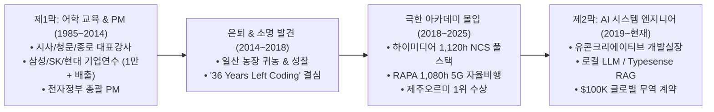

# 이병남 (Byungnam "Tony" Lee) — AI 시스템 & RAG 엔지니어 채용 패키지

  
  
AI SYSTEMS & RAG ENGINEER | BYUNGNAM "TONY" LEE

> **"로컬 LLM과 고성능 시맨틱 벡터 검색을 결합한 하이브리드 RAG, 5G 비가시권(BVLOS) 자율비행 드론 관제, 엔터프라이즈 클라우드 AI 플랫폼을 아우르는 2026년 채용 전형 종합 포트폴리오입니다."**

---

## 📌 2026 채용 전형 4대 핵심 서류 (Core Application Package)

한국 테크 기업 및 AI 스타트업 채용 전형의 표준에 맞추어 **4가지 독립된 핵심 서류**를 제공합니다:

| 문서 구분 | 문서 파일명 | 온라인 웹 뷰어 | 대상 및 핵심 목적 |
| :--- | :--- | :--- | :--- |
| **1. 이력서 (Resume)** | [01_이력서_이병남.md](01_이력서_이병남.md) | [웹 뷰어](docs/portfolio.html?tab=tab-resume) / [인쇄용](docs/resume_latest.html) | • 30초 스크리닝 요약본 • 기본 인적사항, 핵심 스택, 학력(미 메릴랜드대), 자격증, 경력 요약 |
| **2. 경력 기술서 (CV)** | [02_경력기술서_이병남.md](02_경력기술서_이병남.md) | [경력 기술서 뷰어](docs/portfolio.html?tab=tab-career) | • 실무 역량 및 문제 해결 능력 심층 검증 • 인생 피봇 스토리(27년 교육 -> 4년 은퇴/귀농 -> 3,000h 아카데미 -> 2막 AI) • 전 직무 STAR 상세 기술 & 정량적 성과($100K 수출, 레이턴시 42ms) |
| **3. 포트폴리오 (Portfolio)** | [03_포트폴리오_이병남.md](03_포트폴리오_이병남.md) | [포트폴리오 쇼케이스](docs/portfolio.html?tab=tab-portfolio) | • 시각적 결과물 및 아키텍처 다이어그램 • 4대 플래그십 시스템(YogaQ RAG, 5G 드론 GCS, 오르미 1위 AWS GenAI, KOR2UNITY) • 시스템 구조도 및 UI/UX 시연 |
| **4. 포트폴리오 기술 문서 (Dossier)** | [04_포트폴리오_기술문서_이병남.md](04_포트폴리오_기술문서_이병남.md) | [기술 문서 뷰어](docs/portfolio.html?tab=tab-tech) | • CTO, 테크 리드, 아키텍트 전용 딥다이브 명세 • Typesense 스키마/가중치 수식, MAVLink 어댑터, XAI 알고리즘, 벤치마크 표, 트러블슈팅 |

---

## 🌐 인터랙티브 웹 포털 & 라이브 데모 (Interactive Demos)

- **종합 웹 포트폴리오 (4개 문서 탭 전환 & PDF 인쇄)**: [docs/portfolio.html](docs/portfolio.html)
- **이력서 최신 웹 버전 (KO/EN 언어 토글 지원)**: [docs/resume_latest.html](docs/resume_latest.html)
- **메인 포트폴리오 웹사이트**: [docs/index.html](docs/index.html)
- **라이브 서비스 데모**:
  - **요가큐(YogaQ) 사업·기술 슬라이드**: [elbee.yogaman.club/modoo](https://elbee.yogaman.club/modoo)
  - **요가큐(YogaQ) 원페이저 사업계획서 PDF**: [elbee.yogaman.club/modoo/print.pdf](https://elbee.yogaman.club/modoo/print.pdf)
  - **YogaQ Studio 대화형 AI 챗봇**: [aiegoo.github.io/yoga/chat](https://aiegoo.github.io/yoga/chat)
  - **YogaQ Studio 시맨틱 검색 데모**: [aiegoo.github.io/yoga/search](https://aiegoo.github.io/yoga/search)
  - **Edge MCU 싱글페이지 웹 서빙 (SPA on Edge)**: [festory.eggs.or.kr](https://festory.eggs.or.kr)
  - **GitHub Actions 기반 서버리스 인증/배포**: [aiegoo.github.io/pro-git](https://aiegoo.github.io/pro-git)
  - **양자 내성 암호(PQC) 통신 PoC**: [aiegoo.github.io/kisec-final/#/4/1](https://aiegoo.github.io/kisec-final/#/4/1)
  - **엔지니어링 문서 포털**: [pf7.eggs.or.kr](https://pf7.eggs.or.kr)

---

## 🧭 커리어 피봇 & 배경 스토리 요약 (Career Narrative)

1. **[1985 ~ 2014] 제1막: 27년간의 탑티어 교육자 & 대기업 비즈니스 컨설턴트**
   - 미국 메릴랜드대학교 학사 출신(TOEFL 627)으로 시사/청문/종로 대표강사로 10,000명 이상의 글로벌 인재 양성.
   - 삼성HP, SK, 현대 등 대기업 사내 연수 및 전자정부 대형 프로젝트 총괄 PM 수행.
2. **[2014 ~ 2018] 전환점: 은퇴, 일산 텃밭 귀농, 그리고 "36년의 소명"**
   - 27년 교육 커리어 은퇴 후 고양시 일산에서 4년간 소규모 농장을 운영하며 삶을 성찰.
   - *"남은 36년을 죽음을 기다리며 살 것인가, 36년간 코딩을 창작하며 살 것인가 (36 years left dying vs coding)"*라는 실존적 질문 앞에 소프트웨어 엔지니어로 100% 완전 전업 결심.
3. **[2018 ~ 2025] 혹독한 재교육: 3,000시간 이상의 고강도 아카데미**
   - **하이미디어 아카데미 (1,120시간)**: 매일 8시간 수업 + 원서 320시간 독파로 풀스택 기초 완성.
   - **한국전파진흥협회 RAPA (1,080시간)**: C++, ROS, Gazebo, 초경량 1종 조종자(1,000+ 시간) 취득.
   - **제주오르미캠프 (AI/Cloud)**: AWS ECS Fargate, OpenSearch, Bedrock, XAI 아키텍처로 **팀 프로젝트 1위 우수상 & 개인 최우수상** 수상.
4. **[2019 ~ 현재] 제2막: 현업 풀스택 & AI 시스템 엔지니어**
   - 유콘크리에이티브 개발실장, 제이디랩 수석연구원, 하이테크 개발팀장 재직.
   - 카자흐스탄 $100,000 무역 계약 성사 및 5개국 기술 교류 MOU 주도.

---

## 📚 실무 아키텍처 기술 레퍼런스 색인 (15 Architecture Documents)

WSL 환경(`\\wsl.localhost\Ubuntu-22.04\home\aiegoo\repos`)에서 검증하여 복사된 15개 실무 엔지니어링 문서가 [technical_references/](technical_references/README.md)에 보관되어 있습니다:

- **1. 드론 & 지상관제 (Drone GCS)**: [BVLOS 클라우드 관제](technical_references/drone_gcs/10-GCS-Ecosystem-Architecture-and-BVLOS-Cloud-Integration.md) | [이기종 어댑터](technical_references/drone_gcs/09-Heterogeneous-Drone-SDK-Adapters-and-Fleet-GCS.md) | [GCS 제품 명세](technical_references/drone_gcs/18-Heterogeneous-GCS-Product-and-Evidence-Briefing.md) | [Gazebo 시뮬레이션](technical_references/drone_gcs/13-Gazebo-Sim-Harmonic-Fleet-Actuation-and-Cockpit-Integration.md) | [Hailo-8 NPU 사양](technical_references/drone_gcs/hardware_specs_rpi5_hailo8.md)
- **2. Typesense & 로컬 LLM RAG**: [엔드-투-엔드 구조](technical_references/typesense_rag/YOGA_PROJECT_STRUCTURE_AND_WORKFLOW.md) | [클러스터 셋업](technical_references/typesense_rag/TYPESENSE_SETUP.md) | [아키텍처 다이어그램](technical_references/typesense_rag/ARCHITECTURE_VISUAL_DIAGRAM.md) | [인프라 세부 명세](technical_references/typesense_rag/INFRASTRUCTURE_SETUP.md)
- **3. AWS 클라우드 & XAI**: [클라우드 아키텍처 플로우](technical_references/cloud_ai_aws/ARCHITECTURE_FLOW.md) | [모델 설명가능성(XAI)](technical_references/cloud_ai_aws/MODEL_EXPLAINABILITY.md) | [OpenSearch 마이그레이션](technical_references/cloud_ai_aws/AWS_ENDPOINTS_AND_CHROMADB_MIGRATION.md) | [Bedrock 자동 폴백](technical_references/cloud_ai_aws/AWS_BEDROCK_FALLBACK_GUIDE.md)
- **4. 한국어 NLP & Unity 3D**: [KOR2UNITY 기술 아키텍처](technical_references/korean_nlp_unity/KOR2UNITY_TECHNICAL_ARCHITECTURE.md) | [퀵스타트 가이드](technical_references/korean_nlp_unity/KOR2UNITY_QUICK_START.md)
