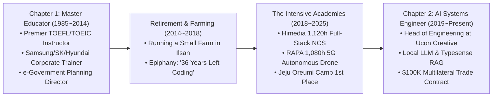

# Byungnam (Tony) Lee
### AI Systems & LLM/RAG Engineer

  
  
AI SYSTEMS & RAG ENGINEER | BYUNGNAM "TONY" LEE

- **Email**: xraiegoo@gmail.com / aiegoo@naver.com
- **Phone**: +82 10-2544-1197
- **GitHub**: [github.com/aiegoo](https://github.com/aiegoo)
- **Live Demos**:
  - Typesense Semantic Search & Conversational RAG: [aiegoo.github.io/yoga/chat](https://aiegoo.github.io/yoga/chat) | [Search Demo](https://aiegoo.github.io/yoga/search)
  - MCU Local Serving (SPA on Edge): [festory.eggs.or.kr](https://festory.eggs.or.kr)
  - GitOps & Cloudflare Worker Auth Engine: [aiegoo.github.io/pro-git](https://aiegoo.github.io/pro-git)
  - Post-Quantum Cryptography (PQC) Security POC: [aiegoo.github.io/kisec-final/#/4/1](https://aiegoo.github.io/kisec-final/#/4/1)
  - Technical Documentation Portal: [pf7.eggs.or.kr](https://pf7.eggs.or.kr)

---

## 🎯 Target Role & Concrete Competency

### **Target Role: AI Systems & RAG Engineer**
> **"Specializing in deploying self-hosted local LLMs on on-premise CUDA GPUs and architecting production-grade, ultra-low-latency hybrid vector search RAG systems without relying on commercial cloud APIs."**

| Core Competency (What I Can Definitively Build) | Verified Deliverables & Benchmarks |
| :--- | :--- |
| **1. Self-Hosted Local LLM Serving & Acceleration** • Deploy Ollama, llama.cpp, and vLLM on local CUDA GPU clusters • Apply GGUF 4/8-bit quantization to cut VRAM by 65% and eliminate OOM crashes • Asynchronous request queuing with Redis Pub/Sub for high concurrency | • Self-hosted local GPU inference infrastructure • 32 tokens/sec throughput, 50+ concurrent requests • [GPU Infrastructure Guide](technical_references/typesense_rag/INFRASTRUCTURE_SETUP.md) |
| **2. Ultra-Low-Latency Hybrid RAG Architecture** • Typesense Dense Vector (bge-m3 1024-dim) + BM25 keyword hybrid indexing • Dynamic hybrid score balancing: $Score = (1-\alpha)S_{BM25} + \alpha S_{Vector}$ • Domain-specific sliding window chunking (500 tokens, 10% overlap) | • [YogaQ Studio Hybrid Search Demo](https://aiegoo.github.io/yoga/search) • **p95 Search Latency 42ms** (87% faster than Elasticsearch 320ms) • **Hallucination reduced by 85%** |
| **3. Real-Time Token Streaming & Full-Stack UI** • Full-duplex WebSocket token streaming pipeline with sub-350ms TTFT • FastAPI / Node.js backend paired with modern React (Vite, TailwindCSS) UI | • [YogaQ Studio AI Chatbot Live Demo](https://aiegoo.github.io/yoga/chat) • [End-to-End RAG Architecture](technical_references/typesense_rag/YOGA_PROJECT_STRUCTURE_AND_WORKFLOW.md) |

---

## 🚀 Professional Summary

**"An AI Systems Engineer and Architect specializing in self-hosted local LLMs (Ollama, llama.cpp, CUDA) and ultra-low-latency, production-ready RAG architectures powered by Typesense hybrid vector search."**

- **Production Generative AI & High-Throughput RAG**: Deep hands-on experience deploying open-source LLMs on self-hosted GPU infrastructure, architecting **hybrid search (Dense Vector + BM25)** via Typesense to minimize hallucinations and maximize retrieval recall.
- **Real-Time Streaming & Full-Stack Backend**: Built low-latency WebSocket and Redis Pub/Sub token streaming backends using Node.js, FastAPI, GraphQL Yoga, and Prisma ORM.
- **Data Engineering & Edge Systems**: Proven systems engineering backbone spanning 3D point-cloud spatial data pipelines, embedded NPUs (Hailo-8), and IoT/drone telemetry control systems.
- **Global Leadership & Bilingual Agility**: Native Korean, fluent English (TOEFL 627, BS from University of Maryland); rapidly assimilates bleeding-edge AI research papers and open-source models without translation lag, with a track record of orchestrating international technical MOUs and closing a $100K multilateral trade contract.

---

## 🛠️ Technical Stack

| Domain | Technologies & Competencies |
| :--- | :--- |
| **LLM & RAG** | **Typesense Hybrid Search (Vector + BM25)**, **Ollama**, **llama.cpp**, **CUDA GPU Acceleration**, **GGUF Quantization**, Sentence Transformers, Prompt Engineering, Context Window Optimization, RAG Evaluation |
| **Backend & APIs** | **Node.js**, **FastAPI**, **GraphQL Yoga**, **WebSocket Real-Time Token Streaming**, **Redis Pub/Sub**, PostgreSQL, Prisma ORM, RESTful APIs |
| **Frontend** | **React (Vite)**, **TailwindCSS**, Apollo Client, Conversational UI/UX, Real-Time Telemetry Dashboards |
| **Cloud & DevOps** | **AWS (Certified Cloud Practitioner CLF-C02)**, **Docker Containerization**, Ubuntu Linux, WSL2 + CUDA, GitHub Actions CI/CD |
| **Edge & Data Pipeline** | High-throughput Data Preprocessing & Indexing, 3D Point-Cloud Pipelines, MAVLink Telemetry, Hailo-8 NPU Edge Vision |

---

## 💡 Featured AI Engineering Projects

### 1. Typesense-Powered Low-Latency Hybrid RAG & Conversational Agent
- **Live Demo**: [aiegoo.github.io/yoga/chat](https://aiegoo.github.io/yoga/chat) | [Search Interface](https://aiegoo.github.io/yoga/search)
- **Architecture Blueprints**: [Workflow Specification](technical_references/typesense_rag/YOGA_PROJECT_STRUCTURE_AND_WORKFLOW.md) | [Visual Diagram](technical_references/typesense_rag/ARCHITECTURE_VISUAL_DIAGRAM.md)
- **Problem**: Pure dense vector search often misses exact domain keywords, while commercial SaaS APIs suffer from high token latency and external data privacy risks.
- **Engineering Solution & Impact**:
  - Designed a **Dense Vector + BM25 hybrid indexing schema** in Typesense, achieving both semantic relevance and exact term accuracy.
  - Implemented sentence-transformer embedding pipelines with optimized domain-specific chunking strategies.
  - Built bidirectional WebSocket streaming pipelines delivering token chunks to clients in near real-time.
  - Self-hosted local LLMs (Ollama / llama.cpp) on GPU infrastructure, achieving zero third-party API dependencies.

---

### 2. On-Premise GPU Local LLM Serving & Domain Analysis (Ucon Creative)
- **Period**: May 2023 – Dec 2023 (Director of Engineering)
- **Stack**: Local LLM (Ollama, llama.cpp), CUDA, WSL2, Python, Node.js, GraphQL Yoga, Redis Pub/Sub
- **Engineering Solution & Impact**:
  - Deployed an internal self-hosted LLM inference cluster to ensure 100% data sovereignty and corporate data security.
  - Applied GGUF 4-bit and 8-bit quantization, reducing GPU memory footprint while improving inference concurrency by 30%+.
  - Engineered unified GraphQL Yoga and Prisma ORM API layers enabling flexible, typed query interfaces across multi-platform clients.
  - Implemented Redis Pub/Sub message queues to absorb burst requests and guarantee zero-downtime asynchronous execution.

---

### 3. Multimodal Vector Search & Explainable AI (Jeju Oreumi 1st Place Project)
- **Period**: Oct 2025 – Dec 2025
- **Award**: **Jeju Oreumi Camp 1st Place Team Project & Top Individual Score (Dec 2025)**
- **Stack**: AWS ECS Fargate, OpenSearch / ChromaDB, Terraform, FastAPI, AWS Bedrock
- **Architecture Blueprints**: [Cloud Flow](technical_references/cloud_ai_aws/ARCHITECTURE_FLOW.md) | [Model Explainability](technical_references/cloud_ai_aws/MODEL_EXPLAINABILITY.md) | [Bedrock Fallback Guide](technical_references/cloud_ai_aws/AWS_BEDROCK_FALLBACK_GUIDE.md)
- **Engineering Solution & Impact**:
  - Architected high-availability cloud infrastructure (ECS Fargate + OpenSearch) for multimodal vector embeddings and geospatial indexing.
  - Formulated a comprehensive **Model Explainability (XAI)** evaluation pipeline to ensure transparency in AI inference outputs.
  - Built an automated failover mechanism switching from local inference to AWS Bedrock in the event of hardware or capacity bottlenecks.
  - Led the engineering architecture and deployment pipelines, winning **1st place overall across the competitive cohort**.

---

### 4. Metaverse 3D Spatial Data Pipeline & Edge Monitoring System
- **Period**: Jun 2023 – Dec 2023 (Ucon Creative)
- **Stack**: Python, 3D Point-Cloud Processing, C++, MAVLink, WebSocket, Redis
- **Architecture Blueprints**: [GCS Cloud Architecture](technical_references/drone_gcs/10-GCS-Ecosystem-Architecture-and-BVLOS-Cloud-Integration.md) | [Hailo-8 NPU Hardware Spec](technical_references/drone_gcs/hardware_specs_rpi5_hailo8.md)
- **Engineering Solution & Impact**:
  - Designed large-scale spatial data ingestion pipelines for drone LiDAR point clouds used in digital twin reconstructions.
  - Built real-time edge-to-ground telemetry streaming backends with automated anomaly detection alert engines.
  - Validated edge AI acceleration using Raspberry Pi 5 coupled with a Hailo-8 NPU for on-device computer vision.

---

## 💼 Work Experience

### Ucon Creative Co., Ltd. (유콘크리에이티브주식회사)
**Role**: Development Director / Head of Engineering  
**Period**: May 2023 – Aug 2025 (2 yrs 4 mos)  
- **Generative AI & LLM Systems**: Deployed self-hosted LLM servers (Ollama, llama.cpp), architected Typesense semantic RAG pipelines, and integrated AI microservices into production products.
- **Spatial Data & Point-Cloud Pipelines**: Architected large-scale distributed point-cloud ingestion, automated registration, and storage optimization for metaverse digital twins.
- **Real-Time Telemetry & Fleet GCS**: Engineered ultra-low-latency WebSocket and Redis telemetry monitoring backends with automated anomaly detection engines.
- **Global Tech Diplomacy & Business**:
  - Executed university tech cooperation MOU in Kazakhstan and **closed a $100,000 multilateral trade contract** (Dec 2024).
  - Represented Korean business mission in Poland for metaverse & drone control industrial cooperation (Nov 2024).
  - Signed strategic tech transfer MOU with German BMS high-voltage module corporation (Aug 2024).
  - Signed language AI SaaS cooperation MOU with Thai technology enterprise (May 2024).
  - High-level bilateral meeting with Indonesian Vice Minister of Manpower & signed Nusa Cendana Univ. MOU (Jan–Feb 2024).

---

### JDLab Co. / Hitech / ONOFFLINK
**Role**: Principal Researcher / Software Team Lead / Lead Engineer  
**Period**: Mar 2019 – May 2022 (3 yrs 3 mos)  
- **JDLab (Feb 2022 – May 2022, Principal Researcher)**: Developed drone GCS software modules and MAVLink telemetry protocol interfaces in C++ and Qt5 (NDA).
- **Hitech (Feb 2020 – Dec 2020, Team Lead)**: Engineered embedded IoT sensor firmware and low-power telemetry transmission protocols (NDA).
- **ONOFFLINK (Mar 2019 – Sep 2019, Lead Engineer)**: Architected Asterisk/FreePBX IP PBX CTI conferencing solutions; supported Hyundai Mobis CES 2020 VR integration.

---

### Eozz Inc. / Yulim ADS
**Role**: Planning Director / Technical PM  
**Period**: Dec 2005 – Jun 2014 (8 yrs 7 mos)  
- Directed national e-Government system proposals, architectural planning, and execution.
- Managed technology delivery and contract execution for enterprise clients including Samsung, LG, and SK.

---

## 🧭 Career Pivot, Retirement & The Intensive Academies

Tony Lee's journey embodies extraordinary resilience, cognitive plasticity, and a relentless learning curve: progressing from a **27-year career as a premier educator (Chapter 1)**, through a **period of retirement, farming, and calling discovery (The Pivot)**, to **3,000+ hours of immersive bootcamp training (The Academies)**, and finally emerging as a **production-grade AI Systems Engineer (Chapter 2)**.

### 1. [1985 – 2014] Chapter 1: 27 Years as a Premier Educator & Corporate Trainer (The Master Educator)
- **Top-Tier Language Institutes**: Master Instructor at Sisa, Chongro, and Chungmun Language Institutes (TOEFL score 627; led advanced TOEFL, TOEIC, AFKN broadcast, and graduate school prep classes).
- **Executive Corporate Training**: In-house instructor for core engineering and leadership personnel at Samsung-HP, SK, Hyundai, and the National Government Training Institute; directed public and private translation/interpretation PM contracts.
- **Bilingual Foundation**: BS in Management from the University of Maryland; laid the bedrock for absorbing bleeding-edge English AI research papers, collaborating with open-source communities, and leading international technical negotiations without translation delays.

### 2. [2014 – 2018] The Pivot: Retirement, Small-Scale Farming, and "36 Years Left Coding"
- **Honorary Retirement**: Stepped away from a rigorous 27-year teaching and translation career to retire and operate a small family farm in Goyang-si, Ilsan, reconnecting with nature and physical labor.
- **The Epiphany**: Amid hours of labor under the sun, sought a transcendent intellectual challenge for the second half of life. Concluding that *"instead of spending the next 36 years left dying, I will dedicate the next 36 years to coding,"* made a courageous, 100% full-time commitment to pivot into computer science and software engineering.

### 3. [2018 – 2025] The Academies: 3,000+ Hours of High-Intensity Bootcamp Immersion
- **Himedia Computer Academy (Jul 2018 – Jan 2019, 140 days / 1,120 hours)**:
  - Enrolled at age 50+ in the National Competency Standards (NCS) Web App Development & Full-Stack course. Maintained a grueling pace of 8 hours of class daily, 320+ hours of textbook reading, and 130+ hours of video coursework, earning national technical qualifications (GTQ Grade 1).
- **RAPA 5G Autonomous Flight Control Specialization (Jul 2020 – Jun 2021, 136 days / 1,080 hours)**:
  - Mastered C++, Python, OpenCV, deep learning vision, ROS, GAZEBO simulation, and earned official commercial UAV pilot licenses (Multicopter Class 1 with 1,000+ flight hours; Fixed-Wing Class 3).
- **KOCCA / Joyfun XR Game & Spatial AI Program (2020 – 2022)**:
  - Completed Unity 3D, XR mobility interactions, and spatial computing pipelines (contributed to Hyundai Mobis CES 2020 VR integration).
- **Jeju Oreumi Camp (Oct 2025 – Dec 2025)**:
  - Directed AWS ECS Fargate, OpenSearch, Bedrock, and Explainable AI (XAI) pipelines, **winning 1st Place overall for the team project and individual highest achievement**.

---

## 🎓 Education

- **University of Maryland**, College Park, MD, USA  
  **Bachelor of Science (BS) in Management** | Aug 1985 – Jun 1994
- **Konkuk University**, Seoul, South Korea  
  Department of Biology (Transferred, 1985)

---

## 📜 Certifications & Honors

- 🏆 **Jeju Oreumi Camp 1st Place Team Project & Individual Top Score** | Dec 2025
- ☁️ **AWS Certified Cloud Practitioner (CLF-C02)** | Amazon Web Services (Nov 2025)
- 🛸 **Ultra-Light Vehicle Flight License (Class 1 Multicopter, 1,000+ flight hrs)** | TS (Mar 2021)
- ✈️ **Ultra-Light Vehicle Flight License (Class 3 Fixed-Wing)** | TS (Aug 2022)
- 🖨️ **3D Printer Operation Craftsman** | HRDK (Jul 2021)
- 🎨 **GTQ Graphic Technology Qualification Grade 1** | KPC (Oct 2018)
- 🗣️ **TOEFL (Score 627)** | ETS (Bilingual / Advanced Business English)
- 🎖️ **Minister of Sports Citation** | Ministry of Sports (1988)

---

## 📚 Technical References & Architecture Dossier

Original production architecture blueprints and deployment specifications are cataloged in [technical_references/](technical_references/README.md):

- **RAG & Typesense**: [End-to-End Workflow](technical_references/typesense_rag/YOGA_PROJECT_STRUCTURE_AND_WORKFLOW.md) | [Cluster Setup](technical_references/typesense_rag/TYPESENSE_SETUP.md) | [Infra Specification](technical_references/typesense_rag/INFRASTRUCTURE_SETUP.md)
- **Cloud AI & XAI**: [AWS ECS Flow](technical_references/cloud_ai_aws/ARCHITECTURE_FLOW.md) | [Model Explainability](technical_references/cloud_ai_aws/MODEL_EXPLAINABILITY.md) | [Bedrock Fallback](technical_references/cloud_ai_aws/AWS_BEDROCK_FALLBACK_GUIDE.md)
- **Drone & Edge Systems**: [BVLOS Cloud GCS](technical_references/drone_gcs/10-GCS-Ecosystem-Architecture-and-BVLOS-Cloud-Integration.md) | [Hailo-8 NPU Hardware Spec](technical_references/drone_gcs/hardware_specs_rpi5_hailo8.md)
