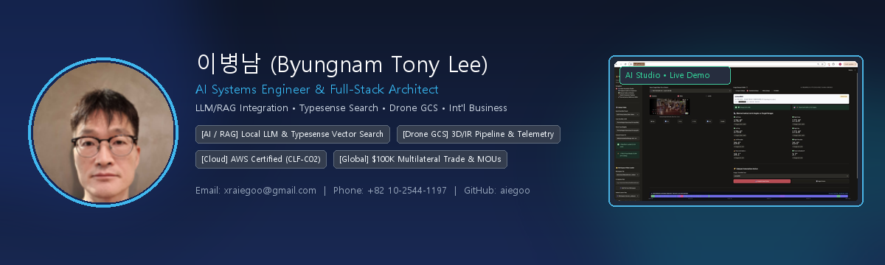

# Byungnam (Tony) Lee
### AI Systems Engineer & Full-Stack Software Architect

- **Email**: xraiegoo@gmail.com / aiegoo@naver.com
- **Phone**: +82-10-2544-1197 / +82-31-819-1196
- **Location**: Goyang-si, Gyeonggi-do, South Korea
- **GitHub**: [github.com/aiegoo](https://github.com/aiegoo)
- **Portfolio & Docs**: [pf7.eggs.or.kr](https://pf7.eggs.or.kr) | [pf1.eggs.or.kr](https://pf1.eggs.or.kr)
- **Live Projects**:
  - Typesense Semantic Search & Chat: [aiegoo.github.io/yoga/chat](https://aiegoo.github.io/yoga/chat) | [aiegoo.github.io/yoga/search](https://aiegoo.github.io/yoga/search)
  - MCU Local Serving (SPA): [festory.eggs.or.kr](https://festory.eggs.or.kr)
  - Quantum Security POC: [aiegoo.github.io/kisec-final/#/4/1](https://aiegoo.github.io/kisec-final/#/4/1)
  - GitHub Actions Auth Architecture: [aiegoo.github.io/pro-git](https://aiegoo.github.io/pro-git)
  - Drone System Portal: [aiegoo.github.io/_mydrone](https://aiegoo.github.io/_mydrone)

---

## Executive Summary

As AI fundamentally reshapes industries, I am a seasoned engineer and architect who bridges cutting-edge AI experimentation with production-grade engineering and real-world business value. Rather than simply calling commercial APIs, I focus on integrating self-hosted LLMs, scalable RAG pipelines, and high-performance backend infrastructure into resilient, maintainable products.

- **Generative AI & LLM Systems**: Built self-hosted local LLM servers (Ollama, llama.cpp, CUDA acceleration), high-throughput RAG search with Typesense semantic/hybrid vector indexing, real-time WebSocket communication, and GraphQL Yoga APIs.
- **Spatial Intelligence & Data Pipelines**: Architected end-to-end 3D scanning drone pipelines for Metaverse reconstruction, point-cloud alignment automation, and mission-critical Ground Control Station (GCS) monitoring platforms.
- **Global Business Execution & Tech Diplomacy**: Proven international leadership, orchestrating governmental and academic tech partnerships, signing MOUs with universities in Indonesia and tech firms in Germany/Thailand, and closing a $100,000 multilateral trade contract in Kazakhstan.
- **Bilingual Fluency**: Native Korean, fluent English (TOEFL 627, BS from University of Maryland); adept at cross-border stakeholder alignment and global tech team leadership.

---

## Core Competencies

| Domain | Technical Stack & Capabilities |
| :--- | :--- |
| **LLM & Generative AI** | • RAG (Retrieval-Augmented Generation) Architecture, Hybrid/Semantic Search • Local/Self-hosted LLMs (Ollama, llama.cpp, GPU tuning, WSL2 + CUDA) • Vector Embeddings & Indexing (Typesense, ChromaDB) • Quantization, Prompt Engineering, Production AI Model Integration |
| **Backend & Architecture** | • Node.js, GraphQL Yoga, Apollo Server, Prisma ORM, PostgreSQL • Python (FastAPI, Django), C++, Redis Pub/Sub, WebSockets • Microservices, RESTful APIs, High-throughput Event-Driven Architectures |
| **Frontend** | • React (Vite), TailwindCSS, Apollo Client, JavaScript (ES6+), HTML5/CSS3 • Responsive/Adaptive Web Design, Real-Time Interactive Dashboards |
| **Cloud & DevOps** | • Linux (Ubuntu Server), Docker, Nginx, WSL2 CUDA setup • AWS Certified Cloud Practitioner (CLF-C02), S3, EC2, CloudFront • CI/CD Automation (GitHub Actions, Custom Webhooks, Deploy Scripts) |
| **Embedded & Autonomous Systems** | • Drone Ground Control Station (GCS) Architecture, MAVLink, PX4, Qt5/C++ • Licensed UAV Pilot (Multicopter Class 1, Fixed-Wing Class 3, 1,000+ flight hours) • Sensor Firmware, Edge-to-Ground Telemetry & Secure Communication Pipelines |
| **Global Leadership** | • Cross-Border Technical MOUs, Strategic Partnership Execution, Gov/Academic Relations |

---

## Professional Experience

### 1. Ucon Creative Co., Ltd. (유콘크리에이티브주식회사)
**Role**: Development Director / Head of Engineering (개발 실장)  
**Period**: May 2023 – August 2025 (2 yrs 4 mos)  
**Scope**: Led AI software development, 3D scanning data pipelines, drone telemetry/monitoring systems, and international technical partnerships.

#### Key Projects & Achievements:
1. **3D Scanning Drone & Metaverse Big Data Pipeline (Jun 2023 – Dec 2023)**
   - Architected 3D point cloud and spatial data pipelines for metaverse digital twin creation.
   - Built high-throughput distributed spatial data storage and automated point cloud registration/post-processing pipelines.
   - Deployed scalable cloud and on-premise infrastructure for massive scan datasets.

2. **Generative AI & LLM Systems Integration (May 2023 – Dec 2023)**
   - Designed self-hosted local LLM inference engines and RAG retrieval mechanisms using Typesense vector search.
   - Developed predictive AI and NLP analysis models integrated into production SaaS platforms.
   - Conducted model benchmarking, quantization, and evaluation for latency-critical environments.

3. **3D-IR Scanning Drone & Secure Pipeline (Oct 2023 – Dec 2023, DevOps PM)**
   - Engineered dual 3D LiDAR and thermal infrared (IR) aerial scanning drone systems.
   - Implemented secure edge-to-ground telemetry transmission protocols compliant with strict data security requirements.

4. **Integrated Drone & EV Fleet Control Platform (Oct 2023 – Dec 2023, DevOps PM)**
   - Designed and built a real-time monitoring and control backend for autonomous drone and EV fleets.
   - Implemented low-latency WebSocket / Redis Pub/Sub channels for state telemetry and real-time visualization.
   - Built automated event anomaly detection and notification engines.

---

### 2. JDLab Co., Ltd. (주식회사 제이디랩)
**Role**: Principal Software Researcher (수석연구원)  
**Period**: Feb 2022 – May 2022 (4 mos)  
- Developed Drone GCS (Ground Control Station) software modules using C++ and Qt5.
- Implemented real-time MAVLink packet parsers and digital mapping controls under strict NDA.

---

### 3. Hitech (하이테크)
**Role**: Software Team Lead (개발 팀장)  
**Period**: Feb 2020 – Dec 2020 (11 mos)  
- Led sensor firmware development and embedded data acquisition modules for IoT devices.
- Engineered low-power telemetry transmission protocols for remote sensing equipment.

---

### 4. ONOFFLINK Co., Ltd. (온오프링크 주식회사)
**Role**: Lead Engineer / Technical PM (개발 책임)  
**Period**: Mar 2019 – Sep 2019 (7 mos)  
- Architected enterprise IP PBX and Computer Telephony Integration (CTI) platforms using Asterisk and FreePBX.
- Supported Hyundai Mobis CES 2020 (Las Vegas) VR mobility driving experience application and deployment pipelines.

---

### 5. Eozz Inc. / Yulim ADS (주식회사 이오즈)
**Role**: Planning Director / Lead PM (기획 실장)  
**Period**: Dec 2005 – Jun 2014 (8 yrs 7 mos)  
- Spearheaded e-Government bids, project proposals, and delivery management for Korean government initiatives.
- Directed multimillion-won corporate design, tech, and translation contracts for Tier-1 clients (Samsung, LG, SK, Hana Tour).

---

### 6. Senior Corporate Trainer & Translation PM
**Period**: 1985 – 2014  
- Master Instructor for TOEFL/TOEIC at premier institutes (Sisa, Chongro, Chungmun).
- Conducted executive corporate training for Samsung-HP, SK, Hyundai, and the National Government Officials Training Institute.

---

## International Engagement & Strategic Partnerships

| Date | Counterpart / Region | Initiatives & Highlights |
| :--- | :--- | :--- |
| **Dec 2024** | **Kazakhstan** | • **Signed $100,000 multilateral trade contract** • Established academic tech cooperation MOU with local university • Expanded Eurasian business and technology delivery channels |
| **Nov 2024** | **Poland** (Korean Business Delegation) | • Represented cutting-edge Metaverse & Drone GCS solutions • Delivered technology keynote and engaged in European market expansion |
| **Oct 2024** | **Kazakhstan** Defense Delegation | • Coordinated high-level defense delegation visit to South Korea • Facilitated bilateral discussions on drone control & secure telemetry systems |
| **Aug 2024** | **Germany** (BMS Entity) | • Negotiated technology transfer for Battery Management System (BMS) high-voltage modules • Executed strategic partnership and joint technology MOU |
| **Jul 2024** | **Indonesia** | • Produced and hosted live technical webinars and international broadcasts • Conducted global tech branding and developer outreach |
| **May 2024** | **Thailand** | • Signed strategic partnership MOU with language technology enterprise for global AI SaaS |
| **Feb 2024** | **Indonesia** (Nusa Cendana Univ.) | • Signed university-to-university tech & AI talent cooperation MOU |
| **Jan 2024** | **Indonesia** Ministry of Manpower | • High-level meeting with Vice Minister of Manpower on AI/tech talent development |
| **Nov 2023** | **Indonesia** Council of University Presidents | • Program Director for official Korean visit of top Indonesian university presidents |

---

## Key Projects & Open-Source Highlights

### 1. Typesense-Powered Semantic Search & Conversational RAG
- **Live URLs**: [aiegoo.github.io/yoga/chat](https://aiegoo.github.io/yoga/chat) | [aiegoo.github.io/yoga/search](https://aiegoo.github.io/yoga/search)
- Real-time RAG engine combining Typesense hybrid vector search with self-hosted Ollama LLM, deployed with modern React frontend and WebSocket backend.

### 2. Multi-Platform Ground Control Station (GCS)
- **Live URLs**: [aiegoo.github.io/_mydrone](https://aiegoo.github.io/_mydrone) | [gcs.eggs.or.kr](http://gcs.eggs.or.kr)
- Cross-platform drone station (Node.js, C++, Qt5) managing aerial telemetry, video, and quantum mesh protocols.

### 3. Post-Quantum Cryptography (PQC) Security POC
- **Live URL**: [aiegoo.github.io/kisec-final/#/4/1](https://aiegoo.github.io/kisec-final/#/4/1)
- Proof of concept demonstrating quantum-resistant cryptographic handshakes and authenticated data exchange.

### 4. GitOps & Cloudflare Worker Authentication Engine
- **Live URL**: [aiegoo.github.io/pro-git](https://aiegoo.github.io/pro-git)
- Serverless authentication workflow leveraging GitHub Apps, Issues, and GitHub Actions CI/CD.

---

## Education

- **University of Maryland**, College Park, MD, USA  
  **Bachelor of Science (BS) in Management** | Aug 1985 – Jun 1994
- **Konkuk University**, Seoul, South Korea  
  Department of Biology (Transferred, 1985)

---

## Certifications & Licenses

- **AWS Certified Cloud Practitioner (CLF-C02)** – Amazon Web Services (Nov 2025)
- **Ultra-Light Vehicle Flight License (Class 1 Multicopter)** – Korea Transportation Safety Authority (Mar 2021, 1,000+ flight hours)
- **Ultra-Light Vehicle Flight License (Class 3 Fixed-Wing)** – Korea Transportation Safety Authority (Aug 2022)
- **3D Printer Operation Craftsman** – Human Resources Development Service of Korea (Jul 2021)
- **GTQ Graphic Technology Qualification (Photoshop Grade 1)** – KPC (Oct 2018)
- **TOEFL (Score 627)** – ETS (May 1985)

---

## Awards & Intensive Programs

- **Jeju Oromi Camp Outstanding Achievement Award** (Dec 2025) – 1st Place Team Project & Individual Top Score
- **Minister of Sports Citation** (1988) – Ministry of Sports, Republic of Korea
- **5G Autonomous Flight Control Specialization** (Jul 2021) – RAPA (Korea Radio Promotion Association)
- **Full-Stack Web & Deep Learning Immersive Program** (1,120 hours, Jul 2018 – Jan 2019)
- **XR Game & Computer Vision AI Immersive Program** (1,080 hours, Jul 2020 – Jun 2021) – KOCCA
