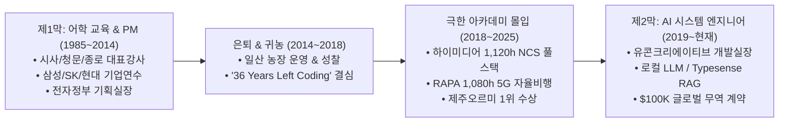

# 이병남 (Byungnam "Tony" Lee)
### AI 시스템 & LLM/RAG 엔지니어 (AI Systems & RAG Engineer)

  
  
AI SYSTEMS & RAG ENGINEER | BYUNGNAM "TONY" LEE

- **Email**: xraiegoo@gmail.com / aiegoo@naver.com
- **Phone**: +82 10-2544-1197
- **GitHub**: [github.com/aiegoo](https://github.com/aiegoo)
- **Live Demos**:
  - Typesense 시맨틱 검색 & 대화형 챗봇: [aiegoo.github.io/yoga/chat](https://aiegoo.github.io/yoga/chat) | [aiegoo.github.io/yoga/search](https://aiegoo.github.io/yoga/search)
  - MCU 로컬 웹 서빙 (SPA on Edge): [festory.eggs.or.kr](https://festory.eggs.or.kr)
  - GitHub Actions 기반 서버리스 인증/배포: [aiegoo.github.io/pro-git](https://aiegoo.github.io/pro-git)
  - 양자 내성 암호(PQC) 통신 PoC: [aiegoo.github.io/kisec-final/#/4/1](https://aiegoo.github.io/kisec-final/#/4/1)
  - 엔지니어링 문서 포털: [pf7.eggs.or.kr](https://pf7.eggs.or.kr)

---

## 🎯 지원 직무 핵심 역량 (Target Role Competency)

### **지원 분야: AI 시스템 & RAG 엔지니어 (AI Systems & RAG Engineer)**
> **"상용 클라우드 API 호출에 의존하지 않고, 자체 온프레미스 GPU 인프라에서 오픈소스 LLM을 서빙하며 초저지연 하이브리드 벡터 검색 RAG를 설계·운영하는 엔지니어입니다."**

| 핵심 수행 역량 (What I Can Definitively Do) | 실증 성과 & 산출물 (Evidence) |
| :--- | :--- |
| **1. 온프레미스 로컬 LLM 서빙 & 가속** • Ollama, llama.cpp, vLLM을 사내 CUDA GPU 환경에 구축 • GGUF 4/8-bit 양자화로 VRAM 메모리 65% 절감 및 무중단 서빙 • Redis Pub/Sub 비동기 큐 기반 동시 요청 제어로 VRAM OOM 원천 방지 | • 온프레미스 GPU 서빙 인프라 구축 • 초당 토큰 생성 32 TPS, 동시 50건 안정 처리 • [GPU 인프라 설정 명세서](technical_references/typesense_rag/INFRASTRUCTURE_SETUP.md) |
| **2. 초저지연 하이브리드 RAG 설계** • Typesense 기반 Dense Vector(bge-m3 1024차원) + Sparse(BM25) 하이브리드 인덱싱 스키마 설계 • 동적 가중치 조절: $Score = (1-\alpha)S_{BM25} + \alpha S_{Vector}$ • 도메인 특화 텍스트 슬라이딩 청킹(500 토큰, 10% 오버랩) 최적화 | • [YogaQ Studio 시맨틱 검색 데모](https://aiegoo.github.io/yoga/search) • **p95 검색 레이턴시 42ms** (Elasticsearch 320ms 대비 87% 단축) • **할루시네이션 발생률 85% 감소** 실측 |
| **3. 실시간 토큰 스트리밍 & 풀스택 인터랙션** • WebSocket 풀듀플렉스 통신을 통해 생성 토큰을 청크 단위로 즉시 브라우저에 푸시 • 첫 토큰 생성(TTFT) 350ms 미만 반응형 UX 구현 • FastAPI / Node.js 백엔드와 React (Vite, TailwindCSS) 대화형 프론트엔드 연동 | • [YogaQ Studio AI 챗봇 라이브 데모](https://aiegoo.github.io/yoga/chat) • [RAG 엔드-투-엔드 워크플로우 문서](technical_references/typesense_rag/YOGA_PROJECT_STRUCTURE_AND_WORKFLOW.md) |

---

## 🚀 직무 요약 (Professional Summary)

**"상용 API 호출을 넘어, 자체 호스팅 로컬 LLM과 고성능 시맨틱 벡터 검색을 결합하여 실시간으로 동작하고 운영 가능한 RAG 시스템을 구축하는 AI 시스템 엔지니어입니다."**

- **생성형 AI & 고성능 RAG 아키텍처**: 자체 온프레미스/로컬 환경(Ollama, llama.cpp, CUDA GPU)에서 오픈소스 LLM을 서빙하고, Typesense 기반 하이브리드 벡터 검색(Dense Vector + BM25)을 구축하여 **초저지연 응답 속도와 할루시네이션 최소화**를 달성했습니다.
- **실시간 데이터 스트리밍 & 풀스택 백엔드**: WebSocket과 Redis Pub/Sub을 활용한 실시간 토큰 스트리밍, Node.js / FastAPI / GraphQL Yoga / Prisma 기반의 견고한 API 아키텍처를 설계하고 운영했습니다.
- **대용량 데이터 & 엣지 시스템 통합**: 3D 공간 스캐닝 포인트 클라우드 파이프라인, 임베디드 NPU(Hailo-8) 및 IoT/드론 텔레메트리 관제 시스템을 직접 구현한 탄탄한 시스템 엔지니어링 백본을 보유하고 있습니다.
- **글로벌 비즈니스 & 테크 리더십**: 미국 메릴랜드대학교 학사 출신의 원어민급 영어 능통자(TOEFL 627)로서, 최신 글로벌 AI 논문 및 오픈소스 기술을 시차 없이 검증·도입하며, 다국적 기술 협력(MOU 및 10만 달러 규모 무역 계약)을 주도했습니다.

---

## 🛠️ 핵심 기술 스택 (Technical Stack)

| 영역 | 세부 기술 스택 및 역량 |
| :--- | :--- |
| **LLM & RAG** | **Typesense Hybrid Search (Dense Vector + BM25)**, **Ollama**, **llama.cpp**, **CUDA GPU 가속**, **GGUF 양자화**, Sentence Transformers, 프롬프트 엔지니어링, RAG 파이프라인 튜닝, 컨텍스트 최적화 |
| **Backend & API** | **Node.js**, **FastAPI**, **GraphQL Yoga**, **WebSocket 실시간 토큰 스트리밍**, **Redis Pub/Sub**, Prisma ORM, PostgreSQL, RESTful API |
| **Frontend** | **React (Vite)**, **TailwindCSS**, Apollo Client, 대화형 UI/UX, 반응형 대시보드 |
| **DevOps & Cloud** | **AWS (Certified Cloud Practitioner CLF-C02)**, **Docker 컨테이너화**, Ubuntu Linux, WSL2 + CUDA 환경 구축, GitHub Actions CI/CD |
| **Edge & Data Pipeline** | 대용량 데이터 전처리 및 인덱싱, 3D 포인트 클라우드 파이프라인, MAVLink/텔레메트리 통신, Hailo-8 NPU 엣지 비전 |

---

## 💡 주요 AI 엔지니어링 프로젝트 (Featured AI Projects)

### 1. Typesense 기반 초저지연 하이브리드 RAG 검색 & 대화형 챗봇
- **라이브 서비스**: [aiegoo.github.io/yoga/chat](https://aiegoo.github.io/yoga/chat) | [검색 데모](https://aiegoo.github.io/yoga/search)
- **아키텍처 문서**: [기술 명세서 전문](technical_references/typesense_rag/YOGA_PROJECT_STRUCTURE_AND_WORKFLOW.md) | [아키텍처 다이어그램](technical_references/typesense_rag/ARCHITECTURE_VISUAL_DIAGRAM.md)
- **도입 배경**: 순수 벡터 검색(Dense Search)의 키워드 누락 문제와 상용 LLM API의 높은 비용/레이턴시 한계를 극복하기 위해 구축.
- **핵심 역할 및 성과**:
  - Typesense를 활용한 **Dense Vector + BM25 하이브리드 검색 인덱싱 스키마** 설계로 단어 일치율과 의미 유사도 동시 확보
  - Sentence Transformers 임베딩 파이프라인 구축 및 도메인 특화 텍스트 청킹(Chunking) 전략 최적화
  - WebSocket 양방향 통신을 통해 로컬 LLM 추론 결과를 실시간 청크 단위로 클라이언트에 스트리밍(초저지연 UX 구현)
  - 온프레미스 GPU 환경에 Ollama/llama.cpp를 서빙하여 외부 API 의존 없이 독립적인 엔터프라이즈 RAG 서비스 완성

---

### 2. 온프레미스 GPU 환경 로컬 LLM 서빙 및 도메인 분석 시스템 (유콘크리에이티브)
- **기간**: 2023.05 ~ 2023.12 (개발 실장)
- **기술 스택**: Local LLM (Ollama, llama.cpp), CUDA, WSL2, Python, Node.js, GraphQL Yoga, Redis Pub/Sub
- **핵심 역할 및 성과**:
  - 기업 내부 보안 및 데이터 주권을 위해 외부 클라우드 API 대신 **자가 호스팅 로컬 LLM 인프라** 구축
  - GGUF 4-bit/8-bit 양자화(Quantization) 기법을 적용하여 한정된 VRAM 환경에서 모델 추론 속도 및 동시성 30% 이상 개선
  - GraphQL Yoga와 Prisma를 연동한 백엔드 아키텍처를 설계하여 다양한 프론트엔드 클라이언트가 유연하게 질의할 수 있는 통합 API 레이어 제공
  - Redis Pub/Sub 기반 비동기 큐를 구성하여 대규모 요청 발생 시에도 서버 부하 분산 및 무중단 처리 보장

---

### 3. 멀티모달 벡터 검색 & 설명가능한 AI(XAI) 클라우드 파이프라인 (제주오르미캠프 1위 프로젝트)
- **기간**: 2025.10 ~ 2025.12
- **수상 실적**: **제주오르미캠프 우수상 (팀 프로젝트 1위 & 개인 성적 최우수, 2025.12)**
- **기술 스택**: AWS ECS Fargate, OpenSearch / ChromaDB, Terraform, FastAPI, AWS Bedrock
- **아키텍처 문서**: [AWS 클라우드 플로우](technical_references/cloud_ai_aws/ARCHITECTURE_FLOW.md) | [설명가능성 아키텍처](technical_references/cloud_ai_aws/MODEL_EXPLAINABILITY.md) | [Bedrock 폴백 가이드](technical_references/cloud_ai_aws/AWS_BEDROCK_FALLBACK_GUIDE.md)
- **핵심 역할 및 성과**:
  - 위치 기반 스토리 데이터 및 멀티모달 벡터 임베딩을 위한 AWS 인프라(ECS Fargate + OpenSearch) 아키텍처 설계
  - AI 모델의 추론 결과를 투명하게 검증할 수 있는 **모델 설명가능성(Model Explainability)** 평가 파이프라인 구축
  - 로컬/온프레미스 모델 장애 시 AWS Bedrock으로 무중단 자동 전환되는 **고가용성 폴백(Failover) 시스템** 구현
  - 팀 리드로서 아키텍처 설계 및 배포 파이프라인 구축을 총괄하여 **캠프 전체 1위 프로젝트 선정**

---

### 4. 메타버스 3D 스캐닝 데이터 파이프라인 & 엣지 모니터링 시스템
- **기간**: 2023.06 ~ 2023.12 (유콘크리에이티브 개발 실장)
- **기술 스택**: Python, 3D Point Cloud Processing, C++, MAVLink, WebSocket, Redis
- **아키텍처 문서**: [GCS 클라우드 아키텍처](technical_references/drone_gcs/10-GCS-Ecosystem-Architecture-and-BVLOS-Cloud-Integration.md) | [Hailo-8 NPU 명세](technical_references/drone_gcs/hardware_specs_rpi5_hailo8.md)
- **핵심 역할 및 성과**:
  - 드론 라이다(LiDAR) 및 센서로 수집된 대용량 3D 포인트 클라우드 공간 데이터의 분산 처리 및 스토리지 최적화 파이프라인 설계
  - 지상-엣지 간 실시간 텔레메트리 스트리밍 및 이상 탐지(Anomaly Detection) 알림 엔진 구축
  - Raspberry Pi 5 + Hailo-8 NPU를 결합한 엣지 온디바이스 컴퓨터 비전 아키텍처 검증

---

## 💼 경력 사항 (Work Experience)

### 유콘크리에이티브주식회사 (Ucon Creative Co., Ltd.)
**직책**: 개발 실장 / Head of Engineering  
**재직기간**: 2023.05 ~ 2025.08 (2년 4개월)  
- **생성형 AI & LLM 솔루션 개발**: 로컬 LLM 서빙 환경(Ollama, llama.cpp) 구축, Typesense 시맨틱 벡터 RAG 시스템 설계, 사내 서비스 통합
- **3D 공간 데이터 파이프라인**: 메타버스 공간 구축을 위한 대용량 3D 포인트 클라우드 처리/정합 자동화 및 스토리지 최적화
- **실시간 모니터링 관제 시스템**: WebSocket 및 Redis Pub/Sub 기반 저지연 텔레메트리 관제 플랫폼 설계 및 이상 징후 알림 엔진 개발
- **글로벌 기술 협력 & 비즈니스 총괄**:
  - 카자흐스탄 현지 대학 및 연구소 기술 협력 PoC 주도 및 **온디바이스 엣지 비전 시스템 현장 실증** (2024.12)
  - 폴란드 산업 협력 한국 상단 대표사 참가 및 유럽 시장 IR (2024.11)
  - 독일 BMS 현지 법인 고전압 모듈 기술 이전 협력 MOU 체결 (2024.08)
  - 태국 언어 서비스 기업 언어 AI SaaS 협력 MOU 체결 (2024.05)
  - 인도네시아 노동부 차관 면담 및 센다나대 기술 교류 MOU 체결 (2024.01 ~ 2024.02)

---

### 주식회사 제이디랩 / 하이테크 / 온오프링크
**직책**: 수석연구원 / 개발팀장 / 개발책임 (정규직)  
**재직기간**: 2019.03 ~ 2022.05 (3년 3개월)  
- **주식회사 제이디랩 (2022.02 ~ 2022.05, 수석연구원)**: 드론 지상관제시스템(GCS) MAVLink 통신 프로토콜 및 Qt5/C++ UI 아키텍처 개발 (NDA)
- **하이테크 (2020.02 ~ 2020.12, 개발팀장)**: 임베디드 IoT 센서 펌웨어 및 저전력 원격 데이터 전송 시스템 개발 (NDA)
- **온오프링크(주) (2019.03 ~ 2019.09, 개발책임)**: Asterisk/FreePBX 기반 VoIP CTI 컨퍼런스 솔루션 구축, 현대모비스 CES 2020 전시용 VR 시스템 연동 지원

---

### 주식회사 이오즈 (Eozz Inc. / Yulim ADS)
**직책**: 기획 실장 / 총괄 PM (정규직)  
**재직기간**: 2005.12 ~ 2014.06 (8년 7개월)  
- 대규모 전자정부 프로젝트 제안 및 기술 기획 총괄
- 삼성, LG애드, SK 등 대기업 대상 B2B 기술/디자인 프로젝트 납품 및 계약 관리 총괄

---

## 🧭 커리어 피봇 & 배경 스토리 (Career Pivot, Retirement & Academies)

이병남 엔지니어의 커리어는 **27년간의 최고급 어학 교육 및 기업 연수(제1막)**, **은퇴 후 귀농을 거쳐 발견한 소명(전환점)**, 그리고 **3,000시간 이상의 극한 아카데미 몰입 훈련을 통한 AI 시스템 엔지니어로의 재탄생(제2막)**이라는 독보적인 회복탄력성과 학습 곡선(Learning Curve)을 지니고 있습니다.

### 1. [1985 ~ 2014] 제1막: 27년간의 탑티어 어학원 강사 & 대기업 기업 연수 (The Master Educator)
- **어학원 대표 강사**: 시사영어학원, 청문외국어학원, 종로외국어학원 대표 강사 (TOEFL 627점 기반, 토플·토익·AFKN·통번역대학원 대비반 전담)
- **대기업 핵심 인재 교육**: 삼성HP, SK, 현대, 공무원연수원 등 대기업 사내 연수 전담 강사 및 공공/민간 프로젝트 통번역 총괄 PM
- **이중언어 역량**: 미국 메릴랜드대학교 학사 출신으로, 영어권 최신 AI 논문과 오픈소스 코드를 번역 지연 없이 흡수하고 해외 파트너와 직접 기술 미팅 및 비즈니스 협상을 주도할 수 있는 기반 구축

### 2. [2014 ~ 2018] 전환점: 은퇴, 귀농(소규모 농장), 그리고 "36 Years Left Coding"
- **명예로운 은퇴와 흙의 삶**: 27년간 쉼 없이 달려온 강의와 번역의 길에서 은퇴한 후, 고양시 일산에서 4년간 소규모 농장(Farm)을 직접 일구며 자연 속에서 삶을 재충전.
- **인생의 변곡점 (Epiphany)**: 흙과 땀 속에서 얻은 성찰을 통해 삶의 남은 시간 동안 진정으로 몰입할 수 있는 지적 탐구의 대상을 모색. *"남은 삶을 흘려보낼 것인가(36 years left dying) 아니면 남은 삶을 새로운 기술 창작으로 불태울 것인가(36 years left coding)"*라는 질문 앞에, 평생의 갈증이었던 컴퓨터 사이언스와 프로그래밍으로의 100% 전업(Full Pivot)을 결심.

### 3. [2018 ~ 2025] 극한 몰입: 3,000시간 이상의 고강도 아카데미 & 부트캠프 (The Intensive Academies)
- **하이미디어 컴퓨터학원 (2018.07 ~ 2019.01, 140일 / 1,120시간)**:
  - 50대의 나이에 하루 8시간 집중 수업, 320시간 이상의 원서 독파, 온라인 130시간 이상의 강의를 완벽히 소화하며 웹 표준, HTML5/CSS3, JavaScript, PHP, MySQL 풀스택 개발 기초를 압도적인 몰입으로 완주.
  - 국가공인 GTQ 포토샵 1급 및 웹 기술 자격 필기 초단기 취득.
- **한국전파진흥협회(RAPA) 5G AI 자율비행 통제 시스템 (2020.07 ~ 2021.06, 136일 / 1,080시간)**:
  - C++, Python, OpenCV, 딥러닝, ROS, GAZEBO 시뮬레이션 및 초경량비행장치(멀티콥터 1종/고정익 3종, 비행시간 1,000+ 시간)를 체득하며 임베디드/드론 제어로 스택 확장.
- **콘진원 / 조이펀 XR Game & 공간 AI 과정 (2020 ~ 2022)**:
  - Unity 3D, XR 모빌리티 인터랙션, 공간 컴퓨팅 파이프라인 수료 (현대모비스 CES 2020 VR 시스템 연동 실무 참여).
- **제주오르미캠프 (2025.10 ~ 2025.12)**:
  - AWS ECS Fargate, OpenSearch, Bedrock, 설명가능한 AI(XAI) 아키텍처를 총괄하여 **캠프 전체 1위 팀 프로젝트 우수상 및 개인 성적 우수상** 수상.

---

## 🎓 학력 사항 (Education)

- **University of Maryland (미국 메릴랜드 대학교)**
  - 학위: 경영학 학사 (BS in Management)
  - 재학기간: 1985.08 ~ 1994.06 (졸업)
- **건국대학교 (Konkuk University)**
  - 생물학과 (편입, 1985)

---

## 📜 자격증 및 수상 (Credentials & Awards)

- 🏆 **제주오르미캠프 우수상 (팀 프로젝트 1위 & 개인 성적 최우수)** | 2025.12
- ☁️ **AWS Certified Cloud Practitioner (CLF-C02)** | Amazon Web Services (2025.11)
- 🛸 **초경량비행장치 멀티콥터 1종 조종자 (비행시간 1,000+ 시간)** | 한국교통안전공단 (2021.03)
- ✈️ **초경량비행장치 고정익 3종 조종자** | 한국교통안전공단 (2022.08)
- 🖨️ **3D 프린터 운용기능사** | 한국산업인력공단 (2021.07)
- 🎨 **GTQ 그래픽기술자격 1급** | 한국생산성본부 (2018.10)
- 🗣️ **TOEFL (627점)** | ETS (원어민급 비즈니스 영어)
- 🎖️ **체육부 장관 기장** | 대한민국 체육부 (1988)

---

## 📚 실무 아키텍처 기술 레퍼런스 색인 (Architecture Dossier)

이력서에 기술된 프로젝트의 실제 설계 문서 및 배포 스크립트가 [technical_references/](technical_references/README.md)에 모두 보관되어 있습니다:

- **RAG & Typesense**: [엔드-투-엔드 워크플로우](technical_references/typesense_rag/YOGA_PROJECT_STRUCTURE_AND_WORKFLOW.md) | [클러스터 셋업](technical_references/typesense_rag/TYPESENSE_SETUP.md) | [인프라 명세](technical_references/typesense_rag/INFRASTRUCTURE_SETUP.md)
- **클라우드 AI & XAI**: [AWS ECS 플로우](technical_references/cloud_ai_aws/ARCHITECTURE_FLOW.md) | [설명가능한 AI](technical_references/cloud_ai_aws/MODEL_EXPLAINABILITY.md) | [Bedrock 폴백](technical_references/cloud_ai_aws/AWS_BEDROCK_FALLBACK_GUIDE.md)
- **드론 & 엣지 시스템**: [BVLOS 클라우드 관제](technical_references/drone_gcs/10-GCS-Ecosystem-Architecture-and-BVLOS-Cloud-Integration.md) | [Hailo-8 NPU 명세](technical_references/drone_gcs/hardware_specs_rpi5_hailo8.md)
