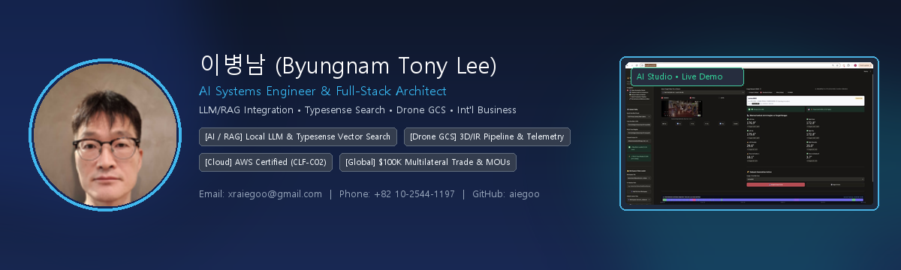

# 이병남 (Byungnam "Tony" Lee)
### AI 시스템 엔지니어 & 풀스택 소프트웨어 아키텍트

- **Email**: xraiegoo@gmail.com / aiegoo@naver.com
- **Phone**: +82-10-2544-1197 / 031-819-1196
- **Location**: 경기도 고양시 일산동구 호수로 688
- **GitHub**: [github.com/aiegoo](https://github.com/aiegoo)
- **Portfolio & Docs**: [pf7.eggs.or.kr](https://pf7.eggs.or.kr) | [pf1.eggs.or.kr](https://pf1.eggs.or.kr)
- **Interactive Demos**:
  - Typesense Semantic Search & Chat: [aiegoo.github.io/yoga/chat](https://aiegoo.github.io/yoga/chat) | [aiegoo.github.io/yoga/search](https://aiegoo.github.io/yoga/search)
  - MCU Local Serving (SPA): [festory.eggs.or.kr](https://festory.eggs.or.kr)
  - Quantum Security POC: [aiegoo.github.io/kisec-final/#/4/1](https://aiegoo.github.io/kisec-final/#/4/1)
  - GitHub Actions Auth Architecture: [aiegoo.github.io/pro-git](https://aiegoo.github.io/pro-git)
  - Drone System Portal: [aiegoo.github.io/_mydrone](https://aiegoo.github.io/_mydrone)

---

## Executive Summary (소개)

AI가 산업의 구조를 근본적으로 재편하고 있는 지금, 저는 기술적 실험에 머무르지 않고 **LLM과 첨단 기술을 실제 서비스와 시스템에 통합하여 운영 가능한 비즈니스 가치로 만들어 온 엔지니어이자 아키텍트**입니다.

- **Generative AI & LLM 운영 아키텍처**: 자체 호스팅 인프라 기반 로컬 LLM(Ollama, llama.cpp) 구축, 고성능 RAG 파이프라인(Typesense 시맨틱/하이브리드 벡터 검색), 실시간 WebSocket 및 GraphQL Yoga 기반 백엔드 아키텍처를 설계하고 제품화했습니다.
- **대용량 데이터 & 공간 인텔리전스**: 3D 스캐닝 드론 및 IR 센서 데이터 파이프라인, 메타버스 공간 정합 자동화, 실시간 관제(GCS) 모니터링 시스템 및 분산 인프라를 구축했습니다.
- **글로벌 비즈니스 & 테크 리더십**: 한국, 인도네시아, 태국, 독일, 카자흐스탄, 폴란드 등 다양한 국가의 정부 고위직 및 대학, 현지 법인과의 기술 협약(MOU), 인력 양성, 10만 달러 규모 중계무역 계약 체결을 실무 총괄한 독보적인 글로벌 협업 역량을 보유하고 있습니다.
- **원어민급 이중언어(Bilingual) 역량**: 영어 능통(TOEFL 627, 미국 메릴랜드대학교 학사), 글로벌 개발팀 리딩 및 해외 파트너십 협상 전담 가능.

---

## 핵심 역량 (Core Competencies)

| 분야 | 상세 기술 스택 및 역량 |
| :--- | :--- |
| **LLM & AI/ML** | • RAG 파이프라인 설계 및 시맨틱/하이브리드 검색 구축 • 온프레미스/로컬 LLM 서빙 및 최적화 (Ollama, llama.cpp, CUDA, GPU 가속) • 벡터 임베딩 및 데이터 인덱싱 파이프라인 (Typesense, ChromaDB) • NLP 모델 파인튜닝, 프롬프트 엔지니어링, 인공지능 모델 프로덕션 배포 |
| **Backend & Architecture** | • Node.js, GraphQL Yoga, Apollo Server, Prisma ORM, PostgreSQL • Python (FastAPI, Django), C++, Redis Pub/Sub, WebSocket 실시간 통신 • 마이크로서비스, RESTful API 설계, 고가용성 비동기 큐 시스템 |
| **Frontend** | • React (Vite), TailwindCSS, Apollo Client, TypeScript/JavaScript • 반응형/적응형 UI/UX, 대시보드 시각화 (Chart.js, D3.js) |
| **DevOps & Cloud** | • Linux (Ubuntu Server), Docker, Nginx, WSL2 + CUDA 환경 구축 • AWS Cloud (Certified Cloud Practitioner CLF-C02, S3, EC2, CloudFront, Route53) • CI/CD 파이프라인 (GitHub Actions, Webhooks, 자동 배포 체계) |
| **Embedded & Drone / IoT** | • 드론 지상 관제 시스템 (GCS) 아키텍처, MAVLink, PX4, Qt5/C++ • 초경량비행장치 무인멀티콥터 1종 조종자 자격 (비행시간 1,000+ 시간) • 센서 펌웨어 데이터 수집 및 엣지-투-그라운드(Edge-to-Ground) 통신 프로토콜 설계 |
| **Global Leadership** | • 글로벌 테크 파트너십(MOU) 체결, 해외 정부/대학/기업 기술 교류 총괄 • 다국적 개발자 협업 및 글로벌 커뮤니케이션 |

---

## 경력 사항 (Work Experience)

### 1. 유콘크리에이티브주식회사 (Ucon Creative Co., Ltd.)
**직책**: 개발 실장 (정규직)  
**재직기간**: 2023.05 ~ 2025.08 (2년 4개월)  
**담당업무**: AI 소프트웨어, 3D 스캐닝 데이터 파이프라인, 관제 모니터링 플랫폼 총괄 개발 및 글로벌 기술 협력

#### 주요 프로젝트 및 성과:
1. **메타버스용 3D 스캐닝 드론 및 대용량 데이터 파이프라인 (2023.06 ~ 2023.12)**
   - 메타버스 공간 복원을 위한 3D 포인트 클라우드 스캐닝 데이터 파이프라인 설계
   - 대용량 공간 데이터 분산 처리 및 스토리지 최적화 구조 구현
   - 다중 스캔 데이터의 정합(Registration) 및 노이즈 필터링 후처리 자동화
   - 클라우드 및 온프레미스 서버 기반 데이터 관리 아키텍처 구축

2. **생성형 AI & LLM 솔루션 개발 (2023.05 ~ 2023.12)**
   - 로컬 LLM 서빙 인프라 및 RAG 파이프라인 구축 (Typesense 시맨틱 벡터 인덱싱 결합)
   - 산업 도메인 특화 데이터 분석 및 예측 AI 모델 통합
   - 모델 성능 벤치마크, 양자화(Quantization) 최적화 및 실제 운영 환경 통합

3. **3D-IR 스캔 드론 및 엣지 파이프라인 개발 (2023.10 ~ 2023.12)**
   - 3D LiDAR 및 열화상(IR) 센서 융합 공간 스캐닝 드론 임베디드 시스템 설계
   - 엣지-투-지상(Edge-to-Ground) 실시간 데이터 파이프라인 및 보안 통신 프로토콜 설계
   - 군/산업 보안 규격을 고려한 데이터 관리 체계 수립

4. **드론/전기차(EV) 통합 관제 소프트웨어 개발 (2023.10 ~ 2023.12)**
   - 드론 및 모빌리티 실시간 상태 관제 플랫폼 아키텍처 설계
   - WebSocket 및 Redis Pub/Sub 기반 초저지연 실시간 모니터링 UI/백엔드 개발
   - 텔레메트리 데이터 시각화 및 실시간 이상 징후 감지(Anomaly Detection) 알림 엔진 구현

---

### 2. 주식회사 제이디랩 (JDLab Co., Ltd.)
**직책**: 개발 수석연구원 (정규직)  
**재직기간**: 2022.02 ~ 2022.05 (4개월)  
- 드론 GCS (Ground Control Station) 시스템 개발 및 지상관제 프로토콜 구현
- C++, Qt5 기반 텔레메트리 데이터 인터페이스 및 실시간 지도 기반 웨이포인트 관제

---

### 3. 하이테크 (Hitech)
**직책**: 개발 팀장 (정규직)  
**재직기간**: 2020.02 ~ 2020.12 (11개월)  
- 임베디드 센서 펌웨어 및 데이터 전송 시스템 개발
- IoT 센서 기반 데이터 수집 및 실시간 전송 모듈 구현

---

### 4. 온오프링크 주식회사 (ONOFFLINK Co., Ltd.)
**직책**: 개발 책임 / PM (정규직)  
**재직기간**: 2019.03 ~ 2019.09 (7개월)  
- IP PBX 및 VoIP CTI (Computer Telephony Integration) 솔루션 개발
- Asterisk / FreePBX 기반 컨퍼런스 콜 시스템 커스터마이징 및 배포 자동화
- 현대모비스 CES 2020 Las Vegas 전시용 Unity VR 주행 인터랙션 시스템 연동 지원

---

### 5. 주식회사 이오즈 (Eozz Inc. / Yulim ADS)
**직책**: 기획 실장 / 총괄 PM (정규직)  
**재직기간**: 2005.12 ~ 2014.06 (8년 7개월)  
- 대규모 전자정부 프로젝트 기획, 제안서 작성, 정부 발주 과제 총괄 관리
- 대기업(삼성, LG애드, SK, 하나투어 등) 대상 IT & 디자인 프로젝트 납품 및 계약 총괄

---

### 6. 전문 통번역사 및 외국어 교육 총괄
**재직기간**: 1985 ~ 2014  
- 시사영어학원, 청문외국어학원, 종로외국어학원 대표 강사
- 삼성HP, SK, 현대, 공무원연수원 등 대기업 사내 연수 및 고급 비즈니스 영어 교육
- 정부 발주 및 공공/민간 프로젝트 통번역 PM

---

## 국제 협력 및 글로벌 사업 성과 (International Engagement & Strategic Partnerships)

| 일자 | 국가 / 대상 기관 | 수행 내용 및 핵심 성과 |
| :--- | :--- | :--- |
| **2024.12** | **카자흐스탄** | • **중계무역 계약 10만 달러 체결** • 카자흐스탄 현지 대학과 첨단 기술 협력 MOU 체결 • 기술 기반 국제 사업 파이프라인 확장 |
| **2024.11** | **폴란드** (한국 상단) | • 메타버스 및 드론 관제 산업 협력 대표단 참가 • 독자 개발 기술 및 사업 모델 발표, 유럽 시장 네트워킹 |
| **2024.10** | **카자흐스탄** 방산 방문단 | • 방산 방문단 방한 초청 실무 총괄 및 방위산업 기술 협력 조율 • 드론 관제 및 보안 통신 기술 소개 |
| **2024.08** | **독일** BMS 현지 법인 | • 배터리 관리 시스템(BMS) 고전압 모듈 기술 협력 이전 논의 • 한국 법인과의 기술 교류 및 사업 제휴 MOU 체결 |
| **2024.07** | **인도네시아** | • 실시간 기술 웨비나 및 한국어 생방송 운영 총괄 • 현지 개발자 대상 기술 브랜딩 및 원격 커뮤니케이션 |
| **2024.05** | **태국** 언어 서비스 기업 | • 언어 기반 AI 서비스 협력 체계 구축 및 글로벌 SaaS 확장 MOU 체결 |
| **2024.02** | **인도네시아** 센다나 대학교 | • 대학 간 첨단 기술 협력 및 AI/SW 교육 프로그램 협약(MOU) 체결 |
| **2024.01** | **인도네시아** 노동부 | • 노동부 차관 현지 직접 면담 • AI/IT 인력 양성 및 기술 협력 정책 협의 |
| **2023.11** | **인도네시아** 주요 대학 총장단 | • 총장단 방한 서울 일정 실무 총괄 • 산학 연계 기술 교육 프로그램 기획 및 조율 |

---

## 주요 프로젝트 및 기술 포트폴리오 (Key Projects & Demos)

### 1. Typesense 기반 시맨틱 벡터 검색 & LLM 챗봇 시스템
- **URL**: [aiegoo.github.io/yoga/chat](https://aiegoo.github.io/yoga/chat) | [aiegoo.github.io/yoga/search](https://aiegoo.github.io/yoga/search)
- **개요**: 로컬 LLM과 Typesense를 결합한 고성능 RAG 검색/챗봇 아키텍처.
- **기술**: Typesense Vector Search, Sentence Transformers, Ollama, React, WebSocket.
- **성과**: 단어 일치 검색의 한계를 넘어 시맨틱 유사도 기반 응답 생성, 초저지연 RAG 파이프라인 구현.

### 2. Node.js & C++ 기반 드론 통합 지상관제시스템 (GCS)
- **URL**: [aiegoo.github.io/_mydrone](https://aiegoo.github.io/_mydrone) | [gcs.eggs.or.kr](http://gcs.eggs.or.kr)
- **개요**: 멀티콥터 및 고정익 드론의 비행 텔레메트리 데이터, 위치, 영상 스트림을 웹 및 데스크톱에서 실시간 관제.
- **기술**: C++, Qt5, Node.js, MAVLink, WebSocket, Quantum Mesh Protocol (저대역폭 통신).
- **성과**: 1,000시간 이상의 실제 조종 경험을 기반으로 조종사와 관제자 요구에 최적화된 UI/UX 및 페일세이프 시스템 설계.

### 3. 양자 내성 암호(PQC) / Quantum 보안 PoC
- **URL**: [aiegoo.github.io/kisec-final/#/4/1](https://aiegoo.github.io/kisec-final/#/4/1)
- **개요**: 양자 컴퓨팅 시대 대비 차세대 보안 프로토콜 및 인증 메커니즘 PoC 연구 개발.

### 4. GitHub Actions & Cloudflare Worker 기반 자동화 인증 아키텍처
- **URL**: [aiegoo.github.io/pro-git](https://aiegoo.github.io/pro-git)
- **개요**: GitHub App, Issue, Worker, GitHub Actions를 유기적으로 연동한 서버리스 이벤트 기반 인증/배포 자동화.

### 5. MCU Local Web Serving (SPA on Embedded)
- **URL**: [festory.eggs.or.kr](https://festory.eggs.or.kr)
- **개요**: 초소형 MCU 임베디드 장치에서 직접 단일 페이지 애플리케이션(SPA)을 로컬 서빙하는 엣지 웹 아키텍처.

---

## 학력 사항 (Education)

- **University of Maryland (미국 메릴랜드 대학교)**
  - 학위: 경영학 학사 (BS in Management)
  - 재학기간: 1985.08 ~ 1994.06 (졸업)
- **건국대학교 (Konkuk University)**
  - 생물학과 (편입, 1985)

---

## 자격증 및 면허 (Certifications & Licenses)

- **AWS Certified Cloud Practitioner (CLF-C02)** | Amazon Web Services (2025.11)
- **초경량비행장치 조종자 1종 (무인멀티콥터)** | 한국교통안전공단 (2021.03, 비행시간 1,000+ 시간)
- **초경량비행장치 조종자 3종 (무인비행기/고정익)** | 한국교통안전공단 (2022.08)
- **3D 프린터 운용기능사** | 한국산업인력공단 (2021.07)
- **GTQ 그래픽기술자격 포토샵 1급** | 한국생산성본부 (2018.10)
- **TOEFL (Score 627)** | ETS (1985.05)

---

## 수상 및 전문 교육 이수 (Awards & Training)

- **제주 오르미 캠프 최우수/우수 수상** (2025.12) - 팀 프로젝트 우수 및 개인 성적 우수상
- **체육부 장관 기장** (1988) - 대한민국 체육부
- **5G 통신 기반 자율비행 통제 시스템 교육** (2021.07) - 한국전파진흥협회
- **웹퍼블리셔 & 빅데이터/딥러닝 집중 집체교육** (2018.07 ~ 2019.01, 1,120시간) - 하이미디어
- **XR Game 및 인공지능 영상처리 과정** (2020.07 ~ 2021.06, 1,080시간) - 콘진원 / 조이펀
