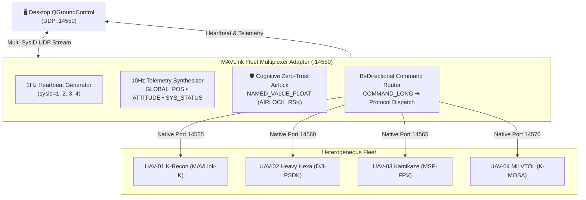

# GCS Ecosystem Architecture, BVLOS Cloud Fleet & UI/UX Integration

This document provides a comprehensive technical overview and reference manual synthesizing the multi-tiered Ground Control Station (GCS) portfolio developed across your repositories:
- **`aiegoo/gcs-uno`** & **`aiegoo/gcs.eggs.or.kr`**: Web-based BVLOS Cloud Fleet Management GCS (Node.js, Webix Jet, RethinkDB, Redis, PM2).
- **`aiegoo/gcs-java-node`** & **`4gremoteoperation`**: Enterprise Java Spring Boot + C++/Qt multi-autopilot cloud backend with Protobuf serialization.
- **`aiegoo/drone_board`**: Onboard 4G cellular companion computer agent (`drone.js`, `mavproxy.sh`, `video.sh`).
- **`aiegoo/dronekit-python`** & **`aiegoo/dronekit-udemy`**: Autonomous mission scripting engine, companion computer harness, and bare-metal STM32 CubeIDE FC firmware (`M-HIVE`).
- **`aiegoo/qgroundcontrol`** & **`aiegoo/UX-Design`**: Frontline C++/Qt5 tactical glass cockpit with custom QML overlay hooks (`CustomFlyViewOverlay.qml`) and tactical dark vector branding.
- **`aiegoo/jdlab-qt`** & **`aiegoo/udemy-qt5`**: Lightweight Qt5/QML ground station with MapboxGL (Seoul theater coordinates) and QtMultimedia RTSP video stream widgets.
- **`aiegoo/kisec-final`**: Security Operations Center (SOC) dashboard and continuous presence engine.

It formally integrates the research and operational blueprints from your production documentation sites:
1. **Infrastructure & Daemons**: [`https://pf7.eggs.or.kr/2021-01-21-gcs-eggs.html`](https://pf7.eggs.or.kr/2021-01-21-gcs-eggs.html) (`D:\repos\tonylee\documentation\archive\blog_2022\2022-01-21-gcs_eggs.md`)
2. **Cockpit UI/UX & Cloud Fleet**: [`https://pf7.eggs.or.kr/2022-01-31-gcs-cloud.html`](https://pf7.eggs.or.kr/2022-01-31-gcs-cloud.html) (`D:\repos\tonylee\documentation\archive\blog_2022\2022-01-31-gcs-cloud.md`)
3. **Java Spring Boot Cloud App**: `D:\repos\tonylee\documentation\archive\blog_2022\2022-01-21-java-drone.md`

---

## 1. Unified Multi-Tier System Topology

The combined architecture provides end-to-end command, control, video distribution, and cyber security across tactical field pilots, automated cloud dispatchers, and heterogeneous aircraft fleets:

```mermaid
flowchart TB
    subgraph Cloud_Tier ["Tier 1: Cloud BVLOS Dispatch & Fleet Operations (GCS.uno / gcs.eggs.or.kr)"]
        NGINX["Nginx Reverse Proxy (SSL :443)"]
        RETHINK[("RethinkDB :28015<br/>Real-Time Document Changefeeds")]
        REDIS[("Redis Cache<br/>In-Memory Session & Metrics")]
        
        subgraph PM2_Daemons ["PM2 Microservice Orchestration"]
            SRV_DRONES["drones-server.js<br/>Fleet Lifecycle & Key Mgmt"]
            SRV_UDP["drone-udp-server.js<br/>Dynamic Ingress UDP 30000–65000"]
            SRV_TCP["gcs-tcp-server.js<br/>Dynamic 1h IP-Locked Bridges"]
            SRV_IO["io-server.js<br/>Socket.IO Real-Time Pub/Sub"]
        end
        
        subgraph Media_Core ["Ultra Low-Latency Video Distribution"]
            NIMBLE["Nimble Streamer (WMSPanel)<br/>RTSP :554 / RTMP :1935 / WS :8081"]
            WOWZA["Wowza Streaming Cloud<br/>Ultra Low-Latency CDN"]
        end
        
        subgraph Cloud_Apps ["Enterprise Cloud Apps"]
            WEBIX["GCS.uno Pilot UI (Webix Jet)<br/>PFD, Joysticks, Tower Radar"]
            JAVA_CLOUD["Java Spring Boot (cloudapp.jar)<br/>Protobuf MAVLink Gateway"]
            LOGBOOK["DroneLogbook Integration<br/>Battery Kits & Regulatory Audit"]
        end
    end

    subgraph Security_Tier ["Tier 2: Cognitive Zero-Trust Tactical Gateway (:8088 / UDP :14550)"]
        GATEWAY["CognitiveTacticalGateway<br/>• Leaky Bucket Risk Margin Engine<br/>• BIV-6 Anomaly Scorer<br/>• Dynamic Command Airlock (HEALTHY / SOFT / HARD)<br/>• NAMED_VALUE_FLOAT Telemetry Broadcast"]
    end

    subgraph Cockpit_Tier ["Tier 3: Frontline Glass Cockpits & Scripting Terminals"]
        QGC["QGroundControl Custom (C++/Qt5/QML)<br/>• CustomFlyViewOverlay.qml Airlock HUD<br/>• UX-Design Tactical Dark Palette"]
        JDLAB["JDLab Qt (C++/Qt/QML)<br/>• MapboxGL Seoul Theater (37.5326° N, 127.0246° E)<br/>• QtMultimedia Low-Latency Stream"]
        DKIT["DroneKit-Python Scripts<br/>• Autonomous Delivery & Waypoints<br/>• Automated Zero-Trust Security Test Harness"]
        IOS_DJI["GCS.uno iOS Bridge<br/>• Direct DJI PSDK Camera & Flight Link"]
    end

    subgraph Aircraft_Edge ["Tier 4: Heterogeneous Aircraft & Edge Companion Computers"]
        subgraph Drone_MavK ["Drone #1: MAVLink-K (SITL / PX4 / Navio2)"]
            FC1["Flight Controller (ArduCopter/PX4)"]
            DBOARD["drone_board Daemon (Node.js)<br/>DRONE_MAVLINK_KEY"]
            CAM1["Raspicam (GStreamer rpicamsrc)<br/>DRONE_VIDEO_KEY"]
        end
        subgraph Drone_DJI ["Drone #2: DJI Matrice 350 (PSDK)"]
            DJI_FC["DJI Flight Controller + O3 Enterprise"]
        end
        subgraph Drone_MSP ["Drone #3: Betaflight Micro-FPV (MSP)"]
            BF_FC["Betaflight STM32 FC"]
        end
        subgraph Drone_KMOSA ["Drone #4: K-MOSA Mil-Std Tactical Recon"]
            KM_FC["K-MOSA Mil-Std C2 Flight Computer"]
        end
    end

    %% Connections
    Drone_MavK <-->|4G Cellular / Socket.IO| NGINX
    CAM1 -->|H.264 RTSP/RTMP| NIMBLE
    NGINX --> PM2_Daemons
    PM2_Daemons <--> RETHINK
    PM2_Daemons <--> REDIS
    SRV_IO <-->|WebSocket| WEBIX
    NIMBLE -->|WebSocket H.264 :8081| WEBIX
    WOWZA --> WEBIX
    
    SRV_TCP -->|Dynamic TCP Bridge| GATEWAY
    GATEWAY <-->|UDP :14550| QGC
    GATEWAY <-->|UDP :14550| JDLAB
    GATEWAY <-->|UDP :14550| DKIT
    
    GATEWAY -->|Port 14555| Drone_MavK
    GATEWAY -->|Port 14560| Drone_DJI
    GATEWAY -->|Port 14565| Drone_MSP
    GATEWAY -->|Port 14570| Drone_KMOSA
    
    IOS_DJI -->|Auth Key / RTMP| NGINX
    JAVA_CLOUD <-->|Protobuf / WebSocket| NGINX
    LOGBOOK <-->|Audit API| WEBIX
```



---

## 2. Cloud Server Infrastructure (`gcs.eggs.or.kr`)

### A. PM2 Micro-Daemon Architecture
The GCS.uno backend runs as a decoupled cluster of microservices managed by PM2 under Ubuntu Linux:

| Daemon File | Technology | Responsibilities | Security & Networking Model |
| :--- | :--- | :--- | :--- |
| **`drones-server.js`** | Node.js / Express | Fleet REST API, drone authorization credentials, database syncing. | Uses pre-shared API keys (`DJI_KEYS`, `DRONE_MAVLINK_KEY`). |
| **`drone-udp-server.js`** | Node.js `dgram` | Ingestion of raw MAVLink packets from 4G companion computers. | Dynamically opens UDP ports in range `30000–65000` per active drone. |
| **`gcs-tcp-server.js`** | Node.js `net` | TCP proxy bridge for external GCS clients (QGC, MissionPlanner). | **On-Demand 1-Hour Ephemeral Lease**: Binds to client IP; automatically torn down after 60 min. |
| **`io-server.js`** | Node.js `socket.io` | Telemetry pub/sub, virtual joystick commands, real-time alerts. | Pushes telemetry diffs to `pilot-ui` with zero client polling. |

### B. Storage Engine
- **RethinkDB (`/var/lib/rethinkdb/gcs_uno_server`)**:
  - NoSQL document store utilizing **Changefeeds** (`r.table('drones').changes().run()`).
  - When battery voltage, GPS position, or flight mode changes in the database, RethinkDB automatically pushes the update to `io-server.js`, which broadcasts it over WebSockets to all connected browser displays.
- **Redis (`/etc/redis/redis.conf`)**:
  - High-throughput in-memory cache storing active drone heartbeat timestamps, operator authorization tokens, and transient sensor buffers.

### C. Nginx Reverse Proxy & SSL
- Terminates SSL via Let's Encrypt automated certbot renew cron.
- Handles WebSocket upgrade headers (`Upgrade $http_upgrade`, `Connection "upgrade"`).
- Reverse proxies Nimble Streamer's HTML5 WebSocket video player (`nimble_proxy.conf`) onto standard HTTPS port `443`.

---

## 3. Video Pipeline: Dual-Path Distribution & Hardware Encoding

### A. Nimble Streamer vs. Wowza Streaming Cloud
The infrastructure implements two video pathways depending on operational environment:

```text
[ Onboard Camera: Raspicam / CSI / HDMI ]
                   │
                   ▼ GStreamer (rpicamsrc / x264enc tune=zerolatency)
      [ 1 Mbps H.264 Elementary Stream ]
                   │
       ┌───────────┴───────────┐
       ▼ (Private / Self-Hosted)▼ (Public Cloud / CDN)
[ Nimble Streamer :554 / :1935 ] [ Wowza Streaming Cloud ]
       │                                │
       ▼ WebSocket H.264 (:8081)        ▼ WebRTC / Ultra Low-Latency CDN
[ GCS.uno Webix Pilot UI ]      [ Global Web / Mobile Clients ]
```

1. **Nimble Streamer (Self-Hosted)**:
   - Configured via WMSPanel (`/usr/bin/nimble_regutil`).
   - Ingests RTSP (`rtsp://host:554/vs/DRONE_VIDEO_KEY`) or RTMP (`rtmp://host:1935/vs/DRONE_VIDEO_KEY`).
   - Serves HTML5 WebSocket streams on port `8081` (`ws://host:8081/vs/...` or `wss://host/vs/...`).
2. **Wowza Streaming Cloud (Global CDN)**:
   - Ingests via RTMP push delivery.
   - Client initializes playback in browser via `window.WowzaPlayerLicense = "KEY"`.

### B. Onboard GStreamer Encoding Pipeline
Tested on Navio2 / Raspberry Pi running `gst-rpicamsrc`:
```bash
gst-launch-1.0 rpicamsrc bitrate=1000000 ! \
    video/x-h264,width=1280,height=720,framerate=30/1 ! \
    h264parse config-interval=1 ! \
    flvmux name=mux ! \
    rtmpsink location="rtmp://video.gcs.uno:1935/drone/$DRONE_VIDEO_KEY live=1"
```
- Includes live clock timestamp overlay (`clockoverlay`) to measure end-to-end glass-to-glass latency (typically 120–180ms over 4G LTE).

---

## 4. Frontline Cockpit UI/UX & Flight Operations

The research from `SmartAP GCS` and `Sky-Drones Cloud` establishes the following frontline UI/UX standards:

### A. World Pane Canvas & Dual-Confirmation Arming
- **World Pane**: Full-bleed interactive GIS map supporting Google Maps, MapboxGL, and satellite imagery.
- **Two-Stage Safety Arming Guard**:
  - Arming buttons feature a mandatory modal confirmation pop-up: *"Confirm vehicle arming? Warning: Propellers will rotate at idle."*
  - RTH Home position and altitude are automatically anchored to the exact GNSS coordinates at the instant the arm confirmation succeeds.
- **Flight Instrument Indicators**:
  - Primary Flight Display (PFD) artificial horizon, speed/altitude tapes, compass rose, and obstacles radar overlay.

### B. Guided Flight ("Fly Here") Mode
- Allows operators to dynamically click any point on the map to set an interactive target crosshair.
- Operators can drag-and-drop the crosshair in real-time to adjust target position, speed, and loiter altitude without canceling or rewriting the pre-programmed waypoint mission.

### C. Rally Points Contingency Architecture
- **Problem**: In long-range BVLOS missions, returning to the launch home point (RTH) upon link loss or battery depletion frequently leads to crashes due to range exhaustion or flying over hostile territory.
- **Solution**: The GCS allows defining multiple **Rally Points** (pre-surveyed emergency landing safe havens) along the flight corridor. If failsafe triggers, the aircraft diverts to the mathematically closest safe rally point rather than home.

```text
[Launch Point] ────── (15 km Corridor) ──────> [Target Mission Area]
      │                       │                        │
  (Rally 1)               (Rally 2)                (Rally 3)
  [Farm Field]           [Substation Pad]         [Emergency LZ]
```

### D. UTM Airspace Services & Real-Time ADS-B
- Direct integration with **Altitude Angel**, **AirMap**, and **High Lander** UTM.
- Operators draw 3D cylinder or corridor flight reservations and submit them for real-time airspace clearance.
- Integrated ADS-B receivers paint commercial manned aviation tracks directly on the tactical map, highlighting proximity conflicts.

### E. RTK GNSS Centimeter Survey-In
- Supports UBlox NEO M8P RTK base stations plugged into the ground station via USB.
- **Survey-In Workflow**:
  1. Base station observes visible satellites until 3D standard deviation drops below 1 meter (minimum 3 minutes).
  2. GCS transitions from `Survey-In In Progress` to `Completed`.
  3. GCS begins streaming RTCM correction packets over MAVLink radio link to the rover drone.
  4. Drone status switches from standard GNSS $\rightarrow$ D-GNSS $\rightarrow$ RTK Float $\rightarrow$ RTK Fixed ($\pm 2\text{ cm}$ accuracy).

---

## 5. Enterprise Cloud Fleet & Asset Management (DroneLogbook)

### A. The "Kit" Abstraction for Battery Lifecycle Management
In multi-pack drones, tracking individual battery cycles leads to accounting skew. The system organizes assets into two distinct kit types:
1. **Battery Kits**: Binds dual or quad batteries used together in a single flight. Charging cycles and discharge curves are recorded synchronously across the kit.
2. **Field Mix Kits**: Bundles non-battery equipment (sensors, gimbals, RTK tripods, tools) to prevent duplicate assignment across multiple simultaneous flights.

### B. Automated Regulatory Compliance
- Built-in PDF report generator formatted for aviation authorities:
  - **FAA** (Part 107 Compliance Records)
  - **EASA** (Specific Category Risk Assessments)
  - **CASA / CAA / DGAC**
- Tracks pilot flight currency, required maintenance intervals (e.g. 50-hour motor bearing inspections), and incident logs.

### C. Sub-Second Hardware Geotagging
- Camera shutter signal is wired to flight controller AUX pin (`CAM_TRIGGER`).
- Autopilot logs precise GNSS timestamp, latitude, longitude, MSL altitude, roll, pitch, and yaw at the exact millisecond of exposure.
- Extracted via `ulog2csv.py` for direct ingestion into photogrammetry engines (Agisoft Metashape, Pix4D, OpenDroneMap).

---

## 6. Synergy & Interlock with the Zero-Trust Tactical Drone Project

The table below outlines how each component from your GCS portfolio maps directly into our current `aiegoo/drone` repository:

| Capability Area | GCS Portfolio Source | Zero-Trust Project Implementation | Integration Mechanism |
| :--- | :--- | :--- | :--- |
| **Frontline Glass Cockpit** | `aiegoo/qgroundcontrol`<br/>`aiegoo/UX-Design` | `qgc_custom/CustomFlyViewOverlay.qml` | Receives `NAMED_VALUE_FLOAT` from Gateway; displays Leaky Bucket Risk Margin bar in QGC flight view. |
| **Rugged Field Tablet** | `aiegoo/jdlab-qt`<br/>`aiegoo/udemy-qt5` | `src/Map.qml`, `VideoStream.qml` | C++/Qt5 station centered on Seoul theater (`37.5326° N, 127.0246° E`), consuming Gateway RTSP video. |
| **Cloud BVLOS Operations** | `aiegoo/gcs-uno`<br/>`gcs.eggs.or.kr` | `views/mav_drone_control.js`<br/>`views/dji_drone_control.js` | Webix Jet dashboard connects via 1-hour IP-locked dynamic TCP bridge through Gateway. |
| **Automated Testing & Edge Scripts** | `aiegoo/dronekit-python`<br/>`Drone-Programming` | `scripts/dronekit_airlock_test.py` | Connects to UDP `:14550`; validates command rejection under `SOFT_CLOAK` during CI/CD. |
| **Firmware HIL Insight** | `aiegoo/dronekit-udemy`<br/>`M-HIVE STM32` | `adapters/base_adapter.py` | Bare-metal FC sensor loop understanding for hardware-in-the-loop (HIL) testing. |
| **Continuous Presence & SOC** | `aiegoo/kisec-final` | `modules/biv6_extractor.py`<br/>`modules/leaky_bucket.py` | BIV-6 6D behavioral presence vectors fed into Mahalanobis Covariance filter. |
| **Tactical Mission Web Console** | Port `8088` (`tactical_console.py`) | WebRTC Video + Leaky Bucket HUD | Sub-100ms video streaming with real-time risk gauges, DEFCON controls, and auto-recovery. |

---

## 7. Concrete Code Integration Snippets

### A. Emitting Named Zero-Trust Telemetry in Gateway
In `gateway/cognitive_gateway.py`, emit periodic MAVLink `NAMED_VALUE_FLOAT` packets to `:14550`:
```python
# Broadcast Zero-Trust metrics to QGroundControl, GCS.uno, and DroneKit
def broadcast_airlock_telemetry(mav_conn, risk_margin, biv6_score, airlock_state):
    state_enum = {"HEALTHY": 0.0, "SOFT_CLOAK": 1.0, "HARD_CLOAK": 2.0, "RECOVERY": 3.0}
    
    # Send Risk Margin (0.0 to 1.0)
    mav_conn.mav.named_value_float_send(
        time_boot_ms=int(time.time() * 1000) & 0xFFFFFFFF,
        name=b"AIRLOCK_RISK\x00\x00\x00\x00",
        value=float(risk_margin)
    )
    # Send BIV-6 Anomaly Score (0.0 to 1.0)
    mav_conn.mav.named_value_float_send(
        time_boot_ms=int(time.time() * 1000) & 0xFFFFFFFF,
        name=b"BIV6_SCORE\x00\x00\x00\x00\x00\x00",
        value=float(biv6_score)
    )
    # Send Airlock State Enum
    mav_conn.mav.named_value_float_send(
        time_boot_ms=int(time.time() * 1000) & 0xFFFFFFFF,
        name=b"AIRLOCK_STATE\x00\x00\x00",
        value=state_enum.get(airlock_state, 0.0)
    )
```

### B. QGroundControl Custom Overlay (`CustomFlyViewOverlay.qml`)
```qml
import QtQuick 2.12
import QGroundControl 1.0
import QGroundControl.Controls 1.0

// Zero-Trust Security Airlock Banner in QGC Glass Cockpit
Rectangle {
    id: airlockBanner
    anchors.top: parent.top
    anchors.topMargin: 12
    anchors.horizontalCenter: parent.horizontalCenter
    width: 380; height: 40; radius: 4
    color: "#1a1e24"
    border.color: riskValue > 0.8 ? "#ff3333" : (riskValue > 0.5 ? "#ffaa00" : "#00ffcc")
    border.width: 1.5

    property real riskValue: _activeVehicle ? _activeVehicle.getNamedValueFloat("AIRLOCK_RISK") : 0.0
    property string airlockStatus: riskValue > 0.8 ? "SOFT CLOAK" : (riskValue > 0.5 ? "ELEVATED RISK" : "HEALTHY")

    Row {
        anchors.centerIn: parent
        spacing: 14
        Text {
            text: "AIRLOCK: " + airlockStatus
            color: riskValue > 0.8 ? "#ff3333" : "#ffffff"
            font.bold: true
            font.pixelSize: 13
        }
        Rectangle {
            width: 120; height: 10; radius: 2; color: "#0d1117"
            Rectangle {
                width: Math.min(120, Math.max(0, riskValue * 120))
                height: parent.height; radius: 2
                color: riskValue > 0.8 ? "#ff3333" : (riskValue > 0.5 ? "#ffaa00" : "#00ffcc")
            }
        }
        Text {
            text: Math.round(riskValue * 100) + "%"
            color: "#00ffcc"
            font.pixelSize: 12
        }
    }
}
```

```

---

## 8. Desktop QGroundControl Multi-Vehicle Discovery & Protocol Multiplexer

To support frontline desktop command stations running standard **QGroundControl (QGC)**, **MissionPlanner**, or **DroneKit** without requiring proprietary ground station software, the Gateway incorporates the **MAVLink Fleet Multiplexer** ([`gateway/mavlink_multiplexer.py`](file:///home/aiegoo/repos/drone/gateway/mavlink_multiplexer.py)).

### A. Multi-Vehicle System ID (SysID) Allocation

QGroundControl automatically discovers and manages multiple aircraft on a single UDP socket (`:14550`) by keying on distinct MAVLink `sysid` identifiers:

| System ID | Assigned Airframe | MAV Type | Autopilot Engine | Protocol Translation Source |
| :---: | :--- | :--- | :--- | :--- |
| **`sysid=1`** | **UAV-01 K-Recon** | `MAV_TYPE_QUADROTOR` (2) | `MAV_AUTOPILOT_ARDUPILOTMEGA` (3) | Native MAVLink-K pass-through (:14555) |
| **`sysid=2`** | **UAV-02 Heavy Hexa** | `MAV_TYPE_HEXAROTOR` (13) | `MAV_AUTOPILOT_GENERIC` (0) | Translated from DJI PSDK (:14560) |
| **`sysid=3`** | **UAV-03 Kamikaze FPV** | `MAV_TYPE_QUADROTOR` (2) | `MAV_AUTOPILOT_GENERIC` (0) | Translated from Betaflight MSP v1 (:14565) |
| **`sysid=4`** | **UAV-04 Mil VTOL** | `MAV_TYPE_VTOL_TILTROTOR` (21) | `MAV_AUTOPILOT_GENERIC` (0) | Translated from K-MOSA 32B Frame (:14570) |



### B. Bi-Directional Command Translation & Zero-Trust Gating

When an operator issues a flight command in QGroundControl (e.g. dragging the arming slider or clicking "Fly-Here"):
1. QGC transmits a `COMMAND_LONG` packet with target `target_sys = N`.
2. The multiplexer inspects the airlock status:
   * **HEALTHY (`state=ACTIVE`)**: Command is translated into target protocol:
     * `MAV_CMD_COMPONENT_ARM_DISARM` $\rightarrow$ DJI PSDK `0x03` / MSP `MSP_SET_ARMING` / K-MOSA `0x01`
     * `MAV_CMD_NAV_TAKEOFF` $\rightarrow$ Target takeoff frame with commanded altitude
     * `MAV_CMD_NAV_RETURN_TO_LAUNCH` $\rightarrow$ Target RTL frame
     * Dispatches `COMMAND_ACK(result=MAV_RESULT_ACCEPTED)` to QGC.
   * **SOFT_CLOAK / HARD_CLOAK**: Kinetic commands are immediately blocked. The multiplexer returns `COMMAND_ACK(result=MAV_RESULT_TEMPORARILY_REJECTED)`, preventing unauthorized takeoff or flight diversion.

### C. REST API Diagnostic Status

The multiplexer runtime status and discovered client endpoints can be inspected via REST:

```bash
curl -s http://127.0.0.1:8088/api/multiplexer/status
```

```json
{
  "running": true,
  "stats": {
    "heartbeats_sent": 128,
    "telemetry_packets_sent": 7680,
    "commands_received": 4,
    "commands_accepted": 3,
    "commands_airlocked": 1,
    "gcs_clients_connected": 2
  },
  "endpoints": ["127.0.0.1:14550", "127.0.0.1:14555"],
  "vehicles": {
    "1": {"name": "UAV-01 K-Recon", "mav_type": 2, "autopilot": 3, "custom_mode": 4},
    "2": {"name": "UAV-02 Heavy Hexa", "mav_type": 13, "autopilot": 0, "custom_mode": 4},
    "3": {"name": "UAV-03 Kamikaze FPV", "mav_type": 2, "autopilot": 0, "custom_mode": 0},
    "4": {"name": "UAV-04 Mil VTOL", "mav_type": 21, "autopilot": 0, "custom_mode": 4}
  }
}
```

### D. Dual-Port Socket Architecture (:14540 <-> :14550) & HiDPI Optimization

To prevent UDP port collision between Linux wildcard listeners and loopback binders:
- **QGroundControl Target Port (`:14550`)**: Standard MAVLink GCS port, exclusively bound by QGC (`0.0.0.0:14550`).
- **Tactical Gateway / Multiplexer Ingress (`:14540`)**: Standard companion offboard port (`0.0.0.0:14540`), receiving commands dispatched from QGC and relaying to the fleet.
- **Display Optimization**: WSL 2 / WSLg high-DPI scaling is automatically calibrated via `scripts/configure_qgc.py` (`indoorPalette=false`, `appFontPointSize=13`, `QT_SCALE_FACTOR=1.75`) to ensure high-contrast outdoor readability.

---

## 9. Interactive Command-Line Shell (`scripts/fleet_cli.py`)

For rapid field operations and headless environments, an interactive tactical CLI shell connects directly to the Cockpit and MAVLink Multiplexer:

```bash
# Launch interactive REPL
./scripts/fleet_cli.py

# One-shot operational commands
./scripts/fleet_cli.py status                  # Live fleet telemetry & airlock posture
./scripts/fleet_cli.py arm [1..4|all]          # Arm airframe(s)
./scripts/fleet_cli.py takeoff [1..4|all] 20   # Takeoff to designated altitude
./scripts/fleet_cli.py rtl [1..4|all]          # Return to launch
./scripts/fleet_cli.py defcon [5|4|3|2|1]      # Toggle Zero-Trust airlock gate
./scripts/fleet_cli.py reset                   # Reset simulation & airlock baseline
./scripts/fleet_cli.py qgc                     # Inspect QGC multiplexer stats
./scripts/fleet_cli.py watch 1.0               # Live refreshing dashboard
```

```
┌───────┬──────────┬──────────────────────┬────────────────────────┬─────────┬────────┬────────────┬─────────┬──────────────┐
│ SysID │ Drone ID │ Airframe Model       │ Coordinates (Lat, Lon) │ Alt (m) │ Batt % │ FlightMode │ Armed   │ Health       │
├───────┼──────────┼──────────────────────┼────────────────────────┼─────────┼────────┼────────────┼─────────┼──────────────┤
│   1   │ UAV-01   │ MAVLink-K            │  37.56650, 126.97800   │     0.0 │  100% │ ARMED      │ ARMED   │ ONLINE       │
│   2   │ UAV-02   │ DJI-PSDK             │  37.56670, 126.97830   │     0.0 │  100% │ DISARMED   │ DISARM  │ ONLINE       │
│   3   │ UAV-03   │ MSP-FPV              │  37.56630, 126.97770   │     0.0 │  100% │ DISARMED   │ DISARM  │ ONLINE       │
│   4   │ UAV-04   │ K-MOSA               │  37.56690, 126.97860   │     0.0 │  100% │ DISARMED   │ DISARM  │ ONLINE       │
└───────┴──────────┴──────────────────────┴────────────────────────┴─────────┴────────┴────────────┴─────────┴──────────────┘
Tactical Gateway State: ACTIVE | Threat: HEALTHY | Risk: 0.0% | Airlocked C2 Blocks: 0
Sim Engine: GAZEBO (Gazebo Sync: STANDBY)
MAVLink Multiplexer: ONLINE (:14540 -> :14550) | Heartbeats: 2672 | Telem Pkts: 153288
```

---

## 10. 3D Urban Path Mapping & Synchronized Mission Waypoints (_kalman)

### A. 2.5D Obstacle Database Integration
The fleet mission planner integrates the Downtown San Francisco building collider dataset from [`https://github.com/aiegoo/_kalman`](https://github.com/aiegoo/_kalman):
* **Datum Origin**: `lat0 = 37.792480, lon0 = -122.397450` (identical to the simulator and QGC map center).
* **Collider Database**: 3,845 building volumes $(x, y, z, dx, dy, dz)$ spanning North `[-315m, +605m]`, East `[-444m, +476m]`, with skyscrapers reaching up to $212\text{m}$.
* **Configuration Space Grid**: Dynamic slicing creates a 2D occupancy grid at target flight altitude $Z_{cruise} + d_{safety}$.

### B. 8-Connected A* Search & Collinear Shortcut Pruning
1. **A\* Search**: Finds optimal collision-free paths through street canyons and over lower rooftop plateaus.
2. **Collinearity Pruning**: Vector cross-product test strips redundant intermediate steps along straight street avenues:
   $$(x_2 - x_1)(y_3 - y_1) - (y_2 - y_1)(x_3 - x_1) = 0$$
3. **Line-of-Sight Shortcutting**: Bresenham raycasting merges visible waypoints into sparse, flyable mission waypoints.
4. **Vectorized Clearance Verification**: Evaluates full 3D trajectory against all 3,845 building colliders in $< 1\text{ms}$ using NumPy vector filtering.

### C. Synchronized Heterogeneous Airframe Corridors

| SysID | Airframe | Base Altitude | Cruise Altitude | Mission Profile | Waypoints |
| :---: | :---: | :---: | :---: | :---: | :---: |
| **1** | **UAV-01 K-Recon** | 45.0m (Roof) | 75.0m | Market Street & Financial District Urban Sweep | 10 WPs |
| **2** | **UAV-02 Heavy Hexa** | 0.2m (Plaza) | 25.0m | Street Canyon Low Perimeter Patrol | 12 WPs |
| **3** | **UAV-03 Kamikaze FPV**| 118.0m (Nest) | 135.0m | High-Altitude Interception Corridor | 6 WPs |
| **4** | **UAV-04 Mil VTOL** | 0.2m (Ground) | 65.0m | Fixed-Wing Arterial Avenue Patrol | 12 WPs |

---

## 11. Summary of Document Artifacts
- **Wiki Page Reference**: [`10-GCS-Ecosystem-Architecture-and-BVLOS-Cloud-Integration.md`](file:///home/aiegoo/repos/drone/wiki_repo/10-GCS-Ecosystem-Architecture-and-BVLOS-Cloud-Integration.md)
- **Path Planner Engine**: [`simulator/path_planner.py`](file:///home/aiegoo/repos/drone/simulator/path_planner.py)
- **3D Obstacle Dataset**: [`data/colliders.csv`](file:///home/aiegoo/repos/drone/data/colliders.csv)
- **Interactive Fleet CLI**: [`scripts/fleet_cli.py`](file:///home/aiegoo/repos/drone/scripts/fleet_cli.py)
- **QGC Launcher & Config**: [`scripts/launch_qgc.sh`](file:///home/aiegoo/repos/drone/scripts/launch_qgc.sh), [`scripts/configure_qgc.py`](file:///home/aiegoo/repos/drone/scripts/configure_qgc.py)
- **Multiplexer Implementation**: [`gateway/mavlink_multiplexer.py`](file:///home/aiegoo/repos/drone/gateway/mavlink_multiplexer.py)
- **Path Planner Verification Suite**: [`tests/test_path_planner.py`](file:///home/aiegoo/repos/drone/tests/test_path_planner.py)
- **QGC Discovery Verification Suite**: [`tests/test_qgc_discovery.py`](file:///home/aiegoo/repos/drone/tests/test_qgc_discovery.py)


